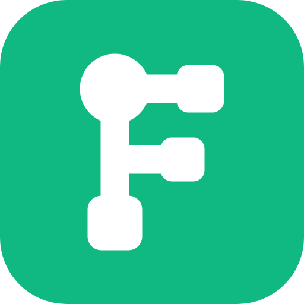
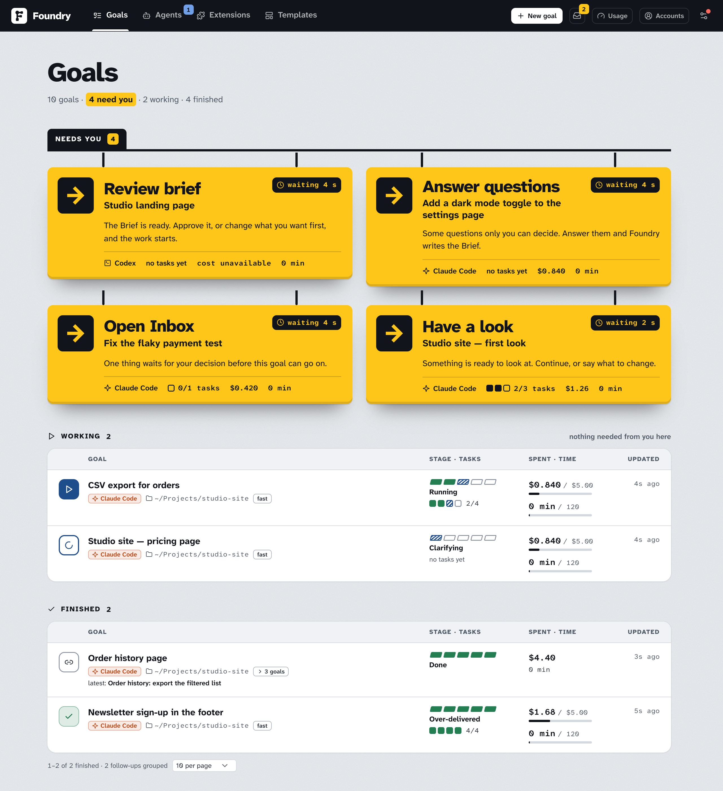
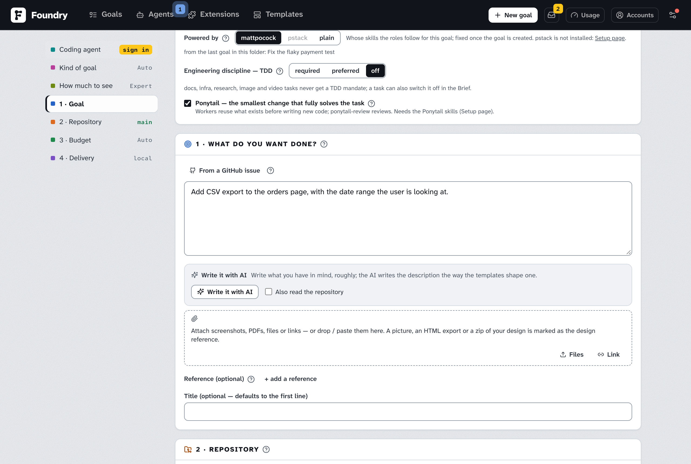
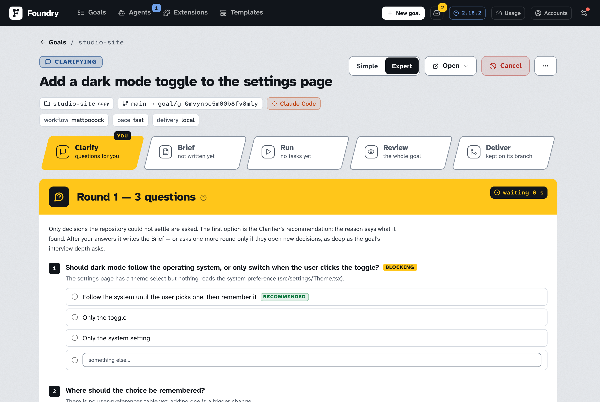
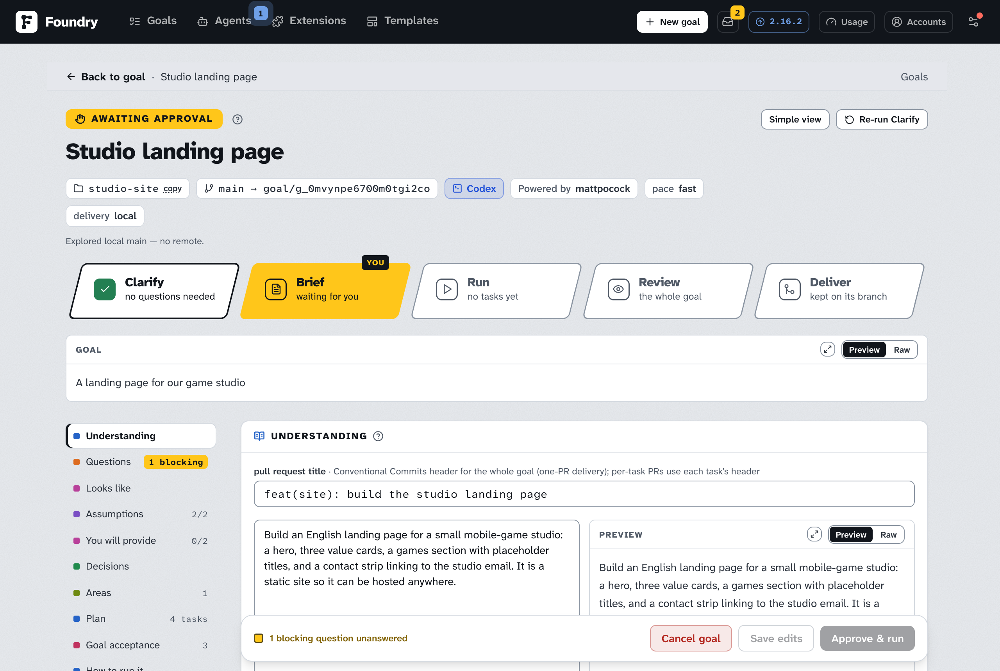
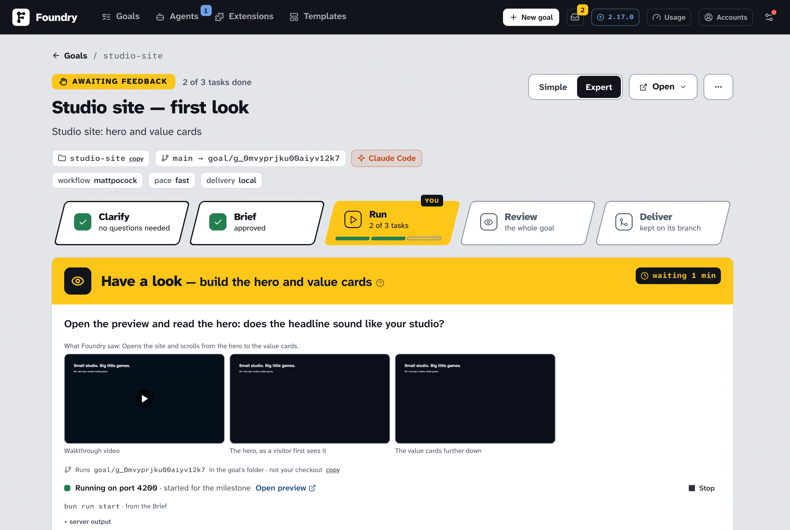
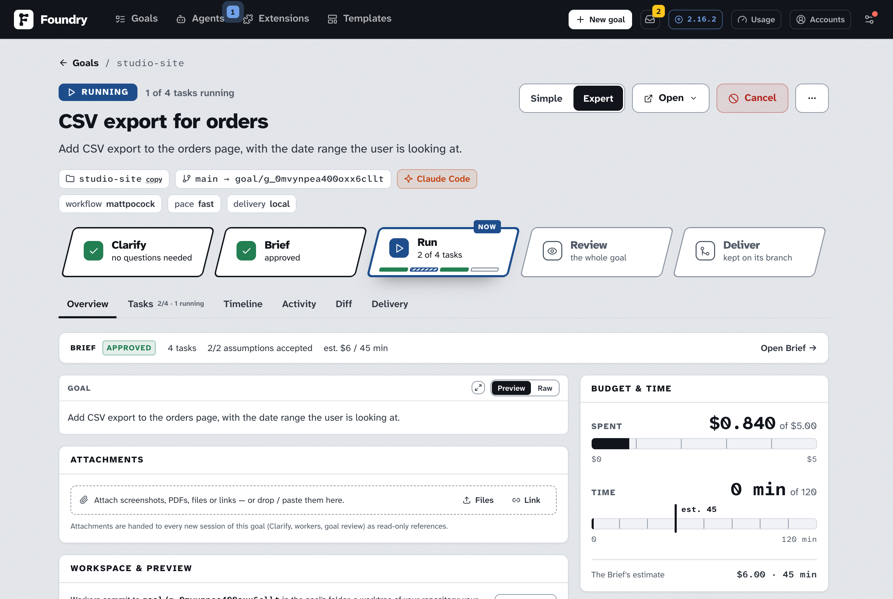
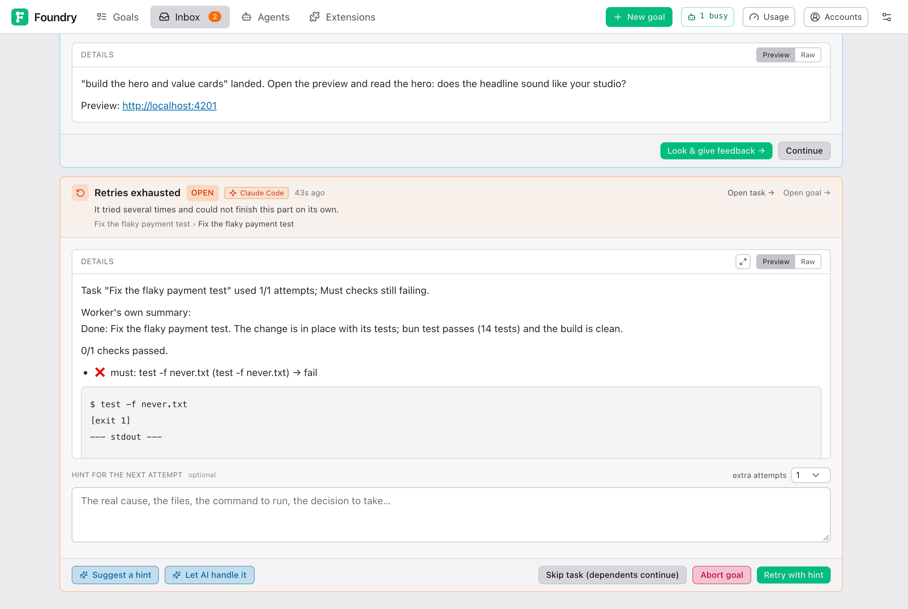

<div align="center">



# Foundry

**Write the goal in one sentence. Get back finished, checked, reviewed work.**

Foundry runs on your own computer and drives your Claude Code, Codex or Antigravity CLI from a web page:<br>
it asks what only you can decide, shows you the plan once, then builds, tests, reviews and delivers on its own.

English · [中文](./README.zh.md)

[Quick start](#quick-start) · [How it works](#how-it-works) · [User guide](docs/guide/) · [Docs](docs/)

<br>



</div>

## Why Foundry

Claude Code, Codex and Antigravity can carry out a request. Keeping a real piece of work on track is the part left to you: saying what
you actually mean, splitting it up, checking every step, noticing when it drifts, and not letting it burn your plan.
Foundry does that part.

- **One sentence in**  
  *"Add CSV export to the orders page."* *"A landing page for our studio."* *"Posters for the new drink."*
- **It asks before it plans**  
  It reads your repository first and asks only what the code can't answer — each question with a recommended answer.
- **One plan to approve**  
  The Brief: what it understood, the tasks, how the result will be checked, what it may cost. Edit anything, then approve.
- **You see it before it's done**  
  At milestones it pauses, starts a live preview and waits for your look.
- **Checked, not guessed**  
  Every task has acceptance checks; the whole result is reviewed against them before it is handed over.
- **Your code stays yours**  
  Foundry runs locally and uses the selected CLI's account: Claude login or ChatGPT sign-in for Codex. Agent inference needs no API key. Work happens on its own branch; your checkout stays unchanged while it runs.
- **You control the spend**  
  Independent model presets pick which model does each job. Time, attempt and concurrency limits apply to both coding agents; USD cost caps apply only to Claude.

## How it works

One workflow for **Claude Code, Codex and Antigravity**. Connect the native accounts independently in **Accounts**, then choose the coding agent for each new goal. The screenshots below use demonstration data.

<table>
<tr>
<td width="50%" valign="top">

**[1 · Describe it](docs/guide/your-first-goal.md#the-new-goal-form)**<br>
Press **New goal**, choose **Claude Code** or **Codex**, select its model preset, and describe the result. Pick a project folder when you are ready to start.

The workflow suite, TDD and Ponytail start from that folder's newest goal, or Settings if there is none. Fields you edit keep your choices.



</td>
<td width="50%" valign="top">

**[2 · Answer a few questions](docs/guide/answering-the-interview.md)**<br>
Only what the repository can't settle, each with the reason and a recommendation. Or press **Accept all recommended**.



</td>
</tr>
<tr>
<td width="50%" valign="top">

**[3 · Approve the Brief](docs/guide/approving-the-brief.md)**<br>
Review the plan, tasks and acceptance checks. Change what you want, then **Approve & run**. Codex uses time and attempt limits; Claude also supports USD budgets.



</td>
<td width="50%" valign="top">

**[4 · Have a look at milestones](docs/guide/while-it-runs.md#milestones)**<br>
The goal pauses, the preview is already running. Press **Continue**, or say what to change.



</td>
</tr>
<tr>
<td width="50%" valign="top">

**[5 · Let it run](docs/guide/while-it-runs.md)**<br>
Tasks run in parallel when they can, each checked before it joins the rest. **Agents** brings both coding agents’ sessions together; **Usage** keeps their limits separate.



</td>
<td width="50%" valign="top">

**[6 · Only interrupted when it matters](docs/guide/when-foundry-needs-you.md)**<br>
A blocked task, a conflict, a budget reached: it lands in the **Inbox** with the buttons to fix it — also on Telegram or Discord.



</td>
</tr>
</table>

When it is done you get the work on its own branch, and — if you chose it — pushed, or as a pull request. See [Getting the result](docs/guide/getting-the-result.md).

## Codex coding agent

Use your Codex CLI with ChatGPT sign-in: tick Codex when the installer asks (or pass `--agent codex`), then sign in.

```sh
curl -fsSL https://raw.githubusercontent.com/louiskhenghao/Foundry/main/install.sh | bash -s -- --agent codex
codex login                   # or Accounts → Sign in to Codex
```

The Codex launch profile defaults to `data-codex/`; the Claude profile defaults to `data/`. Either instance can run both coding agents: choose **Coding agent** on each new goal. The data directory belongs to the instance, not to each goal. Accounts, presets and MCP permissions stay independent. Codex supports ChatGPT sign-in only, and its quota display follows the account's actual windows, including weekly-only accounts.

Foundry needs a hooks-capable Codex CLI: `foundry setup` installs one and Setup checks it. See [Codex setup and differences](docs/operate/codex.md) for prerequisites and current limits. Before upgrading an existing instance, read [backup and rollback](docs/operate/updates-and-backup.md#upgrading-to-mixed-provider-goals). The Claude quick start follows below.

## Quick start

What each release brings: [changelog](https://github.com/louiskhenghao/foundry-releases/blob/main/CHANGELOG.md).

**One line** (macOS, Linux):

```bash
curl -fsSL https://raw.githubusercontent.com/louiskhenghao/Foundry/main/install.sh | bash
# skip the coding-agent question:  … | bash -s -- --agent codex   (or agy for Antigravity, claude,agy, all)
```

It asks which coding agents to use: Claude Code, Codex or Antigravity, and on a Mac whether you want the app or the binary.
**The app** (macOS) puts `Foundry.app` in Applications: Foundry runs from the menu bar and starts when you log in.
**The binary** (Linux) runs the compiled `foundry` from the newest release as a background service. Both are the
release itself, checked against its `SHA256SUMS`, and `foundry setup` installs what is missing (git, uv, graphify, the
coding agents' CLIs, the GitHub CLI, Node.js and the optional tools you tick). Foundry 3.0 has no Docker image and no
install from source ([ADR-0108](docs/develop/adr/0108-foundry-ships-only-as-the-app-and-the-binary.md)): when the
installer finds an earlier install on the computer, it offers to move its goals
([how](docs/operate/install.md#moving-an-earlier-install)). It offers to sign in, opens <http://127.0.0.1:4111> (or
the port it chose), and leaves a `foundry` command: `foundry status | logs | stop | start | update | uninstall`, and
Foundry's own commands too (`foundry ask`, `foundry usage`…). Run the line again, or `foundry update`, to update.

**The app, downloaded** (macOS): `Foundry-<version>-mac-universal.dmg` from the
[releases](https://github.com/louiskhenghao/foundry-releases/releases); drag Foundry onto Applications. It is not
notarized, so the first open needs **System Settings → Privacy & Security → Open Anyway**
([how](docs/operate/install.md#the-app-macos)). Its Setup page installs the tools.

To work on Foundry itself from a git checkout, see the [contributor docs](docs/develop/README.md#getting-a-working-tree).

Open <http://127.0.0.1:4111>, press **New goal**, point it at a repository and describe what you want. The
[Setup](docs/guide/your-first-goal.md#check-the-setup-page) page checks that everything is in place and installs what is missing with one click. Full steps and
remote access from your phone: [Install](docs/operate/install.md).

## Learn more

| I want to… | Read |
|---|---|
| **use Foundry** — goals, the interview, the Brief, the Inbox, costs | [User guide](docs/guide/) · [中文](docs/guide/README.zh.md) |
| **install and run it** — the app and the binary, remote access, notifications, updates, every setting | [Operator docs](docs/operate/) |
| **change its code** — architecture, roles, testing, releasing, design decisions | [Contributor docs](docs/develop/) · [CONTRIBUTING](CONTRIBUTING.md) |

The words Foundry uses (Goal, Brief, Milestone, Model Preset …) are defined in the [glossary](CONTEXT.md).
