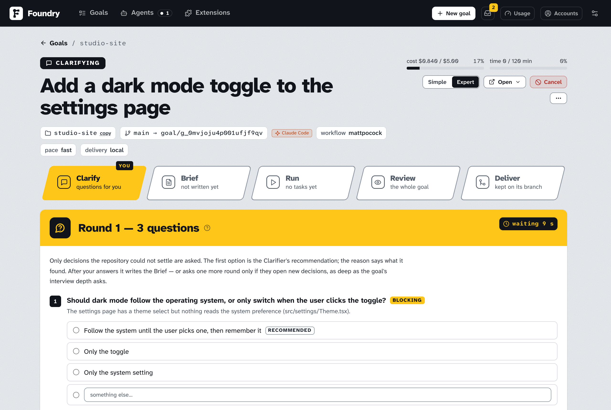

# Answering the interview

> English · [中文](./answering-the-interview.zh.md)

## What the interview is

Before Foundry writes the Brief, it reads your project and your attachments. Most questions it can answer itself. What it cannot answer, only you can decide: which of two designs, who the users are, whether an old feature should stay. Those it asks you, in short rounds.

You answer in the browser, or in Telegram (see [From Telegram](#from-telegram)). It takes a minute or two per round.

## When you get one

- A small, clear goal usually gets no interview. Foundry goes straight to the Brief.
- A bigger or vaguer goal gets one or more rounds when something is worth asking.
- At **Interview depth** 4 or 5 on the New goal form you get at least one round (two at 5), unless nothing is left for you to decide; the higher the depth, the more details it asks about.
- Settings can turn the interview off entirely, or on for every goal: [Settings → New goal defaults](./settings.md#new-goal-defaults).

The interview appears on the goal's page and on its Brief page, as a card titled **Round N — K questions**. If you set up notifications, you also get a message (the **Interview round** switch).

## A round

A round holds every question Foundry can ask right now, at most eight, the most important first. Each question looks like this:

### The question

The numbered text at the top. Read it as a colleague asking you one thing.

### The options and the recommended answer

Up to four answers to pick from. The first one carries the word **recommended**: it is what Foundry would choose. Picking it is always a safe answer.

None fits? Click **something else…** and type your own answer.

### The reason

The small grey text under the question. It says what Foundry found in your project that leaves the question open, for example "the app has both a web and a mobile login".

### Follows from

Some questions say **follows from …**, followed by the earlier question: "question 2" in the same round, or "round 1, question 2" with the start of its text. That question only makes sense because of how you answered the earlier one. Questions that depend on answers you have not given yet wait for the next round.

### Blocking questions

A question marked **blocking** must be answered before **Send answers** works. Hover over the greyed-out button to see which are still open: it lists their numbers. **Accept all recommended** and **Enough — write the Brief** work even with blocking questions open.

### Anything else?

Under the questions, the box **Anything else?** is for what the questions missed or got wrong: "the admin role is out of scope", "keep the old login page too", "you misread the goal: it is one portal, not two". It is optional. Whatever you write there goes with your answers, whichever of the three buttons you press, and becomes a [Decision](#what-happens-to-your-answers) like an answer: the next round and the Brief take it into account, and every worker receives it word for word.

## The three buttons

### Send answers

Sends what you picked. Questions you left empty are not recorded as your decisions; Foundry makes an assumption for them instead, which you can see and reject on the Brief.

After you send, Foundry either asks one more round (only if your answers opened new questions) or writes the Brief.

### Accept all recommended

Answers the whole round in one click. Questions you already answered keep your answer; every empty one takes its recommended option. Use it when you have no strong opinion.

### Enough — write the Brief

Stops the questions. Foundry writes the Brief with the answers you gave so far, and makes assumptions for the rest. Use it when the questions are getting too detailed.

## How many rounds

There is no set number of rounds: Foundry stops when nothing is left to ask at the depth you chose. Usually it is one or two; at depth 5 it can be many. After ten rounds Foundry writes the Brief whatever is left open.

Earlier rounds fold up under the current one: **▸ N earlier rounds** shows what was asked and what you answered. A question you left unanswered says so: the Clarifier went with its recommendation and listed it under Assumptions on the Brief.

## While it plans

After you send a round, the card title changes to **Thinking about your answers…** and the card shows the steps, the current one with a timer counting up; a finished step shows how long it took:

- **Clarifier: reading the repository, then asking or writing the Brief.** A next round usually comes in under a minute.
- **Planner: splitting the goal into tasks**, once the Clarifier has written the Brief. A separate session turns it into tasks, their checks and the estimate; this usually takes a few minutes.

As soon as the Clarifier has written the Brief, the card says **The Brief is taking shape** with an **Open the Brief** link: its understanding, Areas, assumptions and acceptance checks are ready to read and edit while the planner works, and the tasks fill in by themselves. See [While the planner works](./approving-the-brief.md#while-the-planner-works).

If every session slot is taken by running work, the step says **waiting for a free session slot** in amber, with the time waited: Clarify, the planner and the other sessions you wait for may use one slot beyond the limit in Settings, so this wait is for another such session to end, never for a task.

An answer is written in one go, so the live log under the steps can stand still for minutes while it is; the timer shows it is still working. You can close the page; the goal keeps going and the page updates when you come back.

Before the first round the card says **Reading the repository…** instead, for the same reason. The **Activity** tab of the goal lists each round asked and answered, and when the interview ended and why.

## What happens to your answers

Every answer becomes a **Decision**, and so does a note from **Anything else?**. Decisions belong to the whole goal:

- They appear on the Brief page in the **Decisions** card, already applied to the plan.
- Every worker, every reviewer and the pull request receive them word for word, and must follow them.
- If you later run Clarify again, it starts from your decisions instead of asking again.

You can still change your mind on the Brief page: see [Approving the Brief](./approving-the-brief.md#decisions).

## From Telegram

With Telegram notifications and **Answer from Telegram** on, a round arrives as several messages: a line on what to do, one message per question with its options as buttons (⭐ marks the recommended one), and a last message with **Accept all recommended**, **✍️ Add a note…**, **Send answers** and **Enough — write the Brief**.

- Tap an option to pick it. Tap another to change your mind. Nothing is sent until you press a button of the last message.
- **✍️ My own answer…**, or a reply to a question's message, gives an answer of your own.
- **✍️ Add a note…**, or a reply to the last message, is your note for the round (what the questions missed or got wrong). The button then shows it; it goes with your answers.
- **Send answers** says which blocking questions are still open.
- Once the round is sent, here or on the goal's page, each question shows the answer it got.

See [Answering from Telegram](../operate/notifications.md#answering-from-telegram). Discord works the same way when a bot is set up, except that **✍️ My own answer…** and **✍️ Add a note…** open a form instead of waiting for a reply: see [Answering from Discord](../operate/notifications.md#answering-from-discord).

## Tips

- Short answers are fine. "Yes, keep it" is a complete answer.
- If a question shows Foundry misunderstood the goal, say so in **something else…**, or in **Anything else?** when no question is about it. It will correct its understanding.
- If you do not know, take the recommended option. You can reject assumptions and change answers on the Brief before anything is built.
