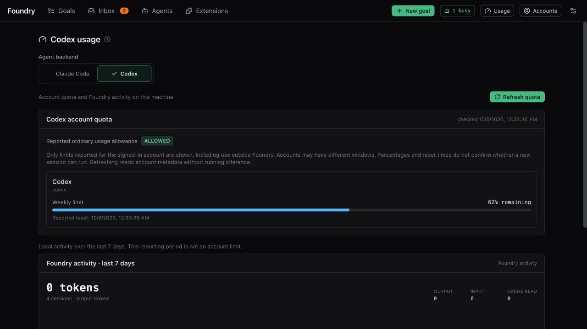
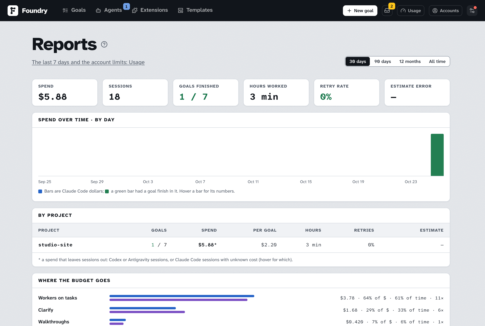

# Costs and usage

> English · [中文](./costs-and-usage.zh.md)

## Codex accounting

**Codex account quota** reads the signed-in ChatGPT account through the native CLI, separately from local activity totals. It shows every returned quota group with **remaining percentage**, window duration and reported reset time. The blue bar is the remaining allowance: 25% used means 75% remaining. Unknown usage is labelled unknown, never a full allowance. **Refresh quota** reads metadata without inference; ordinary polling uses a 60-second cache. **Reported ordinary usage allowance** is the CLI's explicit allowed/blocked/unknown signal. Percentages and past reset times do not prove recovery. Missing quota or reset data stays unknown; a read failure is shown rather than replaced with zero. Accounts also shows the email and plan when the native CLI supplies them.

There is no fixed five-hour/weekly pair. A weekly-only account shows only **Weekly limit**; accounts that report both windows show **5-hour limit** and **Weekly limit**. Names come from the reported duration, regardless of whether Codex calls the slot primary or secondary. Other durations are shown as returned; unknown duration stays unknown. Absent windows are not shown or filled with zero. Multiple quota groups remain separate. The top bar always shows **Usage** for both coding agents. Its tooltip lists Claude activity and Codex account limits separately; several weekly groups appear as **2 weekly limits**, for example. A yellow dot flags a paused/blocked coding agent or low MiniMax quota. Open Usage to inspect each coding agent.

The page opens with the shared **Foundry activity · last 7 days** section, then **Account limits**, whose coding agent selector switches only what is below it: that agent's account limits (and, for Codex and Antigravity, its own **Foundry activity · last 7 days** card), so switching moves nothing above. A paused coding agent shows a banner at the top either way. The shared section covers every coding agent together, because it comes from Foundry's own session records rather than any account: cache hit rate, average Claude cost per session, average session length, sessions not successful, and three lists side by side, **By goal**, **By session kind** and **By model**. Each row shows, on its first line, the coding agents it involves (their icons), its name and its cost; on its second, the goal's state, the time spent in sessions, the number of sessions and the tokens processed (hover for input, cache and output). Time and tokens exist for every coding agent, so rows are listed by time; each list shows its first 8, and **Show all** the rest. Cost is estimated for Claude Code only: a row without Claude Code shows —, and a mixed row shows the Claude Code part, marked *. Counts include only Foundry sessions. The Codex activity card is a local reporting period, separate from the account limits. It has no quota status or reset countdown. Dollar cost, turn count and skill-invocation telemetry are unavailable in this adapter; unavailable never means free or unused. A Claude Code session cut before it reported a cost is **unmeasured** in the same way: the row's cost leaves it out and is marked *, and **sessions with unknown cost** counts them.

Codex USD caps are removed on creation, Brief approval and budget increases. Timeouts, tool-call allowance, attempts and concurrency remain effective. Its turn-cap setting counts tool calls, not model turns. A detected usage-limit error pauses only that provider; without a reset signal Foundry retries after five minutes, which is not a claim that the account quota has reset.

## Antigravity accounting

**Antigravity account quota** reads the signed-in Google account's quota with `agy /usage`, which the CLI answers without running a model. Antigravity puts its models in groups (**Gemini Models**, **Claude and GPT models**); the models of a group share one weekly limit, counted by what the tokens cost, use outside Foundry included. The card shows each group with its **remaining percentage** and reported reset time. A goal runs on one model, so only its group's limit stops it. **Refresh quota** reads it again; ordinary polling uses a 60-second cache. A group at 0% turns the top bar's dot yellow, and a quota agy did not report stays unavailable, never a full allowance.

Antigravity reports tokens, not dollars: its USD caps are removed as Codex's are, and time, attempts, concurrency and the tool-call allowance keep its goals in check. Its turn cap allows three tool calls per turn, since agy calls a tool for every file it reads. Foundry has not yet seen what agy reports when a group's limit runs out, so it may not pause Antigravity sessions the way it pauses a rate-limited Claude or Codex: keep an eye on the quota card.

The dollar figures below apply only to Claude sessions and are usage estimates, not a separate bill from Foundry. Local git operations and checks do not themselves invoke an agent model; commands or media tools that call paid services have their own costs.

## What costs money

| Session | Limit per session |
|---|---|
| Clarify (exploring your repository, the interview, writing the Brief) | $6 per Clarify session. Each interview round, and each repair of the Brief, is its own session. |
| Draft with AI (one task or area) | $2 |
| Revise with answers | $3 |
| Task attempt | $10 by default (Settings → Models & limits), and never more than what is left of the goal's budget |
| Task review | $0.80, plus up to $0.20 when its verdict has to be asked for again |
| Merge attempt (combining two tasks that touched the same lines) | $2 |
| Final goal review | at least $6, up to the task-attempt limit, plus up to $2 when its verdict has to be asked for again |
| Completion docs (only if you turned them on) | $3 |
| Style sample (one image) | $2 per click, at most 8 per direction |
| Suggest a hint (Inbox) | $1 |
| Milestone feedback ("Turn into a plan") | $0.50 |
| Housekeeping: deciding what kind of goal it is (when set to **Auto**), or summarising a very long check output | $0.10 each |
| **Sync models** and **Test** in Settings (one tiny session per model) | $0.50 per model |
| **Refresh signal** on the Usage page | $0.05 |

Which model each of these uses — and so how much it really costs — is set by the goal's **model preset**. See [Settings explained](./settings.md#models--limits).

## Ways to spend less

- **Pick a cheaper preset.** Compare the selected models and efforts; preset names do not guarantee a price or quota saving. You can choose per goal on the New goal form, or per goal type in Settings.
- **Use fast pace** for routine goals. It skips Foundry's own extra reviews; the checks you approved still run.
- **Lower the effort** on the New goal form for simple goals.
- **Set a budget.** A goal stops and asks when it reaches its time limit, or its USD limit for Claude. Codex uses time, attempts and concurrency instead of dollar caps. Time counts while Foundry works on the goal, Clarify included; waiting for you (interview answers, Brief approval, the Inbox, a milestone pause) does not count.
- Foundry resumes interrupted sessions before starting fresh attempts when possible, preserving context. Actual quota use depends on the coding agent and the work.

## Where to see what was spent

- **Claude goals** show running cost estimates and task totals. A session that ended before Claude Code reported a cost (a timeout, a kill, a crash) is **unmeasured**: its turns and tokens are counted from the session's own record, its dollars are unknown and missing from the totals, never counted as $0. Where it can, Foundry shows what it probably cost, marked **≈**: its tokens at the rate the same model cost in sessions that did report it (no price list is kept). The goal's cost meter shows a yellow dot with that estimate; estimates are never added to a total and never count against a budget. Codex marks dollar cost unavailable.
- **Usage → Claude Code** shows spending estimates over time. For each of your plan's usage windows it shows its status — **within limit**, **nearing limit** (still allowed, but Claude warns the window is close to its limit) or **limit reached** — and when it resets, not a percentage. Claude sends a window's status only now and then (a weekly one mostly when that week gets close to its limit), so once the reset time of the last signal has passed the card shows **no current signal** instead of repeating an old warning; for exact percentages, run `/usage` in Claude Code. **Refresh signal** runs one tiny session to update that status.
- When a usage limit is reached, Foundry pauses new sessions only on that coding agent and retries later. A banner shows the retry time (with the date when it is not today); it is not proof of recovered quota. **Resume now** on the banner or the Usage page starts sessions again at once; if the limit still holds, the next session pauses them again. Extra usage (overage) that ran out pauses nothing unless sessions were already running on it, and no pause lasts longer than a week. With several accounts of the coding agent, see [Several accounts](#several-accounts).
- **MiniMax** (video and narration through mmx) has its own card at the bottom of **Usage**, read when the page opens: what is left of each model's window and week on a Token Plan, or the balance of a pay-as-you-go key. **Refresh** reads it again. When under 10% of a window is left, or the balance is under 1, the usage pill in the top bar shows a yellow dot. The card only appears when mmx is installed.

## Several accounts

Claude Code and Codex can hold more than one of your subscriptions: a personal and a work account, say. Open **Accounts**: under **Accounts** on the Claude Code or Codex card, **Add account** signs in to one more (the same sign-in as **Sign in to Claude Code** or **Sign in to Codex**). Foundry gives each added account a folder of its own where only its sign-in is separate: skills, plugins, settings and session history are the same for all of them. Signing in as someone already on the list changes nothing. Antigravity holds one account.

One account is **current**: every new session of that coding agent runs on it. **Use now** makes another one current; sessions already running finish on theirs. The arrows set the order the added accounts are tried in. **Remove** signs an added account out and deletes its folder.

When the current account's usage limit stops a session:

- **Off** (the default): new sessions of that coding agent pause, as above, and the account shows **limited until** its reset. If another account is free, the banner (and a Telegram or Discord message) offers **Switch to *account* and continue**: it makes that account current and lifts the pause.
- **Switch accounts when a usage limit stops a session**, ticked: the next account that is not limited becomes current by itself, and nothing pauses. It stays current after the old one resets. Only when every account is limited do new sessions pause, until the first of them resets.

Either way, the task whose session the limit stopped carries on where it stopped, on the account that is current then: its work is in its folder, its attempt costs no retry, and it is not reviewed half-way. If that account cannot pick the session up, a new session takes over and is told what the earlier one did. Work never moves to another coding agent.

With more than one account, **Usage** shows the windows and quota of the current account, says which one it is, and adds an **Accounts** card: each account with its own 5-hour and 7-day windows as its own sessions last reported them and what Foundry spent on it in each (Claude Code), or its own quota and Foundry's activity on it (Codex). An account Foundry has not used yet shows **no signal yet**. The activity totals above still count every account.

Before the switch turns on, Foundry shows what the provider's terms say. Anthropic writes that Pro and Max usage limits assume ordinary, individual use; OpenAI's terms forbid getting around rate limits. Going on past a limit with another account may be read as against them, and the provider may restrict or suspend the accounts. Add only accounts that are yours.

## Reports

**⚙ → Reports** looks further back than the Usage page, from Foundry's own session records: the last 30 days, 90 days, 12 months or all time. Six numbers at the top — the spend, the sessions, goals finished of those started, the hours Foundry worked, the retry rate and the estimate error — and four parts:

- **Spend over time**: Claude Code dollars per day, week or month (the step follows the window), with how many goals finished in each.
- **By project**: for every folder goals ran in — how many finished, failed or were cancelled, what they cost and what a finished goal cost on average, the hours Foundry worked, the retry rate and how far the Brief's estimates ran from what the goals came to.
- **Where the budget goes**: each kind of session — the workers on tasks, task reviews, Clarify, planning, goal reviews, merge attempts, audits, browser QA, docs, probes — with its share of the dollars and of the time.
- **Estimate misses**: the goals whose cost or time ran furthest from their Brief's estimate, too much or too little. The factors are the ones [calibration](./approving-the-brief.md#estimate-and-budget) corrects new estimates with: actual ÷ estimate, the median over the goals that had an estimate.

Goals count by when they were created, sessions by when they ran. The retry rate is the share of attempted tasks that needed more than one attempt; fix tasks (a review's, an audit's, CI's, the browser QA's or a review comment's) are counted beside it. Dollars are Claude Code's estimates, as everywhere in Foundry: Codex reports none, and a session cut before it reported a cost is left out and counted as unknown. From the command line: `foundry report --days 90` (`--all`, `--json`).

## Image goals need an image key

The configured image skills use a separate media-service API key: an OpenAI-compatible key, or a Gemini key. This key does not enable Codex API-key inference or replace ChatGPT sign-in. Add it in **Settings → Tools & keys**; it applies to the next session, no restart. Without a key, image tasks produce hand-drawn SVG or HTML renders of much lower quality — the Brief tells you so before you approve.
