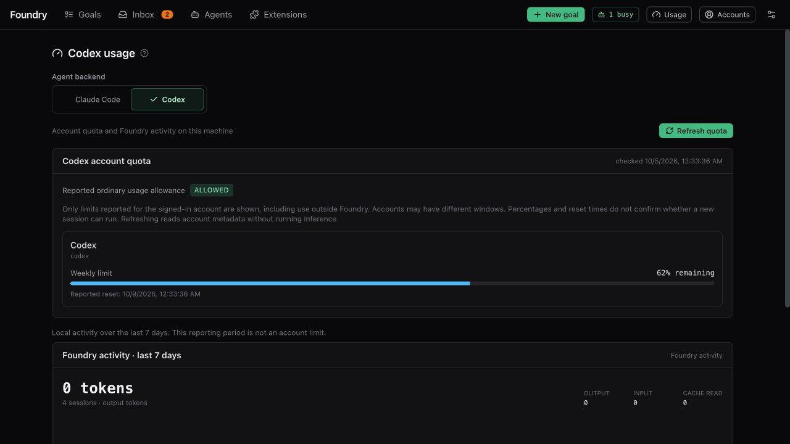
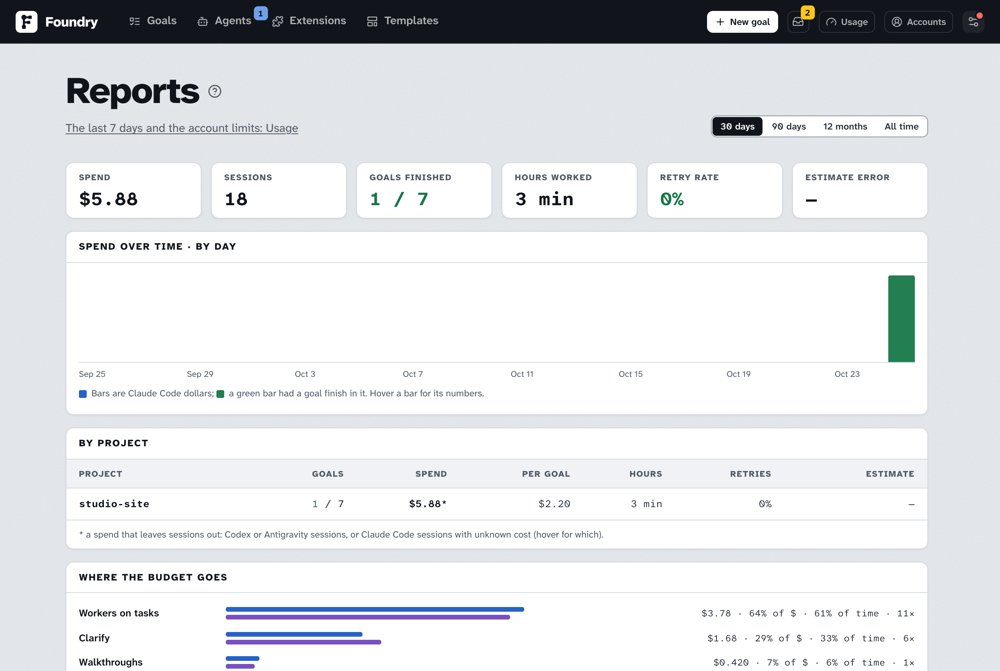

# 费用与用量

> [English](./costs-and-usage.md) · 中文

## Codex 用量

**Codex account quota** 通过原生 CLI 读取已登录 ChatGPT 账户的额度，与本机活动统计分开。卡片展示返回的所有额度分组、**剩余百分比**、时间窗口和报告的重置时间。蓝色条表示剩余额度：已用 25% 就显示剩余 75%。未知用量保持未知，不会显示为满额。**Refresh quota** 只读元数据，不运行推理；普通轮询缓存 60 秒。**Reported ordinary usage allowance** 忠实显示原生的 allowed／blocked／unknown 信号，不能根据百分比或已过去的重置时间推断恢复。缺失的额度和重置时间保持未知；读取失败不会伪装成零用量。原生 CLI 提供邮箱和订阅方案时，Accounts 也会显示；方案按该 coding agent 自己的叫法显示（**Ultra**、**Max**、**Pro**、**Plus**……），添加的账号的方案跟随它的登录状态，升级后下次打开页面就会更新。

不预设每个账户都有「五小时＋每周」两种限制。只有周限额的账户只显示 **Weekly limit**；两者都有的账户显示 **5-hour limit** 和 **Weekly limit**。名称根据原生回传的时长判断，primary 或 secondary 都可能是周限额。其他时长按实际数据显示，未知时长保持未知；未回传的窗口不显示、不补零。多个额度分组保持独立，顶栏统一显示 **Usage**，悬停提示列出每个编码智能体的账号用量：当前 Claude 账号各窗口的百分比（**Session 12% · All models 53% · Fable 11%**）、Codex 的额度（例如两个分组均为周限额时显示 **2 weekly limits**）和 Antigravity 的分组。某个编码智能体暂停或受限、或 MiniMax 额度偏低时显示黄色圆点。点击进入 Usage 后再分别查看两种编码智能体。

页面先显示共享的 **Foundry activity · last 7 days** 区块，再显示 **Account limits**；它旁边的编码智能体选择器只切换下面的内容：该编码智能体的账户额度（Codex 和 Antigravity 还有它们自己的 **Foundry activity · last 7 days** 卡片），所以切换时上面的内容不会移动。无论选哪个，被暂停的编码智能体都会在页面顶部显示横幅。共享区块同时涵盖所有编码智能体，因为数据来自 Foundry 自己的会话记录，而不是任何一个账户：缓存命中率、每个 Claude 会话的平均费用、平均会话时长、未成功的会话数，以及并排的三个列表：**By goal**、**By session kind** 和 **By model**。每一行第一行显示涉及的编码智能体（图标）、名称和费用；第二行显示 goal 的状态、会话所花的时间、会话数和处理的 token（悬停可看输入、缓存和输出）。每种编码智能体都有时间和 token，所以按时间排序；每个列表先显示前 8 个，按 **Show all** 显示其余的。费用只估算 Claude Code：没有 Claude Code 的行显示 —，混合的行只显示 Claude Code 的部分，并标上 *。只统计 Foundry 启动的会话。Codex 活动卡片只表示本机最近七天的活动统计，与账户额度分开，不显示配额状态或重置倒计时。当前适配器不提供美元费用、模型回合数及技能调用记录；“不可用”不代表免费或未使用。被中断、来不及回报费用的 Claude Code 会话同样算作**未计量**：该行的费用不含它并标上 *，**sessions with unknown cost** 统计它们的数量。

Codex 在创建、批准 Brief、提高预算时都会移除美元上限。超时、工具调用次数、尝试次数和并发限制仍然有效。回合上限在 Codex 中限制工具调用次数。检测到限流只暂停对应编码智能体；没有重置时间信号时，五分钟后重试，不代表账户额度已恢复。

## Antigravity 用量

**Antigravity account quota** 用 `agy /usage` 读取已登录 Google 账户的额度，CLI 直接回答，不运行模型。Antigravity 把模型分组（**Gemini Models**、**Claude and GPT models**）；同组模型共用一个每周限额，按 token 的成本扣减，Foundry 之外的使用也算在内。卡片按组显示**剩余百分比**和报告的重置时间。一个 goal 只用一个模型，所以只有它所在组的限额会让它停下。**Refresh quota** 重新读取；普通轮询缓存 60 秒。某组降到 0% 时，顶栏的圆点变成黄色；agy 没有报告的额度保持不可用，不会显示为满额。

Antigravity 只报告 token，不报告美元：它的美元上限和 Codex 一样会被移除，由时间、尝试次数、并发和工具调用次数约束它的 goal。它的回合上限每轮允许三次工具调用，因为 agy 每读一个文件就调用一次工具。Foundry 还没见过某组限额用完时 agy 报告什么，所以它可能不会像对限流的 Claude 或 Codex 那样暂停 Antigravity 会话：请留意额度卡片。

## 账号用量

**Accounts** 页上的每一行账号都显示这个账号自己的用量窗口，由它的编码智能体报告，Foundry 之外的使用也算在内 —— 对 Claude 来说就是菜单栏应用和 `/usage` 显示的那些数字，用这个账号自己的登录读取：

- **Claude Code**：**Session**（5 小时滚动窗口；没有打开的窗口时显示 0% 和 *No active session*）、**All models**（本周）、Claude 单独限制的每个模型一行（比如 **Fable**），以及开启时的 **Extra usage**（额外用量已用掉月上限的多少）。
- **Codex**：它的额度报告里的窗口，按时长命名 —— 5 小时的叫 **Session**，每周的叫 **All models**。
- **Antigravity**：每个模型组一行（**Gemini Models**、**Claude and GPT models**），都是每周限额。

每个窗口是一条显示**已用**百分比的条：蓝色，50% 起变琥珀色，85% 起变红，三个编码智能体用同一套阈值；悬停可看窗口和重置时间。新会话所在的账号（**current**）把窗口展开成卡片，带重置时间（**Resets today 3:42 PM**）和读取时间。**Refresh status** 重新读取所有账号，页面打开期间每分钟再读一次；引擎把每次读数保留一分钟，所以一个账号每分钟最多被问一次。读不到的用量用文字说明 —— **Usage unavailable** 加原因，比如登录已失效 —— 绝不显示成空条。

Claude 的数字来自 Claude 自己的用量报告，Claude Code 也用它，但 Anthropic 没有公开文档：它变了的话，这一行会显示用量不可用，其它功能不受影响。Foundry 从 Claude Code 保存登录令牌的地方读取它，只放在内存里，只发给这一个服务。令牌过期时（由 Claude Code 续期；几小时没跑过的账号手里是旧的），Foundry 会为该账号运行一次 Claude Code 自己的 `/usage`（本地命令，不跑模型，不花钱），然后再读一次；如果这样也没能续期，这一行会说明登录已失效，Foundry 一刻钟后再试。这些数字只是给你看的，从不会提前切换账号（[多个账号](#多个账号)）；它们也说明用完的窗口什么时候重置，所以某个账号的上限中断会话后的暂停会正好等到那时。命令行里 `foundry usage` 打印同样的窗口，有多个账号时每个账号一段。

**Usage** 页的 **Accounts** 卡片显示同样的条（Claude Code 只有一个账号时也显示），下面是 Foundry 自己在这个账号上每个窗口的花费和它的会话带回的最后一个信号，Codex 则是会话数和 token。

下方美元数值只适用于 Claude 会话，表示用量估算，不是 Foundry 额外收取的账单。本机 git 操作和检查本身不调用模型；命令或媒体工具调用付费服务时，费用由对应服务计算。

## 哪些要花钱

| 会话 | 每个会话的上限 |
|---|---|
| Clarify（探索你的仓库、访谈、写 Brief） | 每个 Clarify 会话 $6。每一轮访谈、每一次修补 Brief，都是单独的会话。 |
| Draft with AI（一个任务或一个 Area） | $2 |
| Revise with answers | $3 |
| 任务尝试 | 默认 $10（Settings → Models & limits），且不超过 goal 剩余的预算 |
| 任务审查 | $0.80；需要再要一次结论时，最多再加 $0.20 |
| 合并尝试（合并两个改了同一段代码的任务） | $2 |
| 最终 goal 审查 | 至少 $6，最多到任务尝试的上限；需要再要一次结论时，最多再加 $2 |
| 完成文档（仅在你开启时） | $3 |
| 风格样图（一张图） | 每次 $2，每个方向最多 8 张 |
| Suggest a hint（Inbox） | $1 |
| 里程碑反馈（"Turn into a plan"） | $0.50 |
| 杂活：判断 goal 属于哪一类（类型选 **Auto** 时），或总结一段很长的检查输出 | 每次 $0.10 |
| Settings 里的 **Sync models** 和 **Test**（每个模型一个很小的会话） | 每个模型 $0.50 |
| Usage 页面上的 **Refresh signal** | $0.05 |

这些会话各用哪个模型 —— 也就决定了实际花多少 —— 由 goal 的**模型预设**决定。见 [设置说明](./settings.zh.md#models--limits)。

## 怎样少花钱

- **选更便宜的预设。** 请比较实际选择的模型与推理强度；预设名称不保证价格或额度节省。可以在 New goal 表单里按 goal 选，也可以在 Settings 里按 goal 类型选。
- 常规 goal 用 **fast pace**。它跳过 Foundry 自己额外的审查；你批准的检查照常运行。
- 简单的 goal 在 New goal 表单里**调低 effort**。
- **设预算。** goal 达到时间上限时会停下来问你；Claude 还支持美元上限。Codex 使用时间、尝试次数和并发限制。时间只算 Foundry 实际在做这个 goal 的时候，包括 Clarify；等你的时间（回答访谈、批准 Brief、Inbox、milestone 暂停）不算。
- Foundry 会尽量先续接被中断的会话以保留上下文，再考虑新的尝试；实际额度消耗取决于编码智能体和工作内容。

## 在哪里看花了多少

- **Claude goal** 显示费用估算及每个任务的累计费用。在 Claude Code 回报费用之前就结束的会话（超时、被终止、崩溃）算作**未计量**：它的轮数和 token 从会话自己的记录里统计，美元数未知、不在总数里，也绝不记为 $0。Foundry 会尽量显示它大约花了多少，标为 **≈**：按同一个模型在已回报费用的会话里的单价计算它的 token（不维护价目表）。goal 的费用条旁边会有一个黄色圆点给出这个估算；估算从不计入总数，也不占用预算。Codex 将美元费用标为不可用。
- **Usage → Claude Code** 按时间显示费用估算。它的两张窗口卡片对你套餐的每个用量窗口显示它的会话最近带回的状态——**within limit**、**nearing limit**（仍然允许，但 Claude 提示这个窗口快到上限）或 **limit reached**——和重置时间。Claude 只是偶尔发送窗口状态（每周窗口大多在快到上限时才发），所以上一个信号的重置时间过了之后，卡片会显示 **no current signal**，不再重复旧的警告。确切的百分比在下面的 **Accounts** 卡片和 Accounts 页上（[账号用量](#账号用量)）。**Refresh signal** 会运行一个很小的会话来更新这个状态。
- 用量到了上限时，Foundry 只暂停对应编码智能体的新会话，之后重试。横幅显示的是重试时间（不是今天时会带日期），不保证额度已经恢复。横幅或 Usage 页面上的 **Resume now** 会马上恢复新会话；如果上限仍在，下一个会话会再次暂停。额外用量（overage）用完时，除非会话本来就在用它，否则不会暂停；任何暂停都不会超过一周。这个编码智能体有多个账号时，见 [多个账号](#多个账号)。
- **MiniMax**（通过 mmx 做视频和配音）在 **Usage** 页面底部有自己的卡片，打开页面时读取：Token Plan 下每个模型当前窗口和本周还剩多少，或者按量付费 key 的余额。**Refresh** 会重新读取。某个窗口剩下不到 10%，或者余额不到 1 时，顶栏的用量标签上会出现一个黄色小点。只有装了 mmx 时才会显示这张卡片。

## 多个账号

Claude Code 和 Codex 可以同时登录你的多个订阅，比如一个个人账号和一个工作账号。打开 **Accounts**：在 Claude Code 或 Codex 卡片的 **Accounts** 下，**Add account** 会再登录一个账号（和 **Sign in to Claude Code**、**Sign in to Codex** 是同一个登录流程）。Foundry 给每个新加的账号一个单独的文件夹，只有登录凭据是分开的：skills、插件、设置和会话记录所有账号共用。用已经在列表里的账号再登录一次，什么都不会变。Antigravity 只能有一个账号。

其中一个账号是 **current**（当前账号）：这个编码智能体的每个新会话都在它上面跑。**Use now** 把另一个账号设为当前账号；已经在跑的会话会在原来的账号上跑完。箭头决定新加账号的轮换顺序。**Remove** 会登出新加的账号并删除它的文件夹。

当前账号的用量上限中断了某个会话时：

- **关闭**（默认）：这个编码智能体的新会话照上面说的暂停，账号显示 **limited until** 和重置时间。如果另一个账号可用，横幅（以及 Telegram 或 Discord 消息）会提供 **Switch to *账号* and continue**：把那个账号设为当前账号并解除暂停。
- 勾选 **Switch accounts when a usage limit stops a session**：下一个没有受限的账号会自动成为当前账号，不会暂停。旧账号重置后也不会切回去。只有所有账号都受限时，新会话才会暂停，直到最早重置的那个账号恢复。

无论哪种方式，被用量上限中断的任务都会在当时的当前账号上从中断处接着做：它的改动都在文件夹里，这次尝试不占重试次数，也不会在做到一半时被评审。如果那个账号接不上原来的会话，就由一个新会话接手，并告诉它之前的会话做了什么。工作永远不会转到另一个编码智能体。

有多个账号时，**Usage** 显示的是当前账号的窗口和额度（并注明是哪个账号），并在 **Accounts** 卡片里逐个列出账号（Claude Code 只有一个账号时也显示这张卡片）：每个账号自己的用量窗口，由它的编码智能体报告（[账号用量](#账号用量)），下面是 Foundry 在每个窗口里在它上面花了多少和它的会话带回的最后一个信号（Claude Code），或者它的会话数和 token（Codex）。读不到用量的账号会说明原因。上面的活动总计仍然统计所有账号。

打开自动切换之前，Foundry 会先显示提供商条款里的相关内容。Anthropic 写明 Pro 和 Max 的用量上限以普通的个人使用为前提；OpenAI 的条款禁止绕过速率限制。用另一个账号越过上限继续工作，可能被视为违反这些条款，提供商可能限制或封禁这些账号。只添加属于你自己的账号。

## 报表

**⚙ → Reports** 比 Usage 页面看得更远，数据来自 Foundry 自己的会话记录：最近 30 天、90 天、12 个月或全部。顶上六个数字 —— 花费、会话数、开始的 goal 里完成了几个、Foundry 工作的小时数、重试率和估算偏差 —— 下面四块：

- **Spend over time**：每天、每周或每月的 Claude Code 花费（粒度跟着时间窗走），以及每段里完成了几个 goal。
- **By project**：每个跑过 goal 的文件夹 —— 完成、失败、取消各几个，花了多少、平均一个完成的 goal 花多少，Foundry 工作了几小时，重试率，以及 Brief 的估算和 goal 实际结果差多远。
- **Where the budget goes**：每种会话 —— 做任务的 worker、任务审查、Clarify、规划、goal review、合并尝试、审计、浏览器 QA、文档、探测 —— 各占多少钱和多少时间。
- **Estimate misses**：成本或时间偏离 Brief 估算最远的 goal，偏多偏少都算。这里的系数就是[校准](./approving-the-brief.zh.md#估算和预算)用来修正新估算的那个：实际 ÷ 估算，取有估算的 goal 的中位数。

goal 按创建时间算，会话按运行时间算。重试率是尝试过的任务里需要不止一次尝试的比例；修复任务（审查的、审计的、CI 的、浏览器 QA 的、review 评论的）单独计数放在旁边。钱是 Claude Code 的估算，和 Foundry 其它地方一样：Codex 不报告花费，中途被切断、没报告花费的会话不计入，算作未知。命令行：`foundry report --days 90`（`--all`、`--json`）。

## 图片类 goal 需要图片 key

配置的图片技能使用独立的媒体服务 API key：OpenAI 兼容的 key，或 Gemini key。这个 key 不会启用 Codex API-key 推理，也不会代替 ChatGPT 登录。在 **Settings → Tools & keys** 里添加；下一个会话就生效，不用重启。没有 key 时，图片任务只能做出手绘的 SVG 或 HTML 渲染，质量低很多 —— Brief 会在你批准前告诉你。

[Figure goal](./figures.zh.md)（beta）不需要 key：figure 由技能画出来，花的只是 worker 的 token 和时间 —— Colorfigures 一张图 15–30 分钟、几十万 token，iso-glow 一张约一分钟。[Diagram goal](./diagrams.zh.md)（beta）也不需要：一张图只花 worker 几分钟。[Deck goal](./decks.zh.md)（beta）做幻灯片本身也不要 key —— 这是个长任务，几十页一页页画 —— 只有你让 Brief 加 AI 配图时才用到图片 key。
