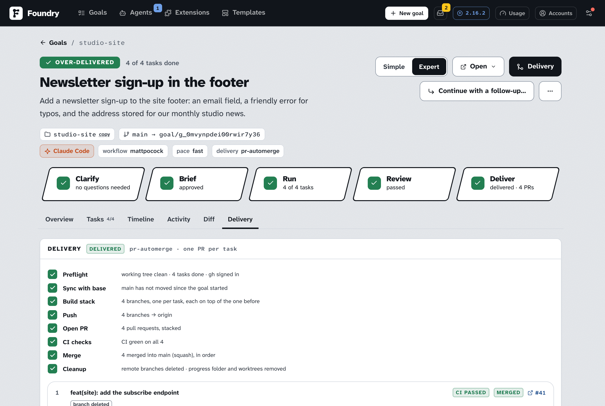
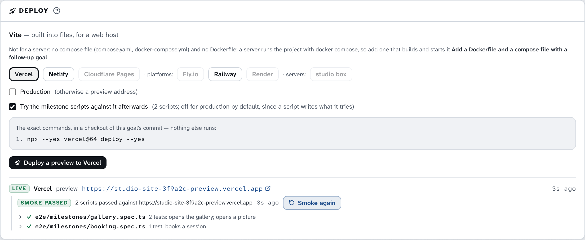

# Getting the result

> English · [中文](./getting-the-result.zh.md)

## Where the result is

When a goal is done, its work is in two places on your computer:

- **On a branch in your project**, named like `goal/…`. A branch is a separate line of history: your own files are untouched until you choose to bring the work in. The goal page shows the branch name at the top (for example `main → goal/abc123`).
- **In the progress folder**, next to your project: `<project>-foundry/<goal>/`. It is that branch, checked out, ready to open and run. See [While it runs](./while-it-runs.md#the-progress-folder).

The goal page says so in plain words: "The work is on branch … in your repository. Nothing has left your machine." What happens next depends on the delivery you chose.

## Delivery modes

You pick the delivery on the New goal form (**4 · Delivery**), and can change it any time on the goal's **Delivery** tab.

| Mode | What Foundry does when the goal is done |
|---|---|
| **Local only** | Nothing. The work stays on a local branch. You push when you want. This is the default in [Settings → New goal defaults](./settings.md#new-goal-defaults), which the New goal form starts from. |
| **Push branch** | Brings in any new work from the base branch, then pushes the goal's branch to the online copy (for example GitHub). No pull request. |
| **Open a PR** | Pushes, then opens a pull request whose description has a summary (what was understood, and the tasks under their Areas), your decisions, the evidence (the check results and the reviewer's notes) and the merge danger (how to undo it, and how much it touches). You review and merge it. |
| **PR + auto-merge** | Opens the pull request, waits for its automatic checks (CI), fixes CI if needed, merges when everything is green, and deletes the pushed branch. |

With **PR + auto-merge**, if branch protection on GitHub blocks the merge, Foundry turns on GitHub's own auto-merge (`gh pr merge --auto`) and waits a while ([Settings → Git & delivery](./settings.md#git--delivery)). If GitHub has not merged by then, it merges later by itself, and Foundry does not delete the branch.

A goal made [from a GitHub issue](./your-first-goal.md#from-a-github-issue) starts the pull request's description with `Closes #12`: GitHub closes the issue when the pull request merges (with one PR per task, the last one carries it). Foundry never writes to the issue itself.

Two rules hold for every mode:

- It is Foundry itself that pushes, opens and merges, exactly as the plan on the Delivery tab lists. The AI working on your tasks cannot push; if it tries, Foundry blocks it and asks you (see [When Foundry needs you](./when-foundry-needs-you.md#it-wants-to-do-something-outside-your-computer)).
- Foundry never pushes to your base branch (for example `main`) directly. Changes reach `main` only through a merge. It never force-pushes the goal's branch. The one exception is a task's branch under **One PR per task**: after the pull request below it merges, that branch's own commits are replayed on top of `main` and the branch is replaced, but only if nobody else pushed to it since (`--force-with-lease`). If someone did, Foundry keeps their commits and merges `main` in instead.

The pull request modes need the GitHub CLI and a connected account: see [Connecting GitHub](#connecting-github).

## Companion repositories

A goal that also changes other folders ([Also change](./your-first-goal.md#also-change-companion-folders)) delivers each of them the way it delivers its own: when you deliver it, the delegated goal that did a companion's part gets the same delivery settings — the same mode and merge method, that repository's own remote and base branch — and runs its own delivery, so each repository gets its own pull request. The main pull request lists the companion repositories and their pull requests once they are open; each companion's says which goal it is part of. The Delivery tab shows the companions under **Companion repositories**, with links to their goals, where each can be re-checked, resumed or reverted on its own. **Local only** leaves every branch where it is: the main goal's in its folder, each companion's in its own.

## One PR for the whole goal or one per task

Under **Granularity** (shown once you pick a mode other than Local only):

- **One PR for the whole goal** (the default): everything in a single pull request, titled with the Brief's pull request title. For **Push branch** this reads **One branch for the whole goal**.
- **One PR per task — stacked**: one pull request per task, each built on the one below it, titled with that task's commit message. With auto-merge they are merged bottom-up. For **Push branch** this reads **One branch per task**.

One PR per task gives smaller pull requests to review, but each is its own push, wait and merge cycle, so it takes longer. A goal with a single task always gets one. If a task cannot be split out cleanly, Foundry falls back to one pull request for the whole goal and says so.

## The other delivery options

Once you pick a mode other than **Local only**, more options appear.

### Target

**remote** is the online copy's name (almost always `origin`, filled in from your project). **base branch** is the branch the pull request goes into; blank means the branch the goal started from. **merge method** (only for auto-merge) is **squash** (the default: one commit on the base branch), **merge commit** or **rebase**.

### No remote yet

If your project has no online copy yet, the form says **No remote yet** and offers two ways:

- **existing remote URL**: paste the address of an empty repository you created, for example `git@github.com:you/repo.git`.
- **or create a GitHub repo**: pick the owner (you or one of your organisations), a name, and **private** or **public**. Foundry creates it at delivery time. When you are connected to GitHub, this is filled in for you: your account, the folder's name, private. GitHub allows only letters, digits, `.`, `-` and `_` in a name and turns every other character into `-`, so a folder called `My App V2` gives `My-App-V2`: the form shows the name the repository will get, and the goal keeps that name.

### Once the PR is open

The four switches and **Fix failing CI** are only for **PR + auto-merge** and are on by default; **Fix review comments** applies to **Open a PR** too.

| Option | Meaning |
|---|---|
| **Wait for CI checks** | Merge only after every automatic check reports. Off: merge as soon as GitHub allows it. |
| **Merge when no checks are configured** | Off: a repository without CI stops at the open pull request. |
| **Auto-resolve conflicts with the base branch** | If `main` moved on and conflicts, Foundry resolves it. Off: a conflict stops the delivery. |
| **Delete the remote branch after merging** | Only the branch this goal pushed, never the base branch. |
| **Fix failing CI** | **don't fix**, **up to once** (default) or **up to twice**. See [When CI fails](#when-ci-fails). |
| **Fix review comments** | **don't fix**, **up to once** (default), **up to twice** or **up to three times**: rounds of review comments Foundry addresses by itself. See [When someone reviews the pull request](#when-someone-reviews-the-pull-request). |

## Connecting GitHub

At the bottom of the delivery choices is a GitHub line:

- **GitHub: yourname** means you are connected.
- **gh installed, not logged in** comes with a **Connect GitHub** button. Press it: a window shows a one-time code. Copy it, open the link, paste it and approve in GitHub; the window says who signed in, then press **Done**. The Setup page has the same sign-in under **GitHub CLI (optional)**.
- **GitHub CLI not installed** means the GitHub CLI is missing on this computer. Whoever installed Foundry can add it; the Setup page shows the command under **GitHub CLI (optional)**.

**Push branch** does not need the GitHub CLI (unless Foundry should create the GitHub repository for you); it only needs the online copy to accept your pushes.

## The Delivery tab

On the goal page, open the **Delivery** tab (in Simple view, **Deliver…** on the Result card switches to Expert view and opens it).



**Before the goal is done**, it says **Will deliver automatically when the goal is done** (unless the mode is Local only). You can change the delivery and press **Save (runs when the goal is done)**.

**While it delivers**, the card shows each step with a tick, a spinner or a cross: **Preflight**, **Remote**, **Sync with base**, **Build stack**, **Push**, **Open PR**, **CI checks**, **Fix CI**, **Merge**, **Cleanup** (only the steps your mode needs). **Cancel** stops it.

**The pull requests** appear in a list with their title, their CI result (**CI passed**, **CI failed**, **CI pending**, **no CI**, or **CI skipped** when it merged without waiting for checks), their state (**open**, **merged** …) and a link **#123** to open them on GitHub. Under a pull request, small labels say what is happening to it:

- the step running on it now, for example **CI checks** or **Merge**, with a spinner
- **waiting for #41**: with one PR per task, a pull request merges only after the one below it
- **rebased onto base**: after the pull request below merged, this one's own commits were replayed on top of `main`
- **base merged in** or **conflict resolved**: `main` was merged into it, and in the second case a Merge Attempt resolved a conflict
- **branch deleted**: its branch was removed from the online copy after the merge

The Overview tab's timeline also shows **Deliver · mode · N PRs · N merged**.

**After a merge**, three lines show whether the work is merged on GitHub, in your own folder, and whether the goal's folders were cleaned up. See [After a pull request merged](#after-a-pull-request-merged).

**N remote command(s) — full audit** lists every command Foundry ran against the online copy, with its result.

**Delivery settings** (or **Deliver this goal** for a Local only goal) is where you pick a mode and see the exact plan: every command Foundry will run, in order. Nothing else runs. For a first delivery the button says what it will do: **Push now**, **Open PR now**, **Open PRs now**, **Open PR and merge when green** or **Open PRs and merge when green**.

Once a delivery has started, the settings stay editable:

- **Save** stores them and starts nothing. While a delivery runs, the switches under **Once the PR is open** apply from its next step. For example, turning **Wait for CI checks** off lets a pull request that is waiting on CI merge without it, marked **CI skipped**.
- **Resume delivery** carries on from where the delivery stands. Open pull requests are kept, merged ones are skipped, and missing ones are added, such as the documentation written when the goal finished. Unsaved changes are saved first.
- **Start over…** asks first. It closes the open pull requests with a comment, deletes the task branches here and online, and delivers again with the settings on screen. Pull requests that already merged stay merged.

While pull requests are open, the remote, base branch, merge method and granularity are locked, and so are the modes without pull requests: changing them would leave the open pull requests behind. Switching between **Open a PR** and **PR + auto-merge** stays possible. While a delivery runs, only the switches can change.

With **One PR per task**, the documentation Foundry writes when the goal finishes (see [Completion extras](#completion-extras)) is delivered as the last pull request.

## When CI fails

CI is the set of automatic checks your online repository runs on every pull request. Foundry's own checks passed before delivery, but CI may test more.

- With **Open a PR**, Foundry does not wait for CI. You see the result on the pull request and decide.
- With **PR + auto-merge**, Foundry waits. If CI fails and **Fix failing CI** allows it, a small fix task reads the failed log, fixes the goal's branch and pushes again. A failing check with no CI log Foundry can read (a deploy integration's status, for example) is not handed to a fix task, and a fix task that finds nothing to change does not push the same commit again: in both cases, and whenever CI still fails, the delivery stops as **failed**.

When it stops, the Delivery tab lists each failing check under its pull request, with the check's own description (for example "Deployment was blocked") and a **details** link, and a *Delivery stopped* item appears in the Inbox with the same reason. Fix the cause, then:

- **Resume delivery** carries on from the first pull request that is not merged, keeping the open ones, with a fresh budget for fixing CI.
- **Re-check** on a pull request reads it on GitHub again; if it passes now, the delivery carries on and merges.
- **Mark as delivered** if you finished it yourself (merged pull requests are recognised; see [When Foundry needs you](./when-foundry-needs-you.md#the-delivery-stopped)).

If you merge the pull request on GitHub yourself, Foundry notices and finishes the delivery; with one pull request per task, the rest wait for **Resume delivery**.

With one pull request per task, a fix for CI is committed on the branch of the pull request that failed and pushed there. The other pull requests are not touched.

## When someone reviews the pull request

A pull request Foundry opened can be reviewed like any other. Foundry reads the review comments on its open pull requests every few minutes, and whenever you open the goal's page. Two kinds count: **inline comments on the diff**, and a **review that requests changes** (its text). An approval, a review that only comments, a comment in the conversation, and anything a bot wrote are left alone, so a comment is how you talk, and a comment on the diff or a request for changes is how you ask for work.

The comments found on one look form a **round**. Within the budget of **Fix review comments** (one round by default), Foundry runs the delivery again: a small fix task reads every comment, with the file, the line and the diff around it, changes the branch in the smallest way that answers them, and the goal's must checks run on the result. The fix is pushed to the pull request's branch, and Foundry replies under each comment with the commit and the files it changed. When the task looked and found nothing to change, the reply says so, and the task's report on the goal page says why. With **PR + auto-merge**, the checks are then waited for and the merge goes on as before. With one PR per task, the fix lands on the branch of the pull request that was reviewed; the others are not touched.

The Delivery tab lists each round under its pull request: how many comments, who wrote them, and what became of them. A round beyond the budget waits for you, with a note and a message, and **Fix review comments** addresses it on your click. **Resume delivery** and **Retry delivery** give a fresh budget. A fix the task cannot make stops the delivery like a CI fix that cannot: one *Delivery stopped* item in the Inbox, and the pull request as it was; answer the comments on GitHub, or press **Resume delivery** to try again.

Foundry writes nothing else to GitHub: no comment when it starts, no review of its own. Its replies end with a hidden mark, so it never mistakes them for yours. Comments left while a delivery is running are picked up once it ends.

## Changing delivery later

You can change the mode at any time on the Delivery tab:

- A **Local only** goal that is done: pick **Push branch** or **Open a PR** and press the button. Nothing else about the goal changes.
- A goal that is still running: pick the new mode and press **Save (runs when the goal is done)**.
- A goal whose delivery already started: see [Delivery settings](#the-delivery-tab) above (**Save**, **Resume delivery**, **Start over…**).

## Media and CAD goals and the output folder

Image, video, figure, diagram, deck and CAD goals produce files, not only code; most of those files are never added to git, a figure's page, a diagram's page and a deck are. Those files are never added to git; the branch only records a list of them (what each file shows and how it was made). A [figure goal's](./figures.md) page is committed in the repository (`figures/<name>.html`) and travels with a push or a pull request; the task drawer lists it under **Files**, and clicking it runs the page in the preview, in a sandbox that cannot reach Foundry. Only the worker's own shots are artifacts. A [diagram goal's](./diagrams.md) page and its SVG are committed the same way (`docs/diagrams/<name>.html` and `.svg`); only the PNG Foundry renders is an artifact. A [deck goal's](./decks.md) PPTX is committed too (`decks/<name>.pptx`, with the skill's project and the page previews beside it), so GitHub shows the slides and the deck can be rebuilt; it has no output folder. A CAD goal commits the model's source (a build123d Python script, where the repository keeps such things) and keeps the exports out of git: the STEP file, the other formats you asked for, and the front, top, right and isometric snapshots the review reads.

- If you chose an **Output folder** on the New goal form, the finished files are copied there when the goal is done, and again when a goal you restarted finishes again; a file you changed in the output folder since its last copy is left as it is, and the new version stays in the progress folder. The Result card says "N file(s) are in … — open the folder and have a look."
- Without an output folder they stay in the `artifacts` folder inside the progress folder. Use **Open ▾** to get there.

While the goal runs, milestone cards show the files produced so far.

### CAD Viewer

A CAD goal's preview card also shows **CAD Viewer**, text-to-cad's own viewer: **Start** runs it, then **Open** (**Open the model** when it is the only app) shows the model in the browser, where you can turn it, measure it and cut sections. It opens on the goal's assembly when one was exported, else on the newest STEP, and follows a newer assembly while it runs; its home lists the other models. The walkthroughs never start it by themselves. It opens only on the computer Foundry runs on: it can read any file there, so Foundry never puts it on your tailnet. When the page is opened at an address other than localhost, the card says **only on Foundry's computer** instead of offering **Open**, with the viewer's localhost address as a link. That link works on Foundry's computer reached by its network name, not on a phone, where localhost is the phone itself.

## Deploy

A finished goal whose result is a web page or an all-in-one web app can be put online from the end of its **Delivery** tab: on Vercel, Netlify or Cloudflare Pages, as a preview address unless you ask for production.



- **What is deployed**: a folder of pages, a site or single-page app built with a known tool (Vite, Astro, Gatsby, Docusaurus, Eleventy, Create React App, Angular), or a full-stack web framework the hosts run (Next.js, Nuxt, SvelteKit, Astro with an adapter, Remix, React Router, SolidStart). The card says which it found, and in which folder of a monorepo.
- **What is not, on a web host**: workers in Docker or a Procfile, a backend deployed apart from its pages (an API in its own folder, a Go or Python service), an app with a custom server of its own, or a repository with several web apps. The card says which it found instead. Half a system online is a broken one, so the hosts get nothing of it — a server of your own runs it whole (below).
- **A server of your own**: a machine you reach over SSH, listed in [Settings → Git & delivery](./settings.md#git--delivery) under **Servers**. It takes the whole project as its compose file runs it (`compose.yaml` or `docker-compose.yml`: every service, databases and workers included), or a lone `Dockerfile` with an `EXPOSE` line, which Foundry wraps in a one-service compose file in its own checkout. The card says what it found (the file, the services, the port) and refuses in words what it cannot run: no compose file and no Dockerfile, or a Dockerfile without a port. Pick the server by name beside the hosts; a repository can be both a web app for the hosts and a project for a server.
- **The readiness check**: the first time you pick a server, the card tries it — the SSH key is in Settings, the server answers with it, `docker compose` runs there for that user, the deploy folder can be written and the project's folder is new or Foundry's, the ports the project publishes are free — and lists each item with what it found. An item that fails says where to put it right: a Settings section, a command to run on the server yourself (adding the key's public half to that user's `authorized_keys`, `usermod -aG docker`, each with what it changes), or Docker's install page; Foundry installs and configures nothing on your server. Two more items are told but never block: what listens on 80 and 443 in front of the project (nginx, Caddy, or nothing, in which case visitors reach the project on its port only) and, when the server has a **Public address**, whether it answers from here — behind Cloudflare or not, with a certificate a browser accepts, or not resolving, or answering nothing yet. A new server with no reverse proxy and no certificate deploys fine; the check tells you what to set up for a domain with https (Caddy gets certificates itself, nginx with certbot, or Cloudflare in front). **Deploy** waits for every blocking item; **Check again** tries once more. Nothing is checked on a timer.
- **What Foundry does on your server, and never does**: it writes under `<deploy folder>/<project name>` only, marks that folder as its own the first time, and never writes over a folder that already holds something else (the deploy stops and says so). It starts, replaces and removes the containers of this compose project only: it never deletes a file on the server, never touches other containers, other projects or the system's configuration, and installs nothing. The confirmation states what the deploy will start, which ports it publishes, which named volumes keep its data, and what stays untouched.
- **The compose file is reviewed first**: a coding session may have written it, and a service in it can reach the whole server. Before anything runs the card reads it and refuses, naming the service and the reason, a privileged container, the host's network or pid space, added capabilities, a security profile turned off, devices, the Docker socket, or a bind mount outside the project folder. Edit the file, or tick **Allow a compose file that reaches outside its project** on that server in Settings when you mean it: then it runs after the confirmation lists what it reaches, and the activity records it.
- **How a server deploy goes**: the goal's commit is streamed over the SSH connection as a tar into `<deploy folder>/<project name>` on the server (`.git` and installed packages left out; what is there is written over, never deleted, so a data folder beside the code stays), then `docker compose up -d --build` runs there under the project's name. **A server deploy is always production**, confirmed each time: there is no second address to put a preview on. The address is the server's **Public address** from Settings when you set one (a domain in front), else `http://<host>:<the first port the compose file publishes>`; a project that publishes no port runs with nothing to open, and the card says so. The SSH key exists as a file only while the commands run, and the commands' record shows `<key file>` in its place.
- **Setting the server up with a script**: a fresh server lacks things — Docker, nginx with a certificate in front, Node and PM2, PostgreSQL, Redis. Foundry does not install them behind your back, and does not spend a coding session on it either: it brings **scripts** (recipes) modelled on the ones people run on a new machine by hand, and the readiness item that failed offers **Set it up with a script…**. The dialog names what the script changes on the server (its header says so: packages, files written and backed up, ports opened, services restarted), takes its inputs with the project's values filled in (the domain from the public address, the port, the project's name), shows **the whole script**, and runs it only after you tick that you read it — once, over ssh as root (`sudo` without a password; a user who cannot is told and given the script to run themselves). Its output appears in the dialog and stays in the activity; a secret input (a certificate's key, a database password) is blanked out. The nginx script takes its certificate three ways: **files** you paste (a Cloudflare origin certificate, or your own), **letsencrypt** (certbot gets one; the domain must already point at the server), or **none** (HTTP on port 80 only, with Cloudflare in front). Every script runs again safely. Your own scripts work the same way: put them in the data folder's `server-recipes/` with a header like the bundled ones (see [Settings → Git & delivery](./settings.md#git--delivery)).
- **PM2 mode**: a server can run Node.js projects without containers, the way many people run them: set its **Mode** to **PM2** in Settings. The deploy then installs with the package manager your lockfile names (yarn, pnpm, npm or bun), builds when there is a build script, and starts or reloads the project under PM2 (`pm2 startOrReload … && pm2 save`), writing an `ecosystem.foundry.config.cjs` into its own checkout when the project has no ecosystem file. The readiness check asks for Node and PM2 for that user (the **Node.js, Yarn and PM2** script puts them there). The process runs as the ssh user on the host itself, with nothing around it; the confirmation says so. A project that is not Node.js (no `package.json`, or no start script and no ecosystem file) is refused in words: use a server in docker mode for it.
- **A project in any language**: a server runs whatever its Dockerfile or compose file builds — Go, Python, PHP, Rust, Java, Ruby or Node alike. A repository without them is not made deployable by a template: the card offers **Add a Dockerfile and a compose file with a follow-up goal**, a goal whose prompt is written for you (a Dockerfile with `EXPOSE` and a `HEALTHCHECK`, a `compose.yaml` with the services it needs, data in named volumes, `docker compose config` and `build` as its checks), so a coding session writes them for that stack and they are reviewed like any goal's work. When you have a server in Settings, the planner adds that task by itself to a code goal that makes something that runs.
- **A platform — Fly.io, Railway or Render**: the whole project, like a server, with a preview beside production, like a host. Pick one beside the hosts once its token is in [Settings → Git & delivery](./settings.md#git--delivery) under **Platforms**. Each takes a `Dockerfile`; Railway and Render also build the stack themselves — Node.js (Render needs a `start` script), Python, Go, Ruby, Rust or Elixir (Render needs a `Procfile` with a `web:` line for those) — and Fly.io takes Dockerfiles only, so the card says to add one (the follow-up goal writes it) or to use Railway. A preview goes to a second app on Fly.io (`<project>-preview`), a `preview` environment of the same project on Railway, or a second service on Render; production to the app, environment or service under the project's name. Each is made by the first deploy, never ahead of time. Fly.io and Railway take the code from Foundry's checkout through their tools (`flyctl` must be installed on this computer; the card's check says when it is not, and the Docker image carries it): the token goes to the tool through its environment, never on a command line, and Foundry writes a `fly.foundry.toml` of its own for the app's name, region and port, so nothing of your project changes. Render deploys the repository's branch from GitHub, so the goal must have gone there first — the preview from the goal's branch, production from the base branch once the goal is merged — and Render's GitHub app must be allowed on the repository; a Local only goal, an unpushed branch or an unmerged production deploy is refused in words before anything is called. The card lists the exact commands (or API calls) first, checks the place before a first deploy (the token, `flyctl`, the GitHub remote and the key's workspace for Render), and asks you to confirm production.
- **The stores — an Expo app to TestFlight and Google Play**: a goal whose project is an Expo app (the `expo` package and an `app.json` or `app.config.js`) shows **App Store (TestFlight)** and **Google Play** beside the other places once the Expo token is in [Settings → Git & delivery](./settings.md#git--delivery) under **Stores**. EAS builds the app in the cloud from Foundry's checkout and holds the signing: Foundry never sees a certificate or a keystore, and a bare React Native, Flutter or native project is refused in words. **iOS**, preview or production alike, is uploaded to App Store Connect, where it appears in TestFlight once Apple has processed it; production is the build you then attach to a version and **submit for review there yourself — Foundry never submits for review and never releases**. From then on the card follows it (every 15 minutes, or on **Check now**): processing, in TestFlight, waiting for review, in review, approved, live in the App Store or rejected, each move on the row and in a Delivery notification, with links to the build on EAS, the submission and App Store Connect. **Android** preview builds an APK to install from the build's page, no store; production submits an app bundle to Google Play's production track, released to everyone once Google's review is done — Google tells no review state through an API, so the row says *submitted* and points to the Play Console. Before a first build the card checks the place: the token, the app linked to an EAS project (`eas init`, run once in your folder), EAS answering, the App Store Connect key and the app's record there (make it in App Store Connect with the same bundle id first), or the Play service account and the app in the Play Console; and, told but not blocking, whether EAS holds the iOS signing yet — the first time, run `npx eas-cli credentials --platform ios` in your folder with your Apple ID, once. Foundry writes its own build and submit profiles into its checkout's `eas.json` (built on yours when it has one), never into your repository; the keys from Settings exist as files only while a command runs. A store build has no address, so no smoke runs.
- **Runtime variables**: what the project needs online — a database address, an API key, a session secret — kept per repository and per place (each server, each platform), the way the previews' variables are kept per repository, in the same dialog: open **Edit…** under **Runtime variables** on the card. It lists what is set (names only; a saved value is never shown again), what the example files ask for without a value here, and what each name is; **Copy from the previews** and **Import from your checkout** add the names not set yet. They go with each deploy and nowhere else: a server's compose services read them from a `.foundry.env` file beside the code (an override hands it to every service), a PM2 process starts with them, a platform gets them in its own secrets store before the deploy; they never enter the goal's folder where the coding agents work, and the deploy's record blanks their values out. The hosts keep their own environment settings and get none. A Transfer carries them under Keys & secrets. Missing names are told by the readiness check and never block: example files list optional settings too.
- **The hosts**: Vercel builds the source itself. Netlify's tool builds here with Netlify's own build. Cloudflare Pages gets the files built here, so it takes static sites only: a server-rendered app goes to Vercel or Netlify.
- **Before anything runs**, the card lists the exact commands. They run in a checkout of the goal's commit in Foundry's data folder, never in your folder, and nothing is pushed to your repository. Each host gets one project per repository, named after its folder, so later deploys go to the same place.
- **Preview or production**: a preview gets an address of its own. **Production** asks you to confirm first, because it replaces what the project's address serves. A host's very first deploy of a new project is its production deploy: Vercel puts it there even when you asked for a preview, so the card lists it as production and a smoke asked for the preview is not run on it.
- **Afterwards** the card lists every deploy with its address, the commands' output folds open below, and a **Delivery** notification says where it went or why it failed. The card then starts on the host this goal last went to.
- **What a deploy adds to the project**: a host's tool may change the repository (Vercel adds its folder to `.gitignore`). When the goal went to GitHub, that goes too: onto the goal's branch while its pull request is open, else in a small pull request of its own, merged when the goal's delivery merges. What must not be committed never is: the hosts' own folders (`.vercel`, `.netlify`, `.wrangler`: the link to the site and what they built) are added to `.gitignore` instead, and installed packages, the build's output and the package files Foundry's install touched stay out. A Local only goal keeps nothing; the activity says what was committed and where.
- **A smoke afterwards**: once a preview is live, Foundry runs the goal's milestone scripts against its address — the same Playwright scripts that recorded each feature, with no server of their own — and keeps what they showed under the deploy: passed or failed, each script's video and screenshots, and the runner's log. A failed script is told like a failed delivery and is yours to look into: what differs online is usually the host's environment (a variable, a database or a service it lacks). **Smoke again** tries once you changed it. An address behind the host's login is not tried, since the scripts would only see the login page: Vercel protects previews by default (the project's **Settings → Deployment Protection**), and a Netlify team can let only its members in (**Visitor access**). The smoke says which setting asks for the login. Production gets no smoke unless you tick **Try the milestone scripts against it afterwards**: a script writes what it tries (an order, an account), and that would land in production's data. A goal without milestone scripts gets none.

Each host, platform and store needs its token, and each server its key, in **Settings → Git & delivery**: see [Git & delivery](./settings.md#git--delivery). The engine keeps them to itself; no coding session ever gets them. A coding session cannot deploy on its own either: the boundary guard blocks the hosts' deploy commands, a `docker compose up` over `ssh`, and the stores' and platforms' deploy commands (EAS, fastlane, Fly, Railway, Render), however they are spelled.

## Completion extras

On the Brief you chose what runs by itself at the end (see [Approving the Brief](./approving-the-brief.md#completion)):

- **Documents** (PRD, README update, Changelog, Confirmation sheet) are written after the final review passes, or after you accept the goal as-is when it did not, and saved on the goal's branch as one commit, so they ship with the work in the same pull request.
- **Refresh the knowledge graph** updates the code map after delivery: in the progress folder for a Local only goal, in your own folder for a delivered one. It only refreshes the index: GitNexus runs with `--index-only`, and anything a tool still writes into `CLAUDE.md`, `AGENTS.md` or `.claude/` is put back, so the folder is left without uncommitted changes. A GitNexus section or skill folder that appears while a task works (a global hook of yours can run GitNexus) is kept out of the task's commit too.

- **Audit the repository at the end** runs `ponytail-audit` once every task is done, before the final review: must-fix findings in the code the goal touched become fix tasks, and every finding stays on the goal.
- **Test it in a browser at the end** opens the finished app in Chromium once every task is done, after the audit and before the final review, and tries each acceptance check with Playwright scripts; a must check that fails becomes a fix task, and every result stays on the goal with its screenshots. The scripts live in a scratch folder (`.foundry-qa/`, kept out of git); any other change the session made is thrown away.

The Overview tab's **Completion** card has one row for each, with a tick, a warning or a cross and how it went in one line. Click a row's name for the details:

- **Audit**: what it found, ranked must fix, should fix and nice to have, with the files; a must-fix finding in this goal's code says that a fix task was created. **Follow-up with the rest** starts a goal for the findings this one did not fix.
- **Browser QA**: each check it tried, pass, fail or skipped, with what it did and saw, the problem and the fix for a failure, and its screenshots; a failed must check says that a fix task was created.
- **Docs**: the documents chosen, the files written (click one to read it), the commit, what it cost, and the pull request it went out in.
- **Graph refresh**: each tool (updating your checkout, graphify, GitNexus) with its result; a failed one shows why, for example a missing program.

A failure here never fails the goal; it is only noted. **Re-run** on a failed row runs it again; documents that were never written show **Generate** instead. New documents land on the goal's branch; after a delivery, **Resume delivery** ships them. Once the work merged and Foundry cleaned up the goal's folder, the documents are written on a new branch from the base branch (the goal's branch name with `-docs`), pushed, and opened as a pull request of their own, which the Docs row links to.

## Getting the result into your own folder

### Without git

You do not have to touch git. The progress folder *is* the finished project: open it with **Open ▾ → Goal workspace** (or **The result** in Simple view), use it, or copy what you need. It stays there after the goal finishes, until a pull request of the goal merges and the work has reached your own folder (see below).

### After a pull request merged

Foundry brings the merged work into your own folder by itself: it fetches and fast-forwards your base branch (for example `main`). It only does this when nothing of yours can be touched: no unsaved changes in your folder, and no commits of your own on that branch that are not online. Once your folder has the work, Foundry removes what the goal left behind: the progress folder, its worktrees and the local `goal/…` branches. Screenshots and the goal's page and history stay.

The goal page shows where things stand, on the Delivery tab and on the Simple view's Result card:

| Line | Meaning |
|---|---|
| **Merged into main on GitHub** | The pull request merged. Before that it says **Waiting for the pull request to merge**; if it was closed instead, **closed without merging** (nothing is changed or removed). |
| **Your local main is up to date** | Your own folder has the work. If Foundry could not update it, the line says why, with a button **Pull into my checkout** that tries again (for example after you committed or stashed your changes). You can also run `git pull` yourself. |
| **Workspace cleaned up** | The progress folder and local branches are gone. If they stay, the line says why (your folder does not have the work yet, the progress folder has unsaved changes, the goal ran again after its merge so it holds work no pull request carried, or it holds files the output folder does not have as they are now, such as a CAD goal's exports when the goal has no output folder, a file changed after its delivery, or one replaced in the output folder by another goal's) with a button **Clean up anyway**. While the files are still being copied to the output folder, the tidy-up waits and then runs by itself; **Clean up anyway** waits up to half a minute for that copy, then leaves everything in place and asks you to press it again once the copy has ended. |

A pull request that merges later — auto-merge that took longer than Foundry waits, or one you merged yourself on GitHub — is noticed within a few minutes, or as soon as you open the goal page, and the same steps run. You can turn all of this off in [Settings → Git & delivery](./settings.md#git--delivery); then your folder only changes when you press **Pull into my checkout**, and the folders stay until you delete the goal.

### A Local only goal

The work is on the goal's branch in your project. Your own folder cannot switch to that branch (the progress folder has it), but you can merge it: in your folder, on your base branch, run

```
git merge goal/abc123
```

with the branch name shown at the top of the goal page. Or change the delivery to **Push branch** or **Open a PR** and let Foundry do it through GitHub.

When you no longer need the goal, **⋯ → Delete goal…** removes it and its progress folder; tick **Also delete the branch** only once the work is merged or pushed.

## Reverting a merged goal

A merged goal that turns out wrong is undone from its page: on the Delivery tab, under the three lines above, press **Revert…**. The dialog lists the merges it would undo — the goal's pull request, or every pull request of a stack, newest first — asks why (your words go into the pull request), and whether to **Merge it right away** with the delivery's merge method or leave the pull request for you.

Foundry then starts a branch from your base branch as it is online, undoes each merge with one revert commit, pushes the branch and opens a pull request titled *Revert "…"*, whose description names the merges, your reason and what the revert touches. With **Merge it right away** it merges the pull request at once, or arms GitHub's auto-merge when branch protections hold it, as a delivery does. A revert that merges — right away, or later when you merge it yourself on GitHub — is noticed the way a delivery's merge is: the remote branch is deleted when the delivery settings say so, and your local base branch is fast-forwarded when that is safe (see [After a pull request merged](#after-a-pull-request-merged)). The goal page then shows a **reverted** tag, and the Delivery tab a line for the revert with its pull request; the goal's own lines, its branch and its history stay as they were.

What it needs: a delivery that merged through Foundry (**Open a PR** or **PR + auto-merge** — a Local only goal, or one you marked as delivered yourself, has nothing Foundry knows to revert), GitHub CLI signed in, and the merges still on the base branch. A merge that no longer reverts cleanly, because a later change touched the same lines, is refused with the files in conflict: revert it by hand, or start a [follow-up](#continue-with-a-follow-up) that undoes it. No model writes anything here, and nothing of your own folder is changed. To bring the work back, revert the revert's pull request on GitHub, or start a follow-up goal.

## Adjusting the result

*Beta: switch it on under [Settings → Beta](./settings.md#beta).*

When a goal has finished and the result is nearly right — the lid should be red, the chart needs one more line, the door should open further — you do not need a new goal. On the goal page, the **Adjust the result** card takes your words on what should change, with pictures or files if they help (paste or drop them in, up to 8), and **Adjust** sets the goal going again. It carries the change out itself, and the card says how:

- **a goal of one task** picks up the session that did the work, which knows every decision it made, and hands it your words;
- **a goal of several tasks** gets a task added after the finished ones — *Adjustment 1: …* — a fresh session told what each step delivered;
- **a failed goal** runs its failed tasks again with your words.

The goal shows as running meanwhile, as it did the first time: the task in progress, then the checks, the task review and the final review, all run again. The adjustment lands on the goal branch as a commit of its own (*… (adjustment 1)*), so a branch you already pushed is never rewritten. When the goal finishes again, the output folder gets the new files, and a branch already pushed or a pull request already open gets the new commit — nothing new to choose. Each adjustment costs the goal, inside its budget: the card shows what is left, and refuses when it is used up (raise the budget first).

Before anything changes, the result as it stands is kept: the artifacts and a figure's page go to `artifacts/.history/<n>/` inside the progress folder, and the card lists them under each adjustment as **Before it**, so you can open an earlier version (a page opens in the same sandbox as the current one). The output folder holds only the latest. The code's earlier versions are in the branch's history as ever.

What it will not do: adjust a goal whose work was merged (its branch is gone from the base; start a [follow-up](#continue-with-a-follow-up)), a goal whose progress folder was cleaned up, an imported goal held as history, or a Delegated goal (adjust its main goal). While the goal is at work, wait for it to finish. An adjustment stays within the goal's acceptance checks, which run again as they are: one that goes against them (*add a heading* to a note whose check says *no heading*) fails them, and the task says so — for a different result, start a follow-up. An adjustment is an instruction, not a conversation: for questions about the result, use the [Conversation](./while-it-runs.md#conversation); for a different piece of work, a follow-up.

## Continue with a follow-up

For Codex, an explicitly selected all-role model override is prefilled in the follow-up, even after the default model changes in Settings. Without an explicit override, the selected preset keeps its separate role assignments. The follow-up is a new goal and captures the preset’s current tables at creation; it does not copy the earlier goal’s frozen table. For Antigravity, the earlier goal's model is prefilled when it is not the one Settings names now.

A goal is rarely the last word. When a goal has finished (done, over-delivered, failed or cancelled), its page shows **Continue with a follow-up…**. It opens the New goal form with a **Follows: …** chip and the earlier goal's repository, goal type, models, effort, Fast mode, workflow suite, TDD, current saved Ponytail, view and delivery already filled in. The workflow suite, TDD and Ponytail take precedence over folder defaults. You write what should happen next; remove the chip if you change your mind. The form's [Follows](./your-first-goal.md#follows) section says where the new goal starts and lets you leave the attachments or the style direction behind.

What the follow-up gets from the earlier goal:

- **Background for the Clarifier:** what you asked for then, the approved Brief's understanding and decisions, how each task ended, the final review and any Stretch checks it did not meet. This is copied when the follow-up is created, so deleting the earlier goal later changes nothing.
- **Where it starts:** from your base branch when the earlier work is already there, otherwise from the earlier goal's branch. In that case the Delivery tab says that the earlier goal's changes go along in this goal's pull request. The pull request still targets your base branch.
- **Attachments and style,** unless you unticked them: copies of the attachments, and the chosen style direction with its reference sample, already picked on the new Brief.

### Carry over unfinished tasks

When the earlier goal stopped with tasks left (cancelled, failed, or done with some skipped), the Follows card lists its tasks with the unfinished ones ticked under **Carry over its unfinished tasks**. With tasks ticked, the new goal takes them as they were planned — their specs, files, order, Areas and acceptance checks, plus the earlier goal's goal-level checks — and skips Clarify: its Brief is written at once and opens for you to confirm or edit, as any Brief. The description box becomes notes for the agents (optional). The earlier goal's carried tasks show **skipped** there, with the new goal named, so resuming it later does not do them twice. Tasks you leave unticked stay out of the new goal: the Brief says so, and the earlier goal's goal-level checks become stretch checks there, since they speak for those tasks too. The new goal stands on the earlier goal's branch, so when that work is not on the base yet, the delivery is one pull request for the whole branch even if you deliver per task; nothing the earlier goal finished is left behind. To add new work instead, untick the tasks: the goal is then clarified from what you write. To go on inside the same goal, use **Resume…** on its page instead (see [Pause and Resume](./while-it-runs.md#pause-and-resume)).

The goal page then shows **Follows: …** and, on the earlier goal, **Followed by: …**, as links. If the earlier goal was deleted, the follow-up says "follows a deleted goal" with its title. In the goals list, a goal and its follow-ups are one entry, folded like a group on the Agents page: the first goal's title with a chip saying how many goals it holds, the newest goal's state (**latest: …**), and the spend and time of all of them. Click it to open its goals as numbered steps joined by a line, oldest first: each says what it is to the chain (**Original**, **Follow-up** or **Carried over N tasks**) and how it stands, with its own spend and time. It opens by itself while one of its goals is under way, remembers when you fold or open it, and **expand all** / **collapse all** above the list fold every group at once. A follow-up whose earlier goal was deleted stays on its own, with a small "↳ follows …" line under its title.

From the command line: `foundry goal new "<prompt>" --follows <goal id>`.

### Mark as follow-up of…

If you started a goal on its own and it really continues an earlier one, open **⋯ → Mark as follow-up of…** on its page and pick an earlier goal of the same repository. This only records the link: nothing about the code, the branch or the Brief changes.
