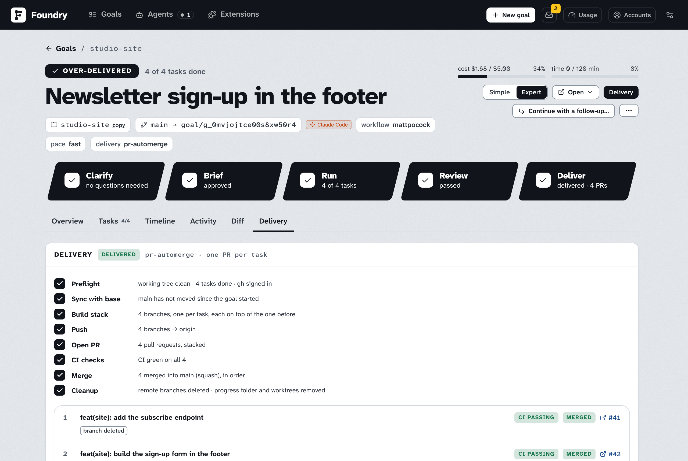
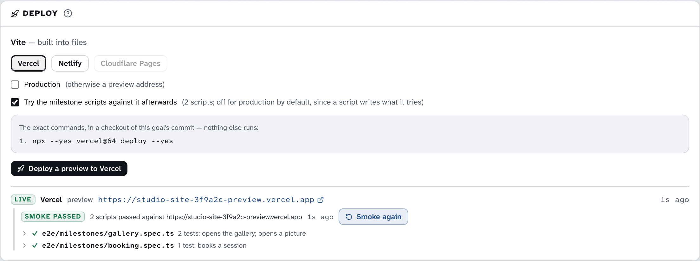

# 拿到结果

> [English](./getting-the-result.md) · 中文

## 结果在哪里

goal 完成后，它的工作在你电脑上的两个地方：

- **在你项目的一个分支上**，名字像 `goal/…`。分支是一条独立的历史线：在你决定把工作合进来之前，你自己的文件都不会被动。goal 页面顶部显示分支名（比如 `main → goal/abc123`）。
- **在进度文件夹里**，就在你的项目旁边：`<project>-foundry/<goal>/`。它就是那个分支，已经检出，可以直接打开和运行。见 [运行期间](./while-it-runs.zh.md#进度文件夹)。

goal 页面会用大白话告诉你："The work is on branch … in your repository. Nothing has left your machine." 接下来会发生什么，取决于你选的交付方式。

## 交付方式

交付方式在 New goal 表单里选（**4 · Delivery**），之后随时可以在 goal 的 **Delivery** 标签里改。

| 方式 | goal 完成时 Foundry 做什么 |
|---|---|
| **Local only** | 什么都不做。工作留在本地分支上。你想推送时自己推。这是 [Settings → New goal defaults](./settings.zh.md#new-goal-defaults) 里的默认，New goal 表单就从那里开始。 |
| **Push branch** | 先把基础分支上的新工作并进来，再把 goal 的分支推送到线上副本（比如 GitHub）。不开 pull request。 |
| **Open a PR** | 推送，然后开一个 pull request，描述里有摘要（理解了什么，以及按 Area 列出的任务）、你的决定、证据（检查结果和审查者的备注）和合并风险（怎么撤销、动了多少）。由你审查并合并。 |
| **PR + auto-merge** | 开 pull request，等它的自动检查（CI），需要时修好 CI，全部通过后合并，并删除推送的分支。 |

用 **PR + auto-merge** 时，如果 GitHub 上的分支保护挡住了合并，Foundry 会打开 GitHub 自己的 auto-merge（`gh pr merge --auto`），并等一段时间（[Settings → Git & delivery](./settings.zh.md#git--delivery)）。如果到时 GitHub 还没合并，它之后会自己合并，Foundry 也不会删除这个分支。

[从 GitHub issue](./your-first-goal.zh.md#from-a-github-issue) 创建的 goal，其 pull request 的描述会以 `Closes #12` 开头：pull request 合并后 GitHub 会关闭这个 issue（每个任务一个 PR 时，由最后一个带上这一行）。Foundry 从不往 issue 本身写东西。

每种方式都遵守两条规则：

- 推送、开 PR 和合并都由 Foundry 自己来做，严格按 Delivery 标签上列出的计划。给你做任务的 AI 不能推送；它要是试图推送，Foundry 会拦下并问你（见 [Foundry 什么时候需要你](./when-foundry-needs-you.zh.md#它想在你电脑以外做事)）。
- Foundry 从不直接推送到你的基础分支（比如 `main`）。改动只能通过合并进入 `main`。goal 的分支从不强制推送。唯一的例外是 **One PR per task** 下某个任务的分支：它下面的 pull request 合并后，这个分支自己的提交会在 `main` 之上重放，然后替换掉原分支，但前提是这期间没有别人推送过它（`--force-with-lease`）。如果有人推送过，Foundry 会保留他们的提交，改为把 `main` 合并进来。

pull request 类的方式需要 GitHub CLI 和一个已连接的账户：见 [连接 GitHub](#连接-github)。

## 伴随仓库

一个还改了其它文件夹的 goal（[Also change](./your-first-goal.zh.md#also-change-companion-folders)）会像交付自己一样交付它们：你交付它时，做伴随部分的那个委派 goal 会拿到同样的交付设置 —— 同样的方式和合并方法，用那个仓库自己的 remote 和基础分支 —— 然后自己跑一遍交付，所以每个仓库都有自己的 pull request。主 pull request 会列出伴随仓库和它们的 pull request（开出之后）；每个伴随仓库的 pull request 会写明它属于哪个 goal。Delivery 标签在 **Companion repositories** 下显示它们，并链接到各自的 goal，可以单独重新检查、继续或撤销。**Local only** 把每条分支留在原处：主 goal 的在它的文件夹里，每个伴随仓库的在自己那里。

## 整个 goal 一个 PR，还是每个任务一个

在 **Granularity** 下（选了 Local only 以外的方式后才出现）：

- **One PR for the whole goal**（默认）：所有内容放在一个 pull request 里，标题用 Brief 里的 pull request 标题。选 **Push branch** 时，这一项显示为 **One branch for the whole goal**。
- **One PR per task — stacked**：每个任务一个 pull request，每个都建在下面那个之上，标题用该任务的提交信息。开了 auto-merge 时，从下往上依次合并。选 **Push branch** 时，这一项显示为 **One branch per task**。

每个任务一个 PR，要审查的 pull request 更小，但每个都要单独推送、等待、合并一轮，所以更慢。只有一个任务的 goal 总是只有一个。如果某个任务没法干净地拆出来，Foundry 会退回到整个 goal 一个 pull request，并告诉你。

## 其它交付选项

选了 **Local only** 以外的方式后，会出现更多选项。

### Target

**remote** 是线上副本的名字（几乎总是 `origin`，会从你的项目里自动填好）。**base branch** 是 pull request 要合入的分支；留空表示 goal 起步的那个分支。**merge method**（只用于 auto-merge）有 **squash**（默认：在基础分支上只留一个提交）、**merge commit** 或 **rebase**。

### 还没有线上副本

如果你的项目还没有线上副本，表单会显示 **No remote yet**，并提供两种办法：

- **existing remote URL**：粘贴你建好的空仓库地址，比如 `git@github.com:you/repo.git`。
- **or create a GitHub repo**：选择所有者（你自己或你的某个组织）、名字，以及 **private** 或 **public**。Foundry 在交付时创建它。连接了 GitHub 时，这些会替你填好：你的账户、文件夹的名字、private。

### PR 开出之后

四个开关和 **Fix failing CI** 只用于 **PR + auto-merge**，默认都打开；**Fix review comments** 对 **Open a PR** 也有效。

| 选项 | 含义 |
|---|---|
| **Wait for CI checks** | 等每个自动检查都报告结果后才合并。关闭：GitHub 一允许就合并。 |
| **Merge when no checks are configured** | 关闭：没有 CI 的仓库会停在已开出的 pull request 这一步。 |
| **Auto-resolve conflicts with the base branch** | 如果 `main` 有了新进展并产生冲突，由 Foundry 解决。关闭：冲突会让交付停下。 |
| **Delete the remote branch after merging** | 只删这个 goal 推送的分支，从不删基础分支。 |
| **Fix failing CI** | **don't fix**、**up to once**（默认）或 **up to twice**。见 [CI 失败时](#ci-失败时)。 |
| **Fix review comments** | **don't fix**、**up to once**（默认）、**up to twice** 或 **up to three times**：Foundry 自己处理的审查评论轮数。见 [有人审查 pull request 时](#有人审查-pull-request-时)。 |

## 连接 GitHub

交付选项底部有一行 GitHub 状态：

- **GitHub: yourname** 表示已连接。
- **gh installed, not logged in** 旁边有个 **Connect GitHub** 按钮。按下它会打开一个窗口，显示一次性代码。复制代码、打开链接、粘贴并在 GitHub 里批准；窗口会显示登录的账户，然后按 **Done**。Setup 页面的 **GitHub CLI (optional)** 下也有同样的登录。
- **GitHub CLI not installed** 表示这台电脑上没有 GitHub CLI。安装 Foundry 的人可以装上它；Setup 页面在 **GitHub CLI (optional)** 下显示了命令。

**Push branch** 不需要 GitHub CLI（除非要 Foundry 替你创建 GitHub 仓库）；它只需要线上副本接受你的推送。

## The Delivery tab

在 goal 页面上打开 **Delivery** 标签（在 Simple view 里，Result 卡片上的 **Deliver…** 会切换到 Expert view 并直接打开它）。



**goal 完成之前**，它显示 **Will deliver automatically when the goal is done**（方式是 Local only 时不显示）。你可以改交付方式，然后按 **Save (runs when the goal is done)**。

**交付过程中**，卡片用勾、转圈或叉显示每一步：**Preflight**、**Remote**、**Sync with base**、**Build stack**、**Push**、**Open PR**、**CI checks**、**Fix CI**、**Merge**、**Cleanup**（只显示你的方式需要的步骤）。**Cancel** 停止交付。

**pull request** 以列表显示，带标题、CI 结果（**CI passed**、**CI failed**、**CI pending**、**no CI**，没等检查就合并时显示 **CI skipped**）、状态（**open**、**merged** ……）和一个链接 **#123**，点开可以在 GitHub 上查看。pull request 下方的小标签说明它正在经历什么：

- 正在它上面进行的步骤，比如 **CI checks** 或 **Merge**，带转圈
- **waiting for #41**：每个任务一个 PR 时，一个 pull request 要等它下面那个合并后才合并
- **rebased onto base**：下面的 pull request 合并后，它自己的提交在 `main` 之上重放过
- **base merged in** 或 **conflict resolved**：`main` 被合并进了它；后者表示有冲突，由一次 Merge Attempt 解决
- **branch deleted**：合并后，它的分支已从线上副本删除

Overview 标签的时间线也会显示 **Deliver · mode · N PRs · N merged**。

**合并之后**，有三行显示工作是否已在 GitHub 上合并、是否已在你自己的文件夹里，以及 goal 的文件夹是否已清理。见 [pull request 合并之后](#pull-request-合并之后)。

**N remote command(s) — full audit** 列出 Foundry 对线上副本执行过的每条命令及其结果。

**Delivery settings**（Local only 的 goal 则是 **Deliver this goal**）是你选择方式、查看确切计划的地方：Foundry 会按顺序执行的每一条命令。除此之外什么都不会执行。第一次交付时，按钮会说明它要做什么：**Push now**、**Open PR now**、**Open PRs now**、**Open PR and merge when green** 或 **Open PRs and merge when green**。

交付开始之后，这些设置仍然可以改：

- **Save** 只保存，不启动任何东西。交付进行中时，**Once the PR is open** 下面的开关从它的下一步起生效。比如关掉 **Wait for CI checks**，正在等 CI 的 pull request 就不再等，直接合并，并标为 **CI skipped**。
- **Resume delivery** 从交付现在的位置继续。还开着的 pull request 保留，已合并的跳过，缺少的补上，比如 goal 完成时写的文档。有未保存的改动时会先保存。
- **Start over…** 会先确认。它会给开着的 pull request 留言后关闭，删掉本地和线上的任务分支，再按屏幕上的设置重新交付。已合并的 pull request 保持合并。

有 pull request 开着时，remote、基础分支、合并方式和粒度都被锁定，不开 pull request 的方式也一样：改了它们，开着的 pull request 就没用了。**Open a PR** 和 **PR + auto-merge** 之间仍然可以切换。交付进行中时，只有开关可以改。

用 **One PR per task** 时，goal 完成时 Foundry 写的文档（见 [完成后的附加项](#完成后的附加项)）作为最后一个 pull request 交付。

## CI 失败时

CI 是你的线上仓库对每个 pull request 运行的一组自动检查。交付前 Foundry 自己的检查已经通过了，但 CI 可能测得更多。

- 用 **Open a PR** 时，Foundry 不等 CI。你在 pull request 上看结果，自己决定。
- 用 **PR + auto-merge** 时，Foundry 会等。如果 CI 失败且 **Fix failing CI** 允许，一个小的修复任务会读失败日志，修好 goal 的分支，再推送一次。没有 Foundry 能读取的 CI 日志的失败检查（比如部署集成的状态）不会交给修复任务；修复任务找不到要改的东西时，也不会把同一个提交再推一次。这两种情况，以及 CI 仍然失败时，交付都会以 **failed** 停下。

停下来时，Delivery 标签会在每个 pull request 下面列出失败的检查，带上检查自己的说明（比如 "Deployment was blocked"）和一个 **details** 链接；Inbox 里也会出现一项 *Delivery stopped*，写着同样的原因。修好原因后：

- **Resume delivery** 从第一个还没合并的 pull request 继续，开着的保留，修复 CI 的次数重新计算。
- pull request 上的 **Re-check** 会重新读取它在 GitHub 上的状态；现在通过了，交付就继续并合并。
- 如果你自己完成了交付，就按 **Mark as delivered**（已合并的 pull request 会被识别；见 [Foundry 什么时候需要你](./when-foundry-needs-you.zh.md#交付停下来了)）。

如果你自己在 GitHub 上合并了 pull request，Foundry 会发现并完成交付；每个任务一个 pull request 时，剩下的会等你按 **Resume delivery**。

每个任务一个 pull request 时，CI 的修复会提交到失败的那个 pull request 的分支上并推送，其它 pull request 不受影响。

## 有人审查 pull request 时

Foundry 开出的 pull request 可以像任何 pull request 一样被审查。Foundry 每隔几分钟、以及你每次打开 goal 页面时，都会读取它开着的 pull request 上的审查评论。两种评论算数：**diff 上的行内评论**，以及**要求修改（request changes）的审查**（它的正文）。批准、只是评论的审查、会话区里的普通评论，以及机器人写的任何东西都不会被处理——所以普通评论是你用来说话的，diff 上的评论或要求修改是你用来派活的。

一次读取发现的评论组成一**轮**。在 **Fix review comments** 的额度内（默认一轮），Foundry 会再跑一次交付：一个小的修复任务读每条评论（带文件、行号和周围的 diff），用能回答它们的最小改动修改分支，并在结果上跑 goal 的 must 检查。修复会推送到 pull request 的分支，Foundry 在每条评论下回复提交号和改了哪些文件。任务看过之后发现没有要改的，回复会这么说，goal 页面上该任务的报告写了原因。用 **PR + auto-merge** 时，接着照常等检查、合并。每个任务一个 PR 时，修复落在被审查的那个 pull request 的分支上，其它分支不动。

Delivery 标签会在每个 pull request 下列出每一轮：多少条评论、谁写的、结果如何。超出额度的一轮会等你，带一条备注和一条消息，按 **Fix review comments** 就会处理它。**Resume delivery** 和 **Retry delivery** 会重新给额度。任务做不到的修复会让交付停下，和 CI 修不好时一样：Inbox 里一项 *Delivery stopped*，pull request 保持原样；你可以在 GitHub 上回答评论，或按 **Resume delivery** 再试一次。

Foundry 不会往 GitHub 写别的东西：开始时不留言，也不会自己写审查。它的回复末尾带一个隐藏标记，所以它永远不会把自己的回复当成你的。交付正在运行时留下的评论，会在它结束后被读到。

## 之后再改交付方式

随时可以在 Delivery 标签上改方式：

- 已完成的 **Local only** goal：选 **Push branch** 或 **Open a PR**，按按钮。goal 的其它东西都不变。
- 还在运行的 goal：选新方式，按 **Save (runs when the goal is done)**。
- 交付已经开始的 goal：见上面的 [Delivery settings](#the-delivery-tab)（**Save**、**Resume delivery**、**Start over…**）。

## 媒体类与 CAD 类 goal 和输出文件夹

图片、视频、figure 和 CAD goal 产出的是文件，不只是代码。这些文件从不加入 git；分支上只记录它们的清单（每个文件是什么内容、怎么做出来的）。[figure goal](./figures.zh.md) 的文件是网页：任务抽屉会在 **Files** 下列出每一个，点开就在预览里运行这个页面，它在一个碰不到 Foundry 的沙箱里。CAD goal 会提交模型的源码（一个 build123d Python 脚本，放在仓库存放这类东西的位置），导出件则不进 git：STEP 文件、你要求的其它格式，以及审查要看的前视、俯视、右视和等轴测快照。

- 如果你在 New goal 表单里选了 **Output folder**，goal 完成时成品文件会复制到那里；你重启过的 goal 再次完成时会再复制一次，但你在输出文件夹里改过的文件会保持原样，新版本留在进度文件夹里。Result 卡片会显示 "N file(s) are in … — open the folder and have a look."
- 没选输出文件夹时，它们留在进度文件夹里的 `artifacts` 文件夹中。用 **Open ▾** 过去。

goal 运行时，里程碑卡片会显示目前产出的文件。

### CAD Viewer

CAD goal 的预览卡片上还会显示 **CAD Viewer**，也就是 text-to-cad 自带的查看器：按 **Start** 启动它，再按 **Open**（只有它一个应用时是 **Open the model**）就在浏览器里打开模型，可以旋转、测量、剖切。它会打开这个 goal 导出的装配体，没有装配体时打开最新的 STEP，运行中导出了新的装配体也会跟着换；它的首页列着其它模型。走查从不会自己启动它。它只在运行 Foundry 的那台电脑上打开：它能读取那台电脑上的任何文件，所以 Foundry 从不把它放到你的 tailnet 上。用 localhost 以外的地址打开页面时，卡片显示 **only on Foundry's computer**，不提供 **Open**，而是把查看器的 localhost 地址作为链接。用网络名称访问 Foundry 那台电脑时这个链接能用；在手机上打不开，因为那里的 localhost 是手机自己。

## Deploy

结果是网页或一体式网页应用的 goal，完成后可以在 **Delivery** 标签的最下面把它放上线：放到 Vercel、Netlify 或 Cloudflare Pages，默认是预览地址，你要求时才是正式（production）地址。



- **会部署的**：一个装着网页的文件夹、用常见工具构建的网站或单页应用（Vite、Astro、Gatsby、Docusaurus、Eleventy、Create React App、Angular），或者托管平台能运行的全栈网页框架（Next.js、Nuxt、SvelteKit、带适配器的 Astro、Remix、React Router、SolidStart）。卡片会写明它找到的是哪一种、在 monorepo 的哪个文件夹里。
- **不会部署的**：Docker 或 Procfile 里的 worker、和页面分开部署的后端（独立文件夹里的 API、Go 或 Python 服务）、自带服务器的应用，或者有好几个网页应用的仓库。卡片会写明它找到了什么。只上线半个系统等于上线一个坏掉的系统，所以这时什么都不部署。
- **托管平台**：Vercel 自己构建源码。Netlify 的工具在这台电脑上用 Netlify 自己的构建流程构建。Cloudflare Pages 拿到的是在这里构建好的文件，所以只接受静态网站：服务端渲染的应用请部署到 Vercel 或 Netlify。
- **执行之前**，卡片会列出确切的命令。它们在 Foundry 数据文件夹里这个 goal 提交的一份检出中执行，从不在你的文件夹里执行，也不会往你的仓库推送任何东西。每个托管平台为每个仓库建一个项目，以文件夹名命名，所以之后的部署都去同一个地方。
- **预览还是正式**：预览会有一个自己的地址。**Production** 会先请你确认，因为它会替换这个项目正式地址上现在的内容。托管平台对一个新项目的第一次部署就是正式部署：即使你选的是预览，Vercel 也会把它放进正式环境，所以卡片会把它列为 production，为预览勾选的冒烟测试也不会在它上面跑。
- **之后**卡片会列出每次部署和它的地址，下面可以展开看命令的输出，**Delivery** 通知会告诉你部署到了哪里，或者为什么失败。之后卡片会默认选中这个 goal 上次部署用的平台。
- **部署给项目加的东西**：托管平台的工具可能会改仓库（Vercel 会把自己的文件夹加进 `.gitignore`）。如果这个 goal 交付到了 GitHub，这些改动也会一起过去：goal 的 PR 还开着时提交到 goal 的分支，否则开一个单独的小 PR，goal 的交付会合并的话它也会被合并。不该提交的永远不会提交：平台自己的文件夹（`.vercel`、`.netlify`、`.wrangler`，里面是站点链接和它们构建的产物）改为加进 `.gitignore`，安装的依赖、构建产物、以及 Foundry 安装时动到的 package 文件都不会进去。Local only 的 goal 什么都不提交；活动记录里会写明提交了什么、提交到了哪里。
- **之后的冒烟测试（smoke）**：预览地址上线后，Foundry 会用这个 goal 的里程碑脚本去跑这个地址——就是记录每个功能时用的那些 Playwright 脚本，只是不再自己启动服务器——并把结果留在这次部署下面：通过还是失败、每个脚本的视频和截图、运行日志。脚本失败时会像交付失败一样通知你，由你来查：线上不一样的多半是托管平台的环境（某个变量、数据库，或缺的服务）。改好之后点 **Smoke again** 再试一次。如果地址前面挡着托管平台的登录页，就不会去试，因为脚本只能看到登录页：Vercel 默认保护预览地址（项目的 **Settings → Deployment Protection**），Netlify 团队也可以只让成员访问（**Visitor access**）。冒烟测试会说明是哪个设置要求登录。正式（production）部署默认不做冒烟测试，除非你勾上 **Try the milestone scripts against it afterwards**：脚本会真的写入它试的东西（一笔订单、一个账号），那会进到正式环境的数据里。没有里程碑脚本的 goal 不会做。

每个托管平台都需要在 **Settings → Git & delivery → Deploy** 里填上它的 token：见 [Git & delivery](./settings.zh.md#git--delivery)。这些 token 只由引擎保管，任何编码会话都拿不到。编码会话也不能自己去部署：边界守卫会拦下托管平台的部署命令，不管它怎么写。

## 完成后的附加项

你在 Brief 上选了最后自动运行哪些（见 [批准 Brief](./approving-the-brief.zh.md#completion)）：

- **Documents**（PRD、README update、Changelog、Confirmation sheet）在最终审查通过后写出（审查没通过、你选择按现状接受时也会写），作为一个提交保存在 goal 的分支上，所以会和工作一起放进同一个 pull request。
- **Refresh the knowledge graph** 在交付后更新代码地图：Local only 的 goal 在进度文件夹里更新，已交付的 goal 在你自己的文件夹里更新。它只刷新索引：GitNexus 以 `--index-only` 运行，工具如果还往 `CLAUDE.md`、`AGENTS.md` 或 `.claude/` 里写了东西，会被还原，文件夹里不会留下未提交的改动。任务进行中出现的 GitNexus 段落或 skill 文件夹（你的全局 hook 可能会运行 GitNexus）也不会进入任务的提交。

- **Audit the repository at the end** 在所有任务完成后、最终审查之前运行 `ponytail-audit`：goal 改过的代码里的 must fix 发现会变成修复任务，所有发现都留在 goal 上。
- **Test it in a browser at the end** 会在每个任务都完成之后、审计之后、最终审查之前，在 Chromium 里打开做好的应用，用 Playwright 脚本逐条尝试验收检查；没通过的 must 检查会变成修复任务，每条结果都连同截图留在 goal 上。脚本放在一个临时文件夹里（`.foundry-qa/`，不进 git）；会话做的其它改动都会被丢弃。

Overview 标签的 **Completion** 卡片每一项一行，用勾、警告或叉加一句话写出结果。点名字可以看详情：

- **Audit**：它发现了什么，按 must fix、should fix、nice to have 排列，带文件名；这个 goal 代码里的 must fix 发现会写明已开修复任务。**Follow-up with the rest** 为这个 goal 没修的发现开一个 goal。
- **Browser QA**：它试过的每一项检查，通过、失败或跳过，做了什么、看到了什么，失败时的问题和修法，以及截图；没通过的 must 检查会注明已创建修复任务。
- **Docs**：选了哪些文档、写了哪些文件（点开就能看）、提交、花费，以及它随哪个 pull request 交付。
- **Graph refresh**：每个工具（更新你的 checkout、graphify、GitNexus）及其结果；失败的会写出原因，比如缺少某个程序。

这里失败从不会让 goal 失败，只会记一笔。失败的那一行有 **Re-run**，可以再跑一次；从没写过的文档显示的是 **Generate**。新写的文档提交到 goal 的分支上；已经交付过的 goal，按 **Resume delivery** 把它交付出去。如果成果已经合并、Foundry 也清理了 goal 的文件夹，文档会写在从基础分支新开的分支上（goal 分支名加 `-docs`），推送后单独开一个 pull request，Docs 那一行会链接到它。

## 把结果放进你自己的文件夹

### 不用 git

你不必碰 git。进度文件夹*就是*完成的项目：用 **Open ▾ → Goal workspace**（在 Simple view 里是 **The result**）打开它，直接用，或者复制你需要的东西。goal 结束后它还在那里，直到这个 goal 的 pull request 合并、而且工作已经到了你自己的文件夹（见下文）。

### pull request 合并之后

Foundry 会自己把合并后的工作带进你自己的文件夹：先 fetch，再把你的基础分支（比如 `main`）fast-forward。只有在不会碰到你任何东西时它才这样做：你的文件夹里没有未保存的改动，这个分支上也没有你自己还没推送的提交。等你的文件夹有了这些工作，Foundry 会清掉 goal 留下的东西：进度文件夹、它的 worktree 和本地的 `goal/…` 分支。截图、goal 页面和它的历史都会保留。

goal 页面会显示现在的情况，在 Delivery 标签和 Simple view 的 Result 卡片上：

| 这一行 | 意思 |
|---|---|
| **Merged into main on GitHub** | pull request 已经合并。合并之前显示 **Waiting for the pull request to merge**；如果它被关闭了，显示 **closed without merging**（什么都不改、不删）。 |
| **Your local main is up to date** | 你自己的文件夹已经有这些工作。如果 Foundry 没能更新它，这一行会说明原因，并有一个 **Pull into my checkout** 按钮可以再试（比如你提交或暂存了自己的改动之后）。你也可以自己运行 `git pull`。 |
| **Workspace cleaned up** | 进度文件夹和本地分支已经删掉。如果它们还在，这一行会说明原因（你的文件夹还没有这些工作，进度文件夹里有未保存的改动，goal 在合并之后又跑过、里面有没进任何 pull request 的工作，或者里面有输出文件夹里没有当前版本的文件，比如没设输出文件夹的 CAD goal 导出的模型、交付之后又改过的文件，或输出文件夹里被另一个 goal 的同名文件替换掉的文件），并有一个 **Clean up anyway** 按钮。文件还在复制到输出文件夹时，清理会等复制完成，然后自动进行；**Clean up anyway** 最多等这次复制半分钟，还没完成就什么都不删，请你等复制结束后再按一次。 |

之后才合并的 pull request —— auto-merge 超过了 Foundry 等待的时间，或者你自己在 GitHub 上合并的 —— 会在几分钟内、或者你一打开 goal 页面就被发现，然后跑同样的步骤。这一切都可以在 [Settings → Git & delivery](./settings.zh.md#git--delivery) 里关掉；关掉后，只有你按 **Pull into my checkout** 时你的文件夹才会改变，文件夹也会一直留到你删除这个 goal。

### Local only 的 goal

工作在你项目里 goal 的分支上。你自己的文件夹没法切换到那个分支（进度文件夹占着它），但你可以合并它：在你的文件夹里，在你的基础分支上，运行

```
git merge goal/abc123
```

分支名用 goal 页面顶部显示的那个。或者把交付方式改成 **Push branch** 或 **Open a PR**，让 Foundry 通过 GitHub 来做。

不再需要这个 goal 时，**⋯ → Delete goal…** 会删除它和它的进度文件夹；只有在工作已经合并或推送之后，才勾选 **Also delete the branch**。

## 撤销已合并的 goal

合并后发现不对的 goal，可以在它的页面上撤销：在 Delivery 标签上面那三行的下方按 **Revert…**。对话框会列出它要撤销的合并 —— 这个 goal 的 pull request，或者每个任务一个 PR 时的每一个，从最新的开始 —— 问你原因（你写的话会进入 pull request），以及是用交付的合并方式马上合并（**Merge it right away**），还是把 pull request 留给你。

然后 Foundry 从线上的基础分支开一个分支，每个合并用一个 revert 提交撤销，推送这个分支，并开一个标题为 *Revert "…"* 的 pull request，描述里写明撤销了哪些合并、你的原因和它改动的范围。勾了 **Merge it right away** 时，它会立刻合并这个 pull request；分支保护挡住时则像交付一样打开 GitHub 的 auto-merge。revert 合并之后 —— 不管是立刻合并，还是之后你自己在 GitHub 上合并 —— 会像交付的合并一样被发现：交付设置里说要删时删掉线上分支，安全时把你本地的基础分支 fast-forward（见 [pull request 合并之后](#pull-request-合并之后)）。goal 页面会显示一个 **reverted** 标签，Delivery 标签上会多一行这次 revert 和它的 pull request；goal 自己的那几行、它的分支和历史都保持原样。

它需要：一次通过 Foundry 合并的交付（**Open a PR** 或 **PR + auto-merge**；Local only 的 goal，或你自己标记为已交付的 goal，Foundry 不知道合并了什么，也就没法撤销）、已登录的 GitHub CLI，以及这些合并仍在基础分支上。如果后来的改动碰了同样的行、合并已经没法干净地撤销，它会拒绝并列出冲突的文件：手动撤销，或者开一个 [follow-up](#continue-with-a-follow-up) 来撤掉它。这里没有模型写任何东西，你自己的文件夹也不会被改。要把工作找回来，在 GitHub 上 revert 这个 revert 的 pull request，或者开一个 follow-up goal。

## Continue with a follow-up

Codex 的 follow-up 会保留明确指定的全角色模型覆盖，即使 Settings 中的默认模型后来改变。没有明确覆盖时，会保留预设的各角色独立分配，不把它们压成单一模型。Follow-up 是新 goal，会在创建时保存预设当前的角色表，不会复制前一个 goal 已冻结的角色表。Antigravity 的 follow-up 会预填前一个 goal 的模型，只要它不是 Settings 现在指定的那个。

一个 goal 很少是最后一步。goal 结束后（done、over-delivered、failed 或 cancelled），它的页面会显示 **Continue with a follow-up…**。它会打开 New goal 表单，带着一个 **Follows: …** 标签，并且已经填好之前那个 goal 的仓库、goal 类型、模型、effort、Fast mode、工作流套件、TDD、当前保存的 Ponytail、视图和交付方式。工作流套件、TDD 和 Ponytail 优先于文件夹默认值。你只要写接下来要做什么；改主意了就把标签去掉。表单里的 [Follows](./your-first-goal.zh.md#follows) 部分会说明新 goal 从哪里开始，也可以选择不带附件或风格方向。

后续 goal 从之前的 goal 拿到的东西：

- **给 Clarifier 的背景：** 你当时要求了什么、已批准 Brief 的理解和决定、每个任务的结果、最终审查，以及没达到的 Stretch 检查。这些在创建后续 goal 时就复制下来了，所以之后删掉之前的 goal 也不会有影响。
- **从哪里开始：** 之前的工作已经在你的基础分支上时，就从基础分支开始；否则从之前那个 goal 的分支开始。这种情况下，Delivery 标签会说明之前那个 goal 的改动会随着这个 goal 的 pull request 一起交付。pull request 的目标仍然是你的基础分支。
- **附件和风格**（除非你取消了勾选）：附件的副本，以及选定的风格方向和它的参考样图，在新的 Brief 上已经选好。

之后 goal 页面会显示 **Follows: …**，之前那个 goal 上会显示 **Followed by: …**，都是链接。如果之前的 goal 被删除了，后续 goal 会显示 "follows a deleted goal" 和它的标题。在 goal 列表里，一个 goal 和它的后续 goal 合成一项，像 Agents 页面的分组那样折叠：显示第一个 goal 的标题和一个写着共几个 goal 的小标签、最新那个 goal 的状态（**latest: …**），以及所有这些 goal 的费用和时间。点它就展开其中每个 goal 的行，从早到晚排列，后续 goal 前面标着 ↳。其中有 goal 还在进行时它会自动展开；你折叠或展开过它，它会记住；列表上方的 **expand all** / **collapse all** 可以一次展开或折叠所有分组。之前的 goal 被删除的后续 goal 独立显示，标题下面有一小行 "↳ follows …"。

在命令行里：`foundry goal new "<prompt>" --follows <goal id>`。

### Mark as follow-up of…

如果你单独开了一个 goal，但它其实是接着之前某个 goal 做的，在它的页面上打开 **⋯ → Mark as follow-up of…**，选同一个仓库里更早的一个 goal。这只会记录这个关联：代码、分支和 Brief 都不会有任何变化。
