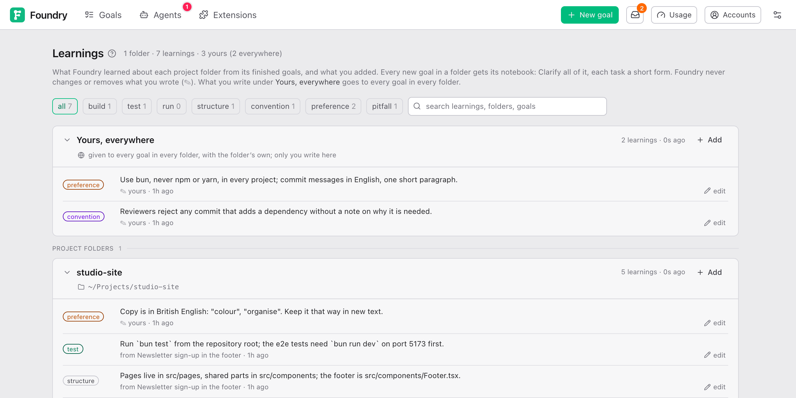

# Learnings

> English · [中文](./learnings.zh.md)

Every goal teaches Foundry something about your project: the command the tests need, where the pages live, the mistake that cost two attempts, the way you like things done. Foundry keeps these **Learnings** per project folder and gives them to every later goal in that folder, so it does not pay for the same lesson twice.

## Where they come from

- **When a goal ends** (done, over-delivered or failed), a short session on the goal's housekeeping model reads how it went: what you asked and decided, where it stopped for you and what you answered, the hints you gave, the attempts that failed and what they ran into, the warnings and the final review. It adds what is worth keeping about the project, merges repeats and drops what turned out wrong. A cancelled goal teaches nothing. With the `retro` skill installed (Claude), the session runs as a retrospective: it may read the goal's session transcripts, and it looks for what the next goal would have wanted — a pointer to the right file, a check that would have caught a mistake, a rule for the reviewer, an instruction that changed nothing.
- **On the pstack suite** the session takes pstack's `reflect` as its method — its judgment, tooling and divergent lenses, and what structure would enforce better than a note — in one session, editing no skill.
- **From you.** What you add or change is yours (✎). Foundry never changes or removes it. What you want in every project goes under **Yours, everywhere** (below).

The goal's **Activity** says what changed, for example *Learnings for this folder: +2 — added how the e2e tests start*. The session costs a few cents, counted in the goal's cost.

## What they do

- **Clarify** reads all of a folder's Learnings, yours first, before it asks questions and plans.
- **Every task** gets them in short, under *Notes on this repository*: build, test and run commands and pitfalls first.
- They are a starting point, not a rule: where the code says otherwise, the code wins.

A folder keeps at most 30 learnings, of at most 300 characters each.

## Yours, everywhere

Some of what you want is not about one project: the package manager you use, the language of your comments and commit messages, a rule every reviewer should hold, a thing you never want done. The first card on the Learnings page, **Yours, everywhere**, is a notebook for that. Only you write in it, and every goal in every folder is given it with the folder's own Learnings: Clarify under a line of its own, each task in the short form, where your entries come first. It is written into every folder's `foundry-learnings` skill too, as a last section, so your own sessions read it. Where a folder's Learnings or the code say otherwise, they win.

## Shared with your own sessions

Each folder's Learnings are also written into the repository as a project skill, `foundry-learnings` (under `.claude/skills` for Claude Code and `.agents/skills` for Codex), so your own sessions there read them too. The file is kept out of git, rewritten whenever the Learnings change and when a goal starts in the folder, and removed with the last entry. Edit the Learnings on their page, not the file. **Settings → New goal defaults → Share Learnings with your own sessions** turns it off and removes the file.

## Seeing and editing them

- **⚙ → Learnings** shows every folder that has some as a card you can fold. Each learning reads in two columns: its kind, then the text with where it came from under it (the goal, or **✎ yours**). The chips at the top (**all**, **build**, **test**, … **pitfall**) show one kind and count each; the search box finds a word in the learnings, the folders or the goals; **expand all** and **collapse all** open or fold every card, and the page remembers the ones you folded.
- A goal's page links to its folder's Learnings (**Learnings for this folder: N**). The **New goal** form says how many a folder has once you pick it.
- **Add** on a folder's card opens a window to write a new learning: its kind and the text. **edit** under a learning opens the same window on that one, to change it (**Save**) or to **Remove** it.
- On a finished goal, **More ▾ → Learn from this goal again** runs the session for that goal once more.

## Turning it off

**Settings → New goal defaults → Learn from finished goals** stops the sessions at the end of goals. The Learnings a folder already has, yours included, are still given to later goals: remove them on the Learnings page to stop that.

Learnings stay on this computer: a [Transfer](./moving-to-a-new-computer.md) moves goals, not Learnings.
