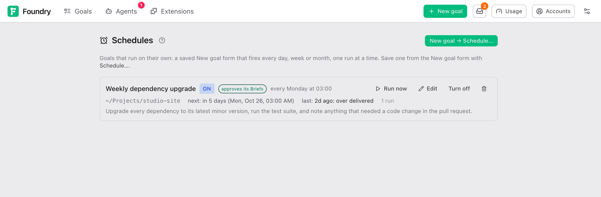

# Schedules

> [English](./schedules.md) · 中文

有些 goal 每次都一样：升级依赖并跑测试、审计仓库、刷新文档。**Schedule** 就是存下来并加了时间的 New goal 表单：每天、每周某一天、或每月某一天，Foundry 用它生成一个 goal 并跑完，不需要有人守在键盘前。⚙ 菜单里的 **Schedules** 页面列出它们。

## 创建一个

像创建 goal 一样填 New goal 表单：描述、文件夹、coding agent、workflow 开关、交付方式、预算。然后按 **Schedule…** 而不是 **Create & clarify**：

- **Name**：每次运行都是一个以它命名、带上当天日期的 goal。
- **When**：**every day**，**every week** 选一个星期几，或 **every month** 选一天（1 到 28，这样每个月都有），加上这台电脑时钟上的一个时间。
- **Approve each run's Brief for me**（默认开启）：跳过访谈，里程碑不暂停，Brief 写好后由 Foundry 自己批准；预算为 **Auto** 时采用 Brief 提议的预算。关闭：每次运行都是普通 goal，访谈和 Brief 都等你。

**Save schedule** 把表单保存为这个 schedule 的配方。附件里的链接会附到每次运行上；上传的文件、参考和 issue 不会保留，因为它们只能给一次。

先从 **Quick** 或固定预算开始：schedule 在你不在时花钱，预算就是让失控的运行停下来的那道闸。见 [费用与用量](./costs-and-usage.zh.md)。

## 一次运行是什么

一次运行就是一个普通的 goal：有 Brief、任务、检查、审查和交付，也会拿到这个文件夹里之前的 goal 学到的东西（[Learnings](./learnings.zh.md)）。goal 页面的标题下会写 **From schedule**；goal 列表里有一个 ⏰ 标签。运行需要你时，它会像任何 goal 一样进入 Inbox 和你的通知渠道；有只有你能回答的问题的 Brief 会等你，哪怕这个 schedule 会自己批准 Brief。

一次只跑一个：上一次运行还没结束时，schedule 会跳过这一轮，并在页面上说明。Foundry 关机时错过的运行，会在它回来后补跑一次（标为迟到），之后从那一次开始计算。

## Schedules 页面

每个 schedule 显示下次什么时候触发，以及上一次运行的结果，并链接到那个 goal。**Run now** 立刻触发（上一次运行还在进行时会拒绝）。**Edit** 打开填好配方的 New goal 表单；**Save schedule** 写回去，节奏从这次编辑开始计算。**Turn off** 让它不再触发；**Turn on** 从那时起重新计算。**Delete** 删除 schedule，它生成的 goal 保留。

[Settings → Notifications](./settings.zh.md#notifications) 里的 **Schedule fired** 开关会在 schedule 触发时发消息：生成了哪个 goal，或者为什么没有生成。命令行里 `foundry schedules` 列出它们，`foundry schedules run <id>` 触发一个。

Schedule 属于这台电脑：[Transfer](./moving-to-a-new-computer.zh.md) 不会带走它们。
