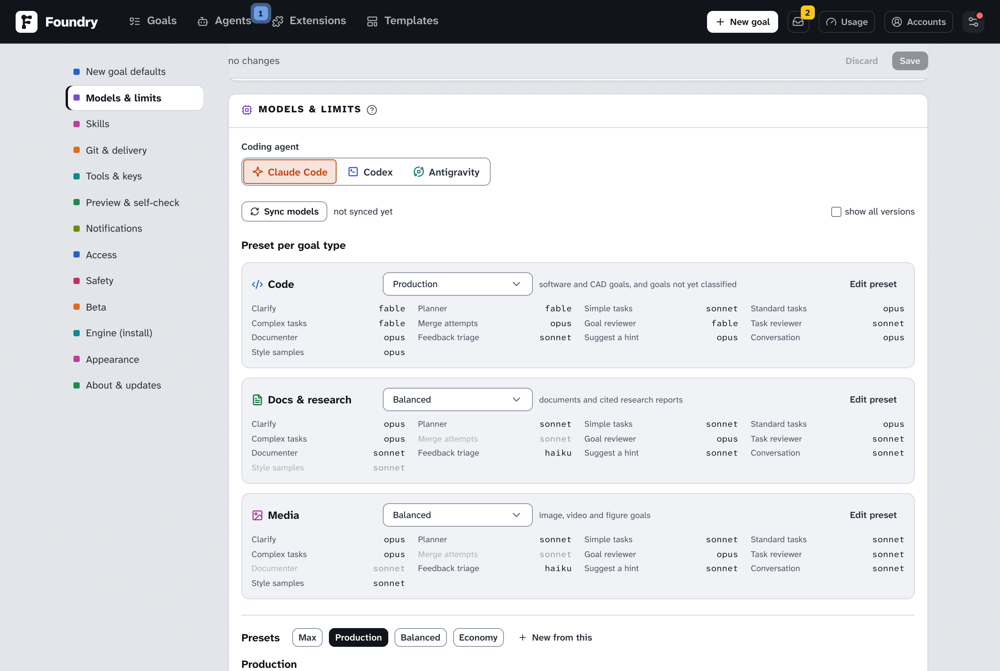
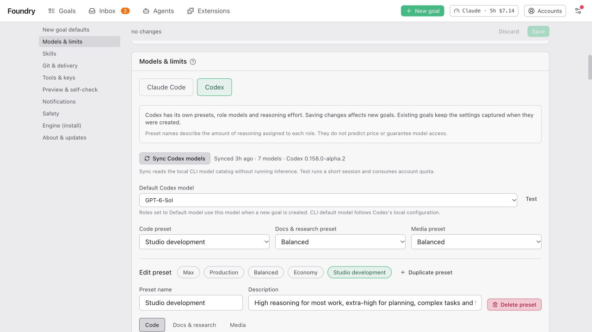
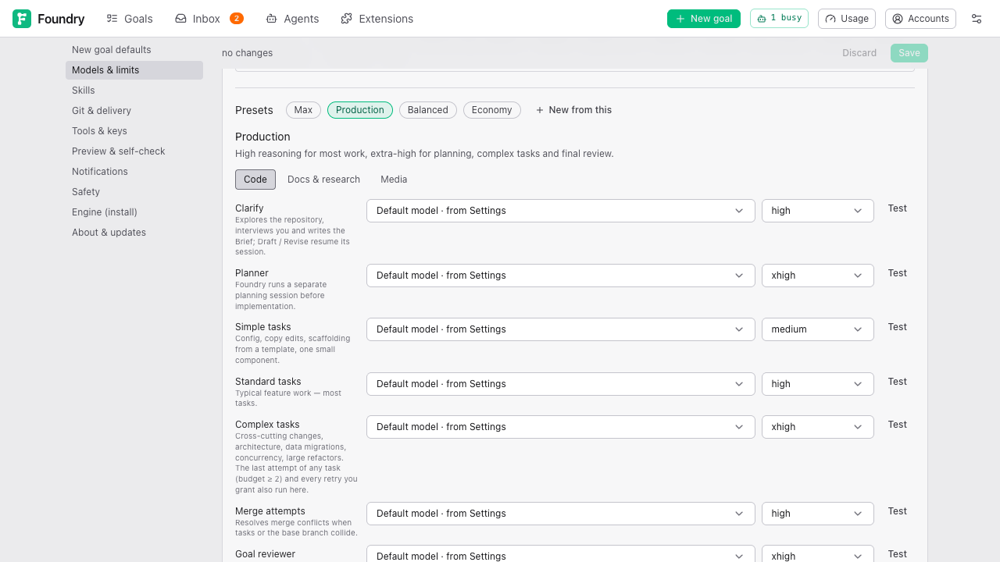
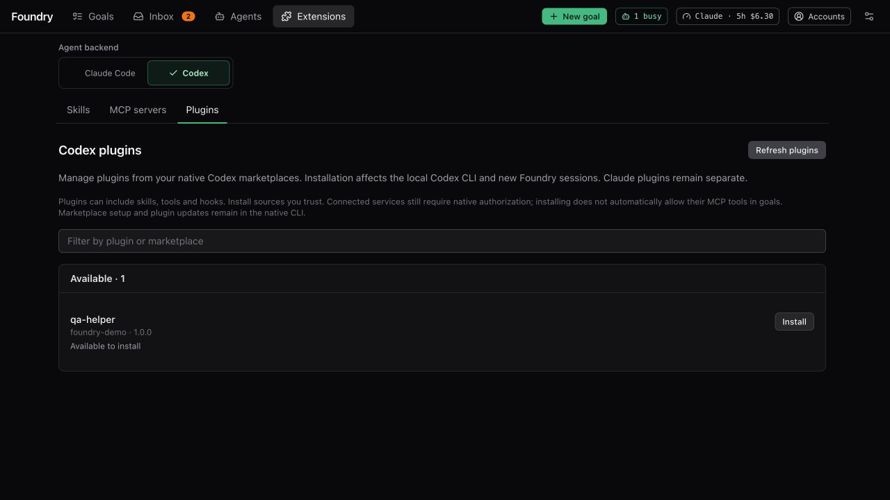
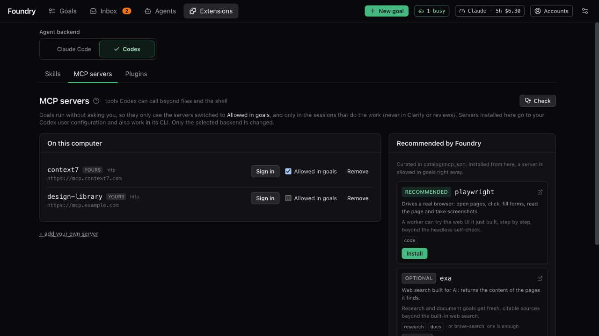

# Settings explained

> English · [中文](./settings.zh.md)

## Three coding agents

**Models & limits** uses the shared **Coding agent** selector for **Claude Code**, **Codex** and **Antigravity**. Each provider has its own model choices: presets for Claude Code and Codex, one model and effort for Antigravity. Codex goals capture their role models, reasoning effort and fallback order when created; edits affect new goals. **Claude cost cap per session (USD)** applies only to Claude. **Concurrent agent sessions** is one total limit across all of them.

**Engine (install)** exposes each CLI's path, and the Claude Code and Codex homes. The **Default coding agent** is chosen at launch; it does not restrict the **New goal** selector. Keep the original launch profile when opening an existing data directory so legacy records retain their provenance. Existing separate directories are not automatically merged.

**Setup** and **Extensions** each let you select **Claude Code**, **Codex** or **Antigravity**, independently of the launch profile. Installs, updates, trash, OAuth and MCP permissions target that selection. Codex loads its home skills plus shared `.agents/skills`; its per-goal autoskills installer writes `.agents/skills` and copies them into task worktrees without committing them. Use **Extensions → Codex → Plugins** for native plugin installs and removals. Antigravity reads skills only from a goal's workspace: Foundry installs them in the shared `~/.agents/skills` (Codex and the skills CLI read it too) and links the installed ones into each goal's workspace, kept out of git. Antigravity takes no plugins from Foundry, so text-to-cad is not available for it, and it keeps its MCP servers itself (`agy mcp add`, `agy mcp list`): **Extensions → MCP servers** says so instead of listing them. Skill invocation telemetry is unavailable for Codex and Antigravity, so reviewers judge the work rather than infer a skipped invocation.

Open the ⚙ menu at the right of the top bar and choose **Settings**. The sections are listed on the left, each with its colour (on a phone or a tablet, as a row of chips in the bar that holds **Save**); this page follows them in order and explains, in plain words, the controls you might want to touch and when. The exact keys, defaults and environment variables are in the operator reference, [configuration.md](../operate/configuration.md).

## How Settings works

- Change what you want, then press **Save** in the bar at the top (it says **N unsaved**). **Discard** throws your changes away. One exception: choosing a skill pack under [Skills](#skills) saves the moment you click it.
- Most changes apply at once. A few are marked **restart**: they apply after Foundry restarts.
- Each setting has a small badge: **default** (never changed), **saved** (you changed it here) or **env** (set by whoever installed Foundry). The ↺ arrow next to a saved value forgets it and goes back to the default.

## New goal defaults

What a new goal starts with. Most of them can be changed for one goal on the New goal form.

| Setting | Default | What it does |
|---|---|---|
| **Default goal view** | expert | Which view a goal opens in: simple or expert. |
| **Pace for new goals** | thorough | **thorough — engine reviews the work**, or **fast — approved checks only**. Image and video goals always start fast. |
| **Have a look: pause new goals at milestones** | on | A goal pauses for the final walkthrough once every task is done, and when a milestone without a script lands, so you can look. Off: it goes on, and what each milestone shows is sent to your notification channels. Each goal has its own switch. |
| **Interview depth** | 3 | How deep the Clarifier questions you before the Brief: from **Skip** (no questions) and **1** (only what a wrong guess would waste) to **5** (every detail, until nothing is left). See [Interview depth](./your-first-goal.md#interview-depth). |
| **Effort for new goals** | Role preset / CLI default | A goal-wide override, **low** to **max**. Default uses Codex role presets, the Antigravity effort or Claude's CLI default. |
| **TDD for new Expert goals** | required | Test-first: **required**, **preferred** or **off**. |
| **Workflow suite for new goals** | mattpocock | Whose skills the roles follow: **mattpocock** (Matt Pocock's suite), **pstack** (pstack's suite, with Matt Pocock's skills where it has none) or **plain** (no rules; sessions only hear which skills are installed). Each goal fixes its own on the New goal form. See [Workflow suite](./your-first-goal.md#workflow-suite). |
| **Ponytail for new goals** | on | The lazy senior dev: workers write the smallest change that fully solves the task and reuse what exists, the planner plans lean, and `ponytail-review` reviews. TDD still decides how tests are written. Each goal has its own switch. See [Ponytail: less code](./your-first-goal.md#ponytail-less-code). |
| **Learn from finished goals** | on | When a goal ends, a short session adds what it taught about the project to that folder's [Learnings](./learnings.md), which later goals there are given. Off: nothing is learned automatically; the Learnings you keep are still used. |
| **Second opinion on every Brief** | off | Once a goal's Brief is ready for your approval, a reviewer that did not write it reads it against the repository and proposes what to change, on the goal reviewer's model: a checklist on the Brief page you apply or not. Off: the Brief page still has the button. See [Second opinion](./approving-the-brief.md#second-opinion). |
| **Share Learnings with your own sessions** | on | Writes each folder's Learnings into the repository as a project skill (`foundry-learnings`, kept out of git) that your own coding-agent sessions there read; rewritten whenever the Learnings change. Off: the file is removed. |
| **Audit at the end of new goals** | off | New goals run `ponytail-audit` on the finished branch before the final review; must-fix findings in the code the goal touched become fix tasks. Chosen per goal at Brief approval. |
| **Browser QA at the end of new goals** | off | New goals with a web app: once every task is done, one session opens the finished app in Chromium and tries each acceptance check with Playwright; a must check that fails becomes a fix task before the final review. Chosen per goal at Brief approval; needs Chromium for Playwright. |
| **Goal-level fix cycles** | 1 | How many times the final review may send fix tasks before asking you. Thorough pace only. |
| **Small goal (diff lines)** | 400 | A goal that changed this many lines or fewer gets a lighter, cheaper final review. 0 = never. |
| **Review every task** | on | A short review of every task, even when the Brief did not ask for one. Thorough pace only. |

Under **Delivery — what happens to the branch when a goal finishes**: **Mode for new goals** (local only), **Granularity** (one PR per goal) and **Remote** (origin). See [Getting the result](./getting-the-result.md).

Good to know: the New goal form starts from these defaults. **Default goal view**, **Pace**, **TDD**, **Ponytail**, **Workflow suite**, **Effort**, and the delivery **Mode for new goals** and **Granularity** are filled in from here, and the form picks the **Remote** named here when the project has it.

Picking a ready repository folder replaces untouched **Workflow suite**, **TDD** and **Ponytail** with the current saved choices of its newest goal by creation time. The folder path must match exactly; goals still held as imported history are excluded. During validation, or if the folder is invalid, has no commits or has no earlier goal, untouched fields use Settings defaults. Revalidation refreshes inherited values.

A **Follow-up** opened from a goal page uses the chosen earlier goal instead. Later Settings and folder responses do not replace its workflow choices. Manual edits stay, except that an arriving Follow-up draft replaces **Workflow suite**. The on-page **Follows** picker only links goals. See [The New goal form](./your-first-goal.md#the-new-goal-form) for the source note and the Simple-view and Fast-mode TDD rules.

**Interview** and the model preset follow Settings whenever the form is left at its default. Selecting **Default** effort for Codex explicitly uses role preset efforts. The form itself remembers, in this browser, the kind of goal, the budget and the finer delivery options (such as the merge method).

When to change: raise **Interview depth** if you like to be asked about details; set **Effort** lower if most of your goals are small; lower **Goal-level fix cycles** to 0 if you would rather see failed reviews yourself.

## Models & limits

This section decides which model does each job. Choose **Claude Code**, **Codex** or **Antigravity** under **Coding agent**; their model settings are independent. The Claude Code and Codex panels have the same layout ([Antigravity's](#antigravity-model) is one model and one effort): **Sync models**, **Preset per goal type**, the **Presets** editor, then **Other models**. Session limits appear below the selected coding agent’s model settings.

### Codex presets and models

With **Coding agent → Codex** selected, pick a preset for **Code**, **Docs & research** and **Media** under **Preset per goal type**. Each card lists every role as model · effort, for example `Default · high`; **Default** means the role uses **Default Codex model**. The defaults are Production for code and Balanced for the other goal types. These names are independent from Claude presets:

| Preset | Reasoning profile |
|---|---|
| **Max** | `xhigh` for every role; requires a compatible model. |
| **Production** | Mostly `high`; `xhigh` for Planner, Complex tasks and Goal reviewer, `medium` for Simple tasks and Feedback triage, `low` for Housekeeping. |
| **Balanced** | Mostly `medium`; `high` for Planner, Complex tasks and Goal reviewer, `low` for Housekeeping. |
| **Economy** | `low` for every role. |

These profiles initially use **Default model · from Settings**. **Default Codex model**, under **Other models**, selects what that means for new goals. Leaving it as **CLI default model** follows the local Codex configuration; an explicit ID pins a model. Actual speed, quota use and availability depend on that model and your account. Foundry does not infer USD prices from preset names.

An Auto goal with the Default preset captures all three goal-type defaults at creation. It starts from the Code table for classification, then uses the captured table for its inferred type. Choosing an explicit preset instead keeps that preset across goal types.

Press **Edit preset** on a card, or click a preset's name under **Presets**, then pick the **Code**, **Docs & research** or **Media** table. Every role row has a model dropdown, a reasoning effort dropdown and **Test**. A dot • marks a role you changed; hover it to see the shipped value. **Housekeeping** is part of the Codex preset. **Planner** runs in a separate Foundry planning session. Model metadata narrows the effort choices when available; **CLI default** leaves the effort unset. **Custom model ID…** accepts a newer or private model absent from the catalog.

**New from this** creates an editable copy with a **Name** and **Description**. Editing a built-in marks it **modified**; **Reset** restores its shipped tables. **Delete** removes a custom preset and returns goal types using it to their built-in defaults. Press **Save** to apply these changes to new Codex goals. Existing goals retain their captured settings even if the original preset is renamed or deleted.

**Sync models** reads the local CLI catalog without running inference. A listed model is not proof of account access. **Test** deliberately runs a short session for the chosen model and effort; it consumes account quota. The result reports availability, with USD cost unavailable. It does not run automatically when you select or save a model.

Under **Other models → Fallbacks (in order)**, use **Add fallback**, the arrow buttons and the remove button to choose an ordered chain. **CLI default model** here follows native Codex configuration, independently of the base model in Settings. New goals capture that order. Only a model-unavailability error triggers fallback; account, quota and unsupported-effort errors do not silently change models. With an empty chain, an unavailable model asks for your decision.

### Presets

The following preset controls describe the **Claude Code** tab. Its existing model profiles and behavior are unchanged.

A preset is a table: for each job, which model does it. The jobs are:

| Job | What it is |
|---|---|
| **Clarify** | Reads your project, interviews you, writes the Brief. |
| **Planner** | Splits the goal into tasks while clarifying. |
| **Simple tasks**, **Standard tasks**, **Complex tasks** | The workers, by the difficulty set on the Brief. |
| **Merge attempts** | Combines two tasks that changed the same lines, and resolves conflicts when the base branch has moved. |
| **Goal reviewer** | The final review of the whole result. The most expensive single session. |
| **Task reviewer** | The short review of each task. |
| **Documenter** | Writes the completion documents. |
| **Feedback triage** | Turns what you write at a milestone into a plan. |
| **Suggest a hint** | The AI diagnosis for a blocked task in the Inbox. |
| **Conversation** | The Explainer that answers your questions on the goal page ([Conversation](./while-it-runs.md#conversation), beta). |
| **Style samples** | The sample images on the Brief. |

Four presets come with Foundry:

| Preset | In short | Code table |
|---|---|---|
| **Max** | The most capable model (Fable) everywhere. Best results, highest cost. | Fable for everything. |
| **Production** | Fable where judgement matters (planning, hard tasks, the final review), Opus for the bulk. | Fable: Clarify, Planner, Complex tasks, Goal reviewer. Sonnet: Simple tasks, Task reviewer, Feedback triage. Opus: the rest. |
| **Balanced** | Opus for planning and hard tasks, Sonnet for most work and reviews, Haiku for small checks. | Opus: Clarify, Planner, Complex tasks. Haiku: Task reviewer, Feedback triage. Sonnet: the rest. |
| **Economy** | Sonnet for planning and most work, Haiku for simple tasks and small checks. Lowest cost. | Haiku: Simple tasks, Task reviewer, Feedback triage. Sonnet: the rest. |

Each preset has three tables, one per kind of goal: **Code**, **Docs & research**, and **Media** (images and video). They differ slightly; Settings shows each one. Presets use family names (Fable, Opus, Sonnet, Haiku), so they follow new model releases by themselves.

### Preset per goal type

Under **Preset per goal type** you pick which preset each kind of goal uses:

| Goal type | Used for | Default |
|---|---|---|
| **Code** | software and CAD goals, and goals not yet classified | Production |
| **Docs & research** | documents and cited research reports | Balanced |
| **Media** | image and video goals | Balanced |

Under each choice is a preview grid: every job and the model it will use. Greyed rows are jobs that kind of goal rarely runs. A single goal can use another preset: the **Models** choice on the New goal form.

When to change: pick **Economy** or **Balanced** for Code to spend less (see [Costs and usage](./costs-and-usage.md#ways-to-spend-less)); pick **Max** when quality matters more than cost.

### Editing a preset

Press **Edit preset** next to a goal type, or click a preset's name under **Presets**, to open the editor.

- Pick **Code**, **Docs & research** or **Media**, then change the model of any job. A dot • marks a cell you changed; hover it to see the shipped value.
- **Editing a built-in preset** (Max, Production, Balanced, Economy) marks it **modified**, in the editor and in the dropdowns. **Reset** puts back what Foundry ships. If Foundry later ships a better default for a preset you changed, it says **newer default available**.
- **New from this** creates your own preset, starting as a copy of the one shown ("Production copy"). Give it a **Name** and a description.
- **Your own presets** can be renamed at any time in the **Name** field, and removed with **Delete**. Goals still running on a deleted preset continue on their goal type's preset; goal types that used it go back to their default.

Changes apply when you press **Save**: to new goals, and to running goals from their next session.

### Antigravity model

With **Coding agent → Antigravity** selected, the section holds the **Antigravity model** every role of a new Antigravity goal runs on (**Antigravity default** follows the model the CLI itself is set to; **Sync models** lists the account's models with `agy models`, which runs no model, and **Custom model slug…** takes one by hand) and the **Reasoning effort** of every role (low, medium, high, xhigh or max). A goal snapshots both when it is created. Antigravity reports tokens, not dollars, so its goals keep time, attempt and concurrency limits and never a USD budget; there are no presets and no fallback order. See [Run Foundry with Antigravity](../operate/antigravity.md).

### Sync models

**Sync models** asks your Claude Code which models it knows (free) and checks what Fable, Opus, Sonnet and Haiku currently mean, with one tiny session each (about $0.04 in total). The line next to it says when it last ran, with which Claude Code version, and how many models it found.

It also runs by itself when Foundry starts and notices that Claude Code was updated since the last sync. Press it yourself after updating Claude Code if you want to see new models right away.

### Model dropdowns

Every model choice in the preset editor offers:

- **Latest of each family**: Fable, Opus, Sonnet, Haiku. The arrow shows the exact model each name currently means, for example `Opus → claude-opus-…`. These follow new releases. Most people should stay here.
- **Pinned (newest found)**: the exact newest version of each family, found by a sync. Choose one to stay on that version even when a newer one comes out.
- **Older versions**: only when **show all versions** (next to **Sync models**) is ticked.
- **custom id…**: type any model name Claude Code accepts.

### Housekeeping model

**Housekeeping model** (default Haiku), under **Other models**, does Foundry's own one-line chores: deciding what kind of goal it is, summarising logs, checking your usage limit. It costs cents per goal. The only model not set by a preset. **Test** runs one tiny session to confirm the model works and shows what it resolves to.

### Fallbacks

**Fallbacks (in order)** (default `opus, sonnet, haiku`): when a model is unavailable (retired, mistyped, not in your plan), Foundry re-runs that session with the next one in this list and remembers the replacement for that goal. Only when all of them fail does it ask you. The goal's Overview shows a **Model fallback** card when this happened.

### Last attempt on the Complex-task model

On by default. When a task is allowed two or more attempts, its last attempt, and every extra attempt you grant from the Inbox, runs on the preset's **Complex tasks** model. A task that failed on a cheaper model gets one more chance on the strongest before it comes back to you. The Activity tab says when it happens. Turn it off only if cost matters more than finishing.

### Limits

**Limits — what one session may spend before the engine stops it**:

| Setting | Default | What it does |
|---|---|---|
| **Claude cost cap per session (USD)** | 10 | A Claude worker stops at this spend (and never spends more than the goal has left). Codex has no USD cap. |
| **Attempt timeout (minutes)** | 20 | A session running longer is stopped. What it committed stays; Foundry resumes or retries. |
| **Continuations per attempt** | 2 | How often a stopped session is resumed (cheaper, it keeps what it read) before a fresh attempt starts. |
| **Turn cap per session** | 150 | Model turns for Claude; tool calls for Codex; three tool calls per turn for Antigravity, which calls a tool for every file it reads. Keep it generous. |
| **Concurrent agent sessions** | 3 | Total simultaneous sessions across both providers and all goals. |
| **Reference investigation: cost cap** | $3 | The session that studies a goal's reference with REA before Clarify stops at this cost and writes up what it found so far. |
| **Reference investigation: minutes** | 20 | Its time cap. |
| **Account switch on a usage limit** | off | Whether a usage limit moves new sessions to the coding agent's next account. Shown here, switched on the Accounts page: see [Several accounts](./costs-and-usage.md#several-accounts). |

When to change: raise the timeout or Claude cost cap if big tasks keep getting cut off; lower **Concurrent agent sessions** if you hit your plan's usage limit often.

## Skills

Skills are packaged instructions the coding agent can follow. **Coding agent** selects which coding agent's installation status and actions you see; workflow pack choices are shared.

- **Workflow suite** (under [New goal defaults](#new-goal-defaults)): whose skills the roles follow. **mattpocock** (default) tells workers which working method to follow (tests first for features, diagnose first for bugs, the `writing-for-agents` skill when a task edits `AGENTS.md`, `CLAUDE.md` or a skill) and records whether they did; with the `retro` skill installed, the session that writes a goal's [Learnings](./learnings.md) runs as a retrospective. **pstack** follows pstack's suite, with Matt Pocock's skills where pstack has none. **plain** only mentions which skills are installed. Each suite comes from one pinned release, so its skills do not change between goals; every goal fixes its suite when it is created. The pstack suite is installed from the Setup page as one unit and shows on this page as one source, **pstack suite · v0.9.93**, under Managed by Foundry; **Re-sync** puts the copy back at the release in use; to take a later release of either suite, see [Workflow suite releases](#workflow-suite-releases).
- **Setting sources** (Claude only): which Claude Code settings sessions load. Leave empty.
- **autoskills per goal** (on): after you approve a Brief, adds skills matching your project's technology (React, Tailwind…) to the goal's folder. They never reach your commits.
- **MCP tools that run or change things** (off): lets sessions use the tools of allowed MCP servers that run or change things. For REA: launching the target app, attaching a debugger, touching a connected Android device. Off, sessions get static analysis only.
- **Design skills**, **Image skills**, **Video skills** (and **Figure skills** while [Figure goals](#beta) is on): pick one pack for each; only that pack is given to frontend, image, video or figure tasks. The Figure pack's two skills are bundled with Foundry, so installing copies them without a download, and a goal may pick the other installed style on the New goal form; see [Figure goals](./figures.md). A pack shows **installed** or **N missing** with an **Install** button. Choosing a pack saves immediately. Image packs only produce real images with a key under [Tools & keys](#tools--keys). When an installed skill lacks the key it needs, its card shows **⚠ key missing** with the key's name and what is lost without it; click it to go to **Tools & keys**.
- **Memory** — a Hindsight server that remembers what each folder's goals did and taught — is not set up here but on the Extensions page, MCP servers tab (the card links there); each folder's switch is on the Learnings page. See [Memory](./memory.md).

The **Extensions** page in the top bar holds your skills, MCP servers and native Codex plugins. Every group on it starts closed, so the page is a short list: click a group's name to open it. A search or a filter opens every group with a match, and a closed group's heading says when a source in it has an update. The following skill update and plugin-bundle details describe Claude. For Codex, **Skills** lists native and shared skills, and the skills inside each plugin Codex has switched on, grouped by plugin (Codex updates and removes those itself; the row says how). A skill installed outside Foundry shows up the next time the page loads. **Plugins** lists the native packages themselves. A design or image pack that comes as a plugin counts as installed when Codex has that plugin. Shared skills (in `~/.agents/skills`, which other agents read too) can be uninstalled there, including hand-installed ones; they go to the trash and can be restored to the same folder. One that Claude Code also uses through a link in its own skills folder cannot: uninstall it on the **Claude Code** side first, so Claude Code is not left with a broken link. Each skill has a state: **outdated** (a newer version is out — press **Update**), **unreleased** (a plugin's author changed it upstream without raising the version number, so the CLI has nothing new to install yet), **modified** (your copy was edited) or **up to date** (a difference in a README or changelog alone does not count). A command-line tool such as ffmpeg counts as installed as soon as its command is found. A plugin's skills can only be removed together, with **Uninstall plugin**. A copy you installed by hand offers **Adopt** when Foundry can install that skill itself: the copy is replaced by one Foundry keeps up to date. A folder that is a link, or whose `SKILL.md` is a link, into another folder (another tool's install, your own clone) is listed under **Linked from another folder** and left to where it links: no **Adopt**, never a stale copy of a plugin skill that shares its name, and installing a bundle keeps it. Every install, update, adoption or uninstall you start there opens a tab in the **Operations** bar at the bottom of the page, with its own log; several can run side by side. A finished tab stays until you close it, and the bar folds down to a line with counts. On the right, the **Catalog** stays in view while you scroll the list; click a skill's name there to open its details in a window: why it is in the catalog, how it stands on this computer, where it comes from, and which roles follow it under which rules. **Install required**, **+ recommended** and **+ optional** install everything still missing up to that tier, and a tier with missing skills shows **Install N** in its heading for that tier alone; what is already installed is left as it is.

On the **Claude Code** side, each user-level and plugin skill also shows whether Foundry's sessions use it, counted over the newest 30 Claude Code goals in any state (all of them while there are fewer): **used in 4 goals · last 2d ago**, or an **unused** chip (hover it: *no session invoked it in the last 7 goals*) when no session of those goals invoked it. The line under the heading counts them, for example **3 of 42 installed skills were never used in the last 7 goals**, and **unused only**, next to **needs attention**, keeps just those rows. Before the first goal it reads **No goals yet: skill usage is unknown** and nothing is marked. Project skills are left out: sessions read them without invoking them. An unused skill still weighs on every session's context, so it is one to consider uninstalling; Foundry never removes one for you. Codex reports no skill invocations, so its view shows none of this.

### Workflow suite releases

Above the sources, **Workflow suites** lists Matt Pocock's skills and pstack, each with the release it is at. Foundry pins one; **pinned by Foundry** or **moved by you** says who chose it. The row also says how this computer has the suite (Foundry's copies, a Claude plugin or Foundry's suite copy) and whether a newer release is out: **v1.4.0 available**, with a one-line forecast such as **+2 new · 1 removed · 24 stay**. When the newest release no longer ships a skill Foundry's workflow uses, a yellow note on the row names it and what the workflow does with it, for example *grilling: the Clarifier prefers it*, before you open anything.

**Preview** opens the forecast for the release picked under **Release**. It lists the skills that release removes, the ones Foundry's workflow uses first; **deprecated upstream** marks one the repository moved to a `deprecated/` folder, and the changelog lines that say what became of it follow. Then come the new skills and the changelog's headings in between. **Move to v…** under the forecast moves the suite:

- Foundry's copies are updated, and a skill the release no longer ships goes to the trash (restore it from the **Trash** tab).
- A Claude plugin's marketplace is pinned to the new tag in Claude Code's settings and the plugin is updated. Restart your own Claude sessions to load it.
- pstack's copy is re-synced.

The move runs as a tab in the **Operations** bar and is refused while a goal runs. You can move to any release from Foundry's pin onward, and back to the pin. A later Foundry update that pins a newer release than yours takes over. **Re-sync** shows when what is installed is not at the release in use, for example after such an update.

### Skill compatibility

Compatibility depends on a skill’s tools and dependencies, not its author. The catalog selects installation recipes for **Coding agent**; Claude-only recipes do not appear in the Codex catalog or its workflow hints.

| Skill | Codex behavior |
|---|---|
| Anthropic `frontend-design` / `webapp-testing` | Portable instructions. Web testing additionally needs Python, Python Playwright and Chromium. |
| `skill-creator` | Uses OpenAI’s version. If an older Anthropic copy is present, expand **Catalog**, find `skill-creator` and use **Replace**; the old copy goes to trash. Shared skills remain managed at their original location. |
| `claude-api` | Optional reference for projects using the Anthropic SDK. It does not switch Foundry’s login or require Claude as the executing agent; it is not automatically suggested to every worker. |
| Graphify / Impeccable | Use the Codex installation recipe / native skill directory. Update an older Foundry-managed Impeccable copy to select the current native variant. |
| Claude plugin recipes | Not offered in the Codex skill catalog; native Codex plugins have their own **Plugins** tab. |
| Image / video skills | Still need their rendering tools, project dependencies and any service credentials. ChatGPT login does not provide image API keys or the desktop app’s image tools to headless sessions. |

An **installed** label means the skill was found, not that every optional tool or service has been configured. Personal/shared skills are still visible; Foundry does not remove them when the selected catalog changes. If an explicit upstream skill path disappears, installation reports the missing path rather than choosing a same-named skill for another agent.

### Codex plugins

Select **Codex**, then **Plugins**. **Installed** and **Available** list packages returned by your native marketplaces; filter by plugin or marketplace, or use **Refresh plugins** after a change in the CLI. **Install** and **Remove** open a confirmation dialog, then show progress in **Operations**. The list refreshes after completion. Foundry checks the native installation state before showing success.

Installation shares the configured Codex home with the local CLI. New sessions load its enabled components. Install sources you trust: plugins can contain skills, tools and hooks. Removing a package removes its native user installation and cached package; reinstall from its marketplace to restore it. Changes are refused when Foundry reports active work. Claude plugins remain separate.

**Installed · disabled by native configuration** means the package is installed but disabled. **Managed in Codex** means the marketplace policy does not permit this page to change it. Configure marketplaces, update packages and enable/disable plugins in the native CLI. Connected services still need their own authorization, and installation does not grant **Allowed in goals** for MCP tools. If the installed CLI lacks compatible plugin JSON commands, the page reports **Native plugin list unavailable** and offers refresh.

### MCP servers

Select a coding agent at the top of **Extensions** before opening **MCP servers**. Codex servers use its native CLI configuration; **Check** opens a fresh native connection and discovers tools without running inference. Codex supports stdio and streamable HTTP, including HTTP OAuth sign-in; legacy SSE is unavailable. Native user-configured servers can be added, replaced and removed here. Running sessions keep their existing connections; new sessions see configuration changes. Claude and Codex have independent **Allowed in goals** switches, and Codex starts with no allowed servers.

The following connector and plugin details describe Claude Code. MCP servers give Claude Code tools beyond files and the shell: current library docs, a real browser, web search, your mail. The **Extensions** page has an **MCP servers** tab that lists the servers Claude Code loads for your account: the ones you installed (**yours**), the ones a plugin brings (**plugin**) and your claude.ai connectors (**claude.ai**). **Check** connects to each one and shows whether it works; it is not automatic because it starts every server.

Some servers need an account before they work. A claude.ai connector (Gmail, Google Drive, …) has a **Connect** button: it opens claude.ai, where you authorize it with the account it should use; Claude Code and Foundry share that connection. A server reached by URL has **Sign in**: a browser opens on the computer running Foundry, or, when there is none (Docker), you open the link yourself and paste back the address the browser ends on. If the sign-in cannot finish in Foundry, the window shows the command to run in your own terminal instead (for example `claude mcp login context7`), with a copy button. After **Check**, a server that still needs this shows **needs auth** and a **Set up** button.

Goals run without asking you, so a server's tools reach a goal only when its **Allowed in goals** box is ticked, and only in the sessions that do the work, never in Clarify or reviews. Servers you installed yourself and claude.ai connectors start unticked: a mail connector could send mail on its own.

**Recommended by Foundry** lists servers worth having. **context7** (current documentation for libraries) and **playwright** (a real browser) need no key and are recommended; Setup reminds you while they are missing. **exa** and **brave-search** add web search for research goals and need a key: press **Install…**, paste the key, then **Install**. One of the two is enough. A server installed from here is allowed in goals right away.

**rea** (optional) reverse engineers shipped software on this computer: native binaries, JavaScript and Electron apps, .NET, Android packages, websites and captures, with the evidence behind each conclusion. It is what a goal's [reference](./your-first-goal.md#reference) is studied with, and a worker that must understand an undocumented interface can use it too. Before it installs, Foundry asks you to confirm its terms once: software you own or are allowed to examine, no bypassing of licences or logins, no copying of proprietary code, and findings reach your model provider like any other context. Of its tools, the ones that run the target, attach a debugger or touch a connected device stay off in sessions until **MCP tools that run or change things** is on under [Skills](#skills). Native apps and binaries also need Hopper, Ghidra or IDA on this computer; the Setup page says whether one was found.

**+ add your own server** takes a name and a command or a URL. A command server can get its keys as `NAME=value` lines; a URL server signs in instead, with **Sign in** on its row. It starts unticked, and **Change key…** on an installed server's row replaces its key. Servers are installed for your whole user account, so they also work in the Claude Code in your terminal, and **Remove** takes them out of it too. Keys are kept by Claude Code with the server; Foundry keeps no copy. A plugin's server goes with its plugin; claude.ai connectors are managed on claude.ai.

If a task fails because a server's tool was refused, the Inbox says which server and offers **Allow this server and retry**.

## Git & delivery

How Foundry keeps up with the online copy of your project, and how long delivery waits.

- **Fetch the base branch before a goal starts** (on): Foundry looks at the newest version online before it plans. Your own folder is never changed.
- **Where the goal branch starts**: **auto — remote tip when local is behind** (default) starts from the newer online version when your folder is behind; **always the local branch** starts from exactly what is in your folder.
- **Refresh between tasks** (off): on long goals in busy projects, brings in newer work from the base branch between tasks. Off by default because mid-goal changes can surprise the workers.
- **Commit author**: who Foundry's commits are written by. **you, with Foundry as co-author** (default) uses your git identity — the project's, else your global one, else your GitHub account — and adds a `Co-authored-by: Foundry` line; **you only** leaves that line out; **Foundry only** writes them as `foundry`. Deploy integrations such as Vercel teams refuse commits by an author who is not a member, so keep one of the "you" options if you use one. It applies to commits made from now on.
- **Update my local base branch after a merge** (on): when a pull request merges, Foundry fast-forwards your own base branch when that is safe, then removes the goal's progress folder, worktrees and local branches. Off: you pull yourself, and the folders stay until you delete the goal. See [Getting the result](./getting-the-result.md#after-a-pull-request-merged).
- **Deploy — a finished web app to a host**: the tokens [Deploy](./getting-the-result.md#deploy) uses. **Vercel token** (vercel.com → Account Settings → Tokens) and, for a team, **Vercel team** (the team's slug, the part after vercel.com/); **Netlify token** (User settings → Applications → Personal access tokens) and **Netlify team** for new sites (the team's slug, the part after app.netlify.com/teams/, not its name; a slug the token cannot reach fails the deploy, which says so); **Cloudflare API token** with the permission *Cloudflare Pages: Edit* and the **Cloudflare account id**. Leave a host's fields empty to leave it off. The engine keeps them to itself: unlike the keys under Tools & keys, no coding session gets them.
- **Delivery timings (advanced)**: how often Foundry checks a pull request (**Poll interval (s)**, 30), how long it waits for CI to appear (**Grace before "no checks" (s)**, 90) and to finish (**Checks timeout (min)**, 30), and how long it waits for auto-merge when the branch is protected (**Auto-merge wait under branch protection (min)**, 10). Raise **Checks timeout** if your CI takes longer than half an hour.

## Tools & keys

- **Use graphify for relevant-file discovery** (on): uses a code map to find the relevant files, when that tool is installed.
Media-service keys below are separate from agent sign-in. Codex execution continues to use ChatGPT only; entering an image key does not enable API-key inference.

- **OpenAI-compatible API key**: needed for image goals to produce real images. Without it, image tasks fall back to hand-drawn SVG renders. **OpenAI-compatible base URL**: only for a proxy or another compatible provider.
- **Gemini API key**: an alternative for one of the image packs.
- **Kimi (Moonshot) API key**: used by one design pack's models, where a skill calls them.
- **MiniMax API key**: for video and narration through mmx. Leave it empty if you already signed in with `mmx auth login` on this computer; in Docker, fill it in.
- **ElevenLabs API key** and **Groq API key**: narration voices, and speech-to-text for video captions, when a video pack uses them.
- **markitdown binary**: the converter that turns attached documents into text. Leave empty.

**VS Code in the browser (code-server)** says whether it is installed; **Install code-server** installs it once into your home folder (about 150 MB, no administrator rights). It is what **Open ▾ → VS Code (web)** starts.

Keys apply to the next session, no restart. A saved key is never shown again, not even to this page: its field says `saved: sk-p…9f3a — type to replace`. Type a new one to replace it, or press ↺ next to the field to forget it. The Telegram token and Discord webhook under Notifications work the same way. More in [Costs and usage](./costs-and-usage.md#image-goals-need-an-image-key).

## Preview & self-check

The preview is the goal's result running, so you can try it (see [While it runs](./while-it-runs.md#preview)).

- **First port** and **Last port** (4200 to 4299): previews use the first free port in this range.
- **Idle minutes** (60): a preview nobody opened for this long is stopped. Never while a milestone waits for you.
- **Self-check new goals by default** (off): switch the self-check on for every new goal. Each goal also has its own switch, on the Brief's **How to run it** section and on its Preview card.
- **Install Chromium**: the self-check needs a hidden browser, downloaded once (a few hundred MB). The line says **Chromium installed** when it is there.

When to change: turn the self-check on by default if most of your goals are web apps.

## Notifications

Foundry can message you on Telegram or Discord when something happens, so you do not have to watch the page. Setting up the bot or webhook is in [notifications.md](../operate/notifications.md); after that, press **Send test message**.

**Link base URL**: the address where you open Foundry from elsewhere (a LAN address, a domain). Messages link to it; without it they link to this computer (`http://localhost`). **Tailscale links** (auto) adds links on your tailnet when Tailscale runs here, for Foundry and for previews (not the CAD Viewer, which stays on this computer), so they open on your phone; **Tailscale name** overrides the machine's name. See [notifications.md](../operate/notifications.md#links).

**Answer from Telegram** (on by default): Telegram messages about something that waits for you carry buttons (Retry, Skip, Continue, Approve…), and a reply answers in words. Foundry reads your bot's messages while it is on, so give each Foundry its own bot. Commands outside the workspace are approved in the Inbox only. See [Answering from Telegram](../operate/notifications.md#answering-from-telegram).

**Discord bot token (buttons)**: optional, beside the webhook. Your bot then posts the messages that wait for you in the webhook's channel, with the same buttons; words are typed in a form the button opens. See [Answering from Discord](../operate/notifications.md#answering-from-discord).

The eight switches, all on by default:

| Switch | You get a message when | What to do |
|---|---|---|
| **Needs you** | A goal or task is waiting for you: a failed task, a blocked command, a budget reached, a milestone to look at. | Open the Inbox or the goal and answer. Until you do, that part waits. See [When Foundry needs you](./when-foundry-needs-you.md). |
| **Interview round** | Foundry asks a round of questions before writing the Brief. | Answer them; the goal waits for you. |
| **Brief ready** | A Brief waits for your approval. Never one Foundry approves itself. | Read it, then approve it on the Brief page or with the message's button. |
| **Schedule fired** | A [Schedule](./schedules.md) fired: the goal it made, or why none was made (its previous run still going). | Nothing, unless a run was skipped you expected. |
| **Goal finished** | A goal ended done, over-delivered or failed. Never when you cancelled it yourself. | Look at the result, or at what failed. |
| **Delivery** | A pull request was opened or merged, the delivery failed, a deploy ended, its smoke passed or failed, or a revert of a merged goal was opened, merged, closed or failed. | Review the pull request, or look at the Delivery tab. |
| **Usage pause** | A coding agent’s usage limit paused its new sessions, and again when retrying resumes; also when a usage limit moved new sessions to another account. Other coding agents can continue. | Foundry retries automatically; check Accounts and Usage if failures persist. |
| **New version** | A newer Foundry version is out (once per version). | Update when convenient, see [About & updates](#about--updates). |

Turn off what you do not want. The switches apply to every channel alike.

## Access

Who may use this Foundry from another device. With no one on the list — the default — there is no login: a single person on their own computer, or on their own tailnet, needs none. **Add the first person** makes a token for them and turns Access on: from then on every request needs a token, on this computer too, and the browser that made the first token is signed in with it, so no one is locked out.

A token is shown once; copy it and hand it over in private. On a phone or laptop, open Foundry's address and paste it on the sign-in page: that browser keeps it for 90 days (**⚙ → Sign out** forgets it). For the command line, set `FOUNDRY_TOKEN`; `foundry access` lists people, `foundry access add <name>` and `foundry access revoke <id>` do what the buttons do.

While Access is on, what a person does is recorded under their name: the goal page says who asked for the goal and who approved its Brief, and an Inbox item says who answered it. Answers from Telegram or Discord carry no name. **Revoke** takes a token back at once, on every device; revoking the last one turns Access off. Tokens are kept as fingerprints in `access.json` beside the data, never in the event log and never in a Transfer. Access is a light lock for people who already share a tailnet with you; it is not a reason to expose Foundry to the internet (see [remote-access.md](../operate/remote-access.md#give-each-person-a-token)).

## Safety

- **Extra boundary patterns**: commands Foundry must never let a session run on its own, on top of the built-in ones (pushes, pull requests, releases, publishing, deploys, cloud tools), for example `terraform apply|kubectl`. A blocked command comes to your Inbox for approval.
- **Folder browser roots**: which folders the **Select folder…** picker may open. Empty means your home folder and external drives.
- **Desktop apps & printers**: off by default. On, sessions may open desktop apps and hand files to printers on this computer — text-to-cad's Bambu hand-off (Bambu Connect, Bambu Studio), `open …`, `xdg-open`, the slicers' windows. Off, the boundary guard refuses those commands and the hand-off skill (Foundry does not point sessions at it either); headless slicing, preflight reports and part lookups still work. A refused command comes to your Inbox, where you can run it once yourself; a refused skill is noted on the goal page and the work goes on without it.

## Beta

Features on trial. Each is off until you switch it on here, may change or go away in a later release, and is marked **Beta** where it appears while it is on.

- **Conversation on the goal page**: a bubble at the bottom right of a goal's page and its Brief page opens a Conversation with the goal's **Explainer**, a read-only session of the goal's coding agent that answers your questions about the goal's code and Foundry's records of it, in a window beside the page. Its model is the preset's **Conversation** row. Off: no bubble and no Conversation tab; the Conversations already had are kept and come back when it is switched on again. See [Conversation](./while-it-runs.md#conversation).
- **Motion studio video engine**: video goals get an **Engine** picker on the New goal form, with the **motion-studio** engine (a deterministic renderer with a critique loop, [Motion studio](./motion-studio.md)) beside the Video skills pack; its bundled skill appears in the Extensions catalog and the doctor checks ffmpeg and Chromium for it. Off: the Video skills pack alone, as before.
- **Figure goals**: a kind of goal of its own — interactive isometric figures of everyday objects and machines, one web page each, drawn by the Figure pack (Colorfigures or iso-glow) and opened headless by Foundry when a task lands. On: **Figures** is among the kinds of goal, **Figure skills** under Skills, the CLI takes `--nature figure` and the doctor checks the tools. Off: none of that shows; figure goals made before still open. See [Figure goals](./figures.md).
- **Adjust the result**: a card on a finished goal's page takes your words on its result — what should change, with pictures or files — and the goal carries them out itself: the session that did the work picks up where it left off, or a task is added after the finished ones, or a failed goal's failed tasks run again. The checks and reviews run again, the output folder and an open pull request get the new result, and the earlier result is kept. It costs the goal, inside its budget. Off: no card; adjustments already made stay on the goal. See [Adjusting the result](./getting-the-result.md#adjusting-the-result).

## Engine (install)

Settings for whoever installed Foundry. Leave them unless you know why.

- **Port** (4111) and **Host** (127.0.0.1): where Foundry is reachable. Keep 127.0.0.1 unless you set up remote access. Restart needed.
- **claude binary** and **Claude Code home**: where Claude Code and its skills live. Empty finds them. Restart needed.
- **Codex binary** and **Codex home**: the Codex executable and native account/configuration directory. Empty uses PATH and `CODEX_HOME` or `~/.codex`. Restart needed. The launch profile is fixed; choose each goal’s coding agent on New goal.
- **Progress folders**: where each goal's folder is created. Empty puts it next to your project as `<project>-foundry/<goal>`. A folder here gives `<folder>/<project>/<goal>` instead. Applies to goals created from now on.

## Appearance

The theme and light or dark mode, for this browser only: each person and each device picks their own, and a change applies at once without **Save**. **Make a copy** under a theme writes it as a file to edit by hand. See [Themes](./themes.md) for choosing one and making your own.

## About & updates

Shows the version you run and how it is installed. **Check now** asks whether a newer version exists (Foundry also checks once a day). When one exists, the button **Update to X** appears, with what changed, and a pill in the top bar.

The update dialog:

- **Update**: new sessions stop, running ones finish, then Foundry updates and restarts. The page reloads by itself, and so does any other Foundry page left open, on this computer or a phone, within a minute of the new version starting. A page with an edit not yet saved (a Brief, a new goal, a folder's learnings) shows a banner instead, and reloads once you save or press **Reload**. A failed local code update attempts to restore the old checkout; this is not a database rollback. Back up before upgrading to mixed-provider data, and restore that matching backup if you must run an older binary.
- **Update immediately without waiting — interrupts running agents**: tick only if you cannot wait.
- **Not now** closes it.
- If this install cannot update itself, the dialog shows the commands to run instead.

**Open source credits**, at the bottom of the card, opens the projects Foundry is built on and the license notices of everything its Docker image ships. **Download .txt** saves the same notices as one file.

Details for operators: [updates-and-backup.md](../operate/updates-and-backup.md).
