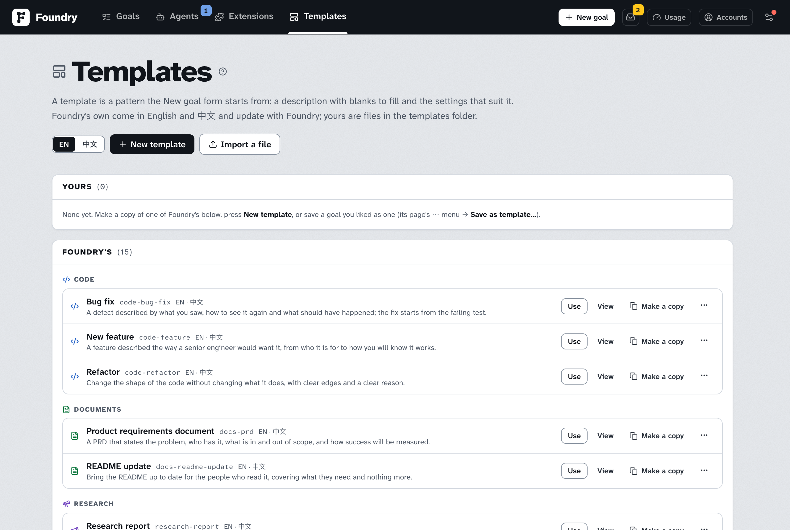

# Templates

> English · [中文](./templates.zh.md)

A **template** is a pattern the New goal form starts from. It is a goal description with blanks to fill (*the product*, *the length*, *who it is for*) and the settings that suit that kind of goal (its kind, Simple or Expert, the pace, the budget, how deep the interview goes). You fill in the blanks and the description writes itself; the form is set the way such a goal wants to be set; you still change anything you like before pressing **Create**.

Foundry ships a set of templates, two or three for each kind of goal, in English and 中文. Your own are files you make: from a goal you liked, from a copy of one of Foundry's, or from scratch.

## Starting from a template

On the New goal form, under *What kind of goal is this?*, **Start from a template…** opens the templates in a dialog: by kind, starting on the kind you chose (every kind while the form still says *Auto*), with a search. Each card names the template, says what it is for and how many inputs it asks. **EN / 中文** switches the language the templates are shown in; this browser remembers it.

Press a card and three things happen:

- The template's inputs appear above the description box, each with a label and a note on what to write. Those marked `*` are needed before the goal can be made; a choice offers its options, and sometimes a way to write your own.
- The description is written from your inputs as you type. The words are the template's; you can edit them at any time, and once you do, the inputs stop writing the description (**Write it from the inputs again** puts it back).
- The form takes the template's settings: the kind of goal, and whatever else the template says, for example a product reel sets *Video*, the motion-studio engine, the Simple view and the Thorough budget. What the template does not name stays as you had it.

The button then reads **Template: …**, and a chip of the same name above the inputs says which template is behind the form; its **×** forgets the template but keeps the words and the settings. If you had already written a description, choosing a template asks before replacing it.

The goal remembers its template: its page shows **template: …** among its facts.

## Filling in with AI

Under the inputs, **Fill in with AI** takes your notes — a few lines in any words about what you have in mind — and fills the inputs from them. It keeps to your notes: it never invents a name, a number or a date you did not give, and leaves empty what you did not say. What it wrote is shown first; **Use these** puts it in the inputs, **Discard** leaves them as they were.

With no template chosen, **Write it with AI** under the description box does the same for the whole description: it takes what you wrote in the box as notes and writes the description the way the templates shape one, deciding the kind of goal when the form still says *Auto*.

Both are one short call on the housekeeping model, a few cents. Tick **Also read the repository**, once the repository below has passed its check, and the draft spends a few read-only turns in your checkout on the Explainer's model instead, so the words name real files and commands; that takes a minute or two and up to a dollar. The cost shows on the **Usage** page as `template` sessions; it belongs to no goal and counts against no budget.

## Making your own

Open **Templates** in the top bar. The page lists yours and Foundry's; **Use** on any of them opens a new goal from it, and **View** reads it in a dialog: its words with each blank named, or **Filled in** with an example in every blank, with **Edit** (one of yours) and **Make a copy** above them.



- **New template** opens the editor with an empty template.
- **Import a file** brings in a template file from elsewhere: one exported from another Foundry, or written by hand. Foundry checks it first.
- Under **Foundry's**, **Make a copy** writes one of the built-in templates to your folder, in both its languages, under a name of its own; the copy is yours to edit.

On a goal's page, the **⋯** menu has **Save as template…**: the editor opens with the goal's description as the template's words and the settings the goal was made with. Write `{{a_key}}` over the parts that should become inputs, and the template is ready for the next goal of that kind.

### The editor

The editor shows one template in one language. **EN / 中文** switches to the other language's file; where there is none yet, the words you see start it.

- **About**: the name, the kind of goal and the one-line summary the gallery shows.
- **The description**: the words the form starts from. Every `{{key}}` in it is an input: write `{{product}}` and an input called *Product* appears on the right.
- **Settings the template brings**: the view, the pace, the engineering discipline, the workflow suite, the interview depth, the budget (with its limits when custom), the video engine or figure style where the kind has one, and whether to skip Clarify with command checks. Each starts as *Form default*, which leaves the form alone.
- **Inputs**: for each `{{key}}`, its label, a help note, whether it is one line, a paragraph or a choice (with its options, separated by `|`, and whether the person may type something else), its default, and whether it is required. An input with a default is not required unless you say so.
- **As the form will show it**: the description with each input as a blank.

**Save** writes the file. A built-in template opens here read-only; **Make a copy to edit** makes it yours.

### Rename, export, delete

Each template of yours has a **⋯** menu on the Templates page: **Rename…** (its files follow the name), **Export the English file** / **Export the 中文 file** (the file as written, to keep or pass on), **Delete…**. **Open in VS Code** (named after the editor found on this computer) opens its file to edit by hand; save there and the page shows the change when it comes back to the front.

## The template file

Your templates live in `templates/` of Foundry's data folder; the Templates page shows where that is. Each is one Markdown file: `<id>.md` in English, `<id>.zh.md` in 中文, the id being lowercase letters, digits and hyphens. A file with a mistake is listed under **The templates folder** on the Templates page with what to fix.

The file is a frontmatter between two `---` lines, then the description:

```markdown
---
name: Product reel
summary: A short film that shows a product off, cut to music.
nature: video
settings:
  videoPack: motion-studio
  mode: simple
  budgetPreset: thorough
inputs:
  - key: product
    label: The product
    help: Its name and what it does, in a line.
  - key: duration
    label: Length
    type: choice
    options: [15 s, 30 s, 45 s, 60 s]
    default: 30 s
  - key: brand
    type: textarea
    required: false
---

Make a {{duration}} product reel for {{product}}.

## Brand
{{brand}}

## Already decided
- One timeline; every format is cut from it.
```

- `name` and `nature` (`code`, `docs`, `research`, `image`, `video`, `figure` or `cad`) are needed; `summary` and `settings` are optional; a `.zh.md` file says `lang: zh`.
- `settings` may name `mode` (`simple` or `expert`), `workflow` (`pace`, `tdd`, `ponytail`, `profile`), `budgetPreset` (and `budgets` with `maxCostUsd`, `maxDurationMin`, `maxConcurrent`, `attemptsPerTask` when custom), `interviewDepth` (0–5), `autoBrief` (`mustChecks` and `stretchChecks`, lists of commands), `videoPack` for a video template and `figurePack` for a figure one. Nothing about a computer or its accounts belongs here: the coding agent, its models, the delivery and the folders are the form's.
- `inputs` only refines what the description already says: a `{{key}}` with no entry is a required one-line input labelled after its key. An entry may give `label`, `help`, `type` (`text`, `textarea` or `choice` with `options` and `other: true` for a free answer), `default`, `required` and `example` (shown when the template is read filled in; never written into a goal). An entry for a key the description never names is a warning, not an error.
- The description may use Markdown. A line that holds nothing but an optional input left empty (`## Brand` followed by `{{brand}}`) is dropped when the description is written.

The 中文 twin of a built-in template is the same template in the other language: the same inputs and settings, its own words.

## Taking them along

A Transfer file (see [Moving to a new computer](./moving-to-a-new-computer.md)) carries your templates and your themes when you tick **Templates & themes**. On the other computer they arrive beside what is there: a file already there as written is skipped, one that clashes gets a numbered name.

From a terminal, `foundry templates` lists them, `foundry templates export <id>` and `foundry templates import <file>` move a file, and `foundry goal new --template <id> --set key=value …` makes a goal from one.
