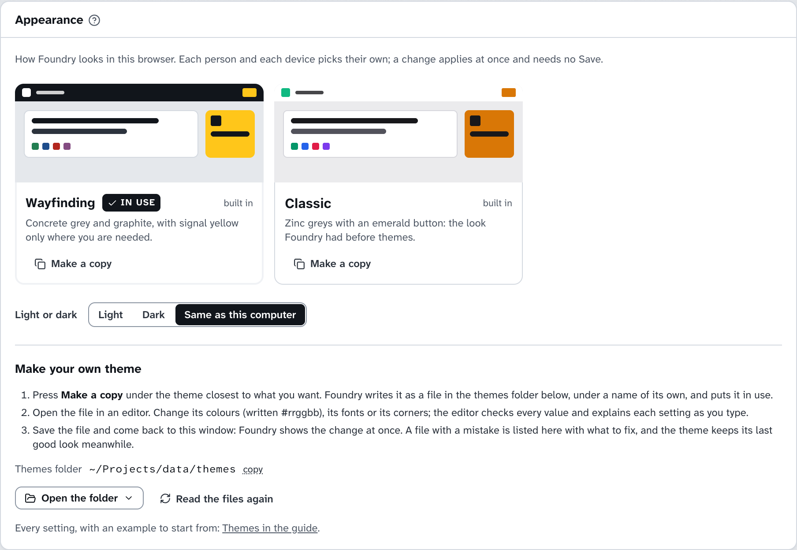

# 主题

> [English](./themes.md) · 中文

主题决定 Foundry 的样子：浅色和深色模式下的配色、字体和圆角。它不会改变页面显示什么，也不会挪动任何东西的位置。Foundry 自带两个主题，你也可以加上自己的。

## 选择主题

打开 **Settings → Appearance**，或者顶栏右侧 ⚙ 菜单里的 **Appearance**。每个主题都显示成一张用它自己的颜色画的小图，点一下就换成这个主题。主题下方的 **Light or dark** 有 **Light**、**Dark** 和 **Same as this computer** 三个选项，最后一个跟随电脑或手机的浅色/深色设置。⚙ 菜单里的 **Light mode** / **Dark mode** 一键在两者之间切换。

主题和明暗都只存在这个浏览器里，所以每个人、每台设备可以各选各的。改动立即生效，不需要保存。



## 自带的主题

| 主题 | 样子 |
|---|---|
| **Wayfinding**（默认） | 把 Foundry 当成一套导视系统：混凝土灰和石墨色承载智能体做的一切，信号黄只出现在需要你的地方。红色标出失败，绿色表示通过，蓝色是信息，紫色是审查。顶栏是石墨色，页面上有一层淡淡的颗粒，阶段牌是斜切的；字体是 Atkinson Hyperlegible，专为分清 0 和 O、1 和 l 而设计。 |
| **Classic** | 有主题之前 Foundry 的样子：锌灰色、翠绿色的主按钮、直立的阶段牌和系统自带的字体。 |

## 做自己的主题

1. 在 **Settings → Appearance** 里，在最接近你想要的那个主题下按 **Make a copy**。Foundry 把它写成主题文件夹里的一个文件，起一个自己的名字（比如 `wayfinding-copy.json`），并直接用上它。
2. 用编辑器打开这个文件。**Open the folder** 会用这台电脑上的编辑器或文件管理器打开主题文件夹，卡片上也显示文件夹路径并带 **copy**。改颜色、字体或圆角都可以。能读 JSON Schema 的编辑器（比如 VS Code）会在你输入时检查每个值，并解释每一项设置：文件里写明了 `theme.schema.json`，Foundry 把它放在同一个文件夹里。
3. 保存文件，回到 Foundry 的窗口。每当 Foundry 的窗口回到前台，它都会重新读取主题文件，所以改动马上就能看到。**Read the files again** 可以手动做同样的事。

有错误的文件会列在 **Make your own theme** 下面，并说明要改什么，比如 `my-theme.json — light.page: a colour is written #rgb or #rrggbb`。文件有错期间，主题保持最后一次正常的样子。

主题文件夹是 Foundry 数据文件夹里的 `themes/`；Appearance 卡片会显示它在你电脑上的位置。除了 `theme.schema.json`，里面每个 `.json` 文件都是一个主题，以文件名命名：只能用小写字母、数字和连字符，并且不能叫 `wayfinding` 或 `classic`，这两个名字已经被占用。想分享主题，把文件复制到另一台 Foundry 的主题文件夹里就行。

## 主题文件

一个主题只需要名字，以及每种模式下的四个颜色。其余都是可选的，没写的由 Foundry 推算。最小的主题：

```json
{
  "name": "Paper",
  "light": { "page": "#f4f1ea", "panel": "#fffdf8", "line": "#e2dccf", "ink": "#2b2622" },
  "dark": { "page": "#16130f", "panel": "#201c17", "line": "#36302a", "ink": "#efe9df" }
}
```

完整一些、包含所有设置的例子：

```json
{
  "$schema": "./theme.schema.json",
  "name": "Night shift",
  "description": "Ink on warm paper, cobalt for the main button.",
  "fonts": {
    "sans": "\"Inter\", ui-sans-serif, system-ui, sans-serif",
    "mono": "\"JetBrains Mono\", ui-monospace, monospace",
    "stylesheets": ["https://fonts.googleapis.com/css2?family=Inter:wght@400..800&family=JetBrains+Mono:wght@400..700&display=swap"]
  },
  "shape": { "radius": 6, "slant": 0, "texture": "none" },
  "light": {
    "page": "#f4f1ea", "panel": "#fffdf8", "inset": "#f8f4ec", "line": "#e2dccf", "lineStrong": "#a89f8f",
    "ink": "#2b2622", "inkSoft": "#4a433c", "inkFaint": "#6f665c",
    "band": "#2b2622", "bandInk": "#fffdf8", "accent": "#2747b8",
    "you": "#f2b705", "work": "#2747b8", "ok": "#2e7d4f", "bad": "#c0392b", "extra": "#7b4fa6"
  },
  "dark": {
    "page": "#16130f", "panel": "#201c17", "inset": "#28231d", "line": "#36302a", "lineStrong": "#6d6458",
    "ink": "#efe9df", "inkSoft": "#d3cabd", "inkFaint": "#a59b8e",
    "band": "#0e0c09", "bandInk": "#efe9df", "accent": "#8fa8ff",
    "you": "#f2b705", "work": "#8fa8ff", "ok": "#6cc08b", "bad": "#ff7b6b", "extra": "#c6a3e8"
  }
}
```

### 颜色

`light` 和 `dark` 两种模式各有一套颜色，写成 `#rrggbb`（或 `#rgb`）。

| 设置 | 用在哪里 | 不写时 |
|---|---|---|
| `page` | 所有内容背后的页面 | 必填 |
| `panel` | 卡片、信息板、菜单和对话框 | 必填 |
| `line` | 细线和边框 | 必填 |
| `ink` | 文字 | 必填 |
| `inset` | 代码块、表头，以及卡片里的小框 | 介于 page 和 panel 之间 |
| `lineStrong` | 输入框边框、空心的任务方块、滚动条 | line 朝 ink 再深一级 |
| `inkSoft` | 次要文字 | ink 朝 panel 淡三分之一 |
| `inkFaint` | 提示、时间和标签 | ink 朝 panel 淡一半，并保证看得清 |
| `band` | 顶栏 | page |
| `bandInk` | 顶栏里的文字和图标 | ink |
| `accent` | 主按钮、选中的标签和选项、焦点框 | ink |
| `you` | 等你的事：Needs you 指示牌、Inbox 数字、待批准的东西 | 琥珀色 |
| `work` | 智能体在工作，以及信息：链接、说明 | 蓝色 |
| `ok` | 完成、通过、已合并、新增的行 | 绿色 |
| `bad` | 失败、错误、危险、删除的行 | 红色 |
| `extra` | 审查、合并，以及其他需要区分的类别 | 和 `work` 相同 |

最后五个颜色各选一次就好。它们用作卡片上的文字时，Foundry 会把颜色调深（浅色模式）或调浅（深色模式）直到看得清，色相不变：明亮的黄色 `you` 写成文字时会变成赭黄色。写在实心指示牌或按钮上的文字，会从主题的颜色里挑最清楚的那个。

Foundry 里所有颜色都跟随主题，包括本指南没有展示的页面。编码智能体自己的颜色（Claude Code 的橙色、Codex 的蓝色、Antigravity 的青色）在每个主题里都不变，一眼就能看出是谁做的。

### 字体

| 设置 | 说明 |
|---|---|
| `sans` | 正文字体，写成 CSS 字体列表，比如 `"Inter", ui-sans-serif, sans-serif`。不写时用系统自带字体。 |
| `mono` | 数字、时间、路径和代码。不写时用系统的等宽字体。 |
| `stylesheets` | 最多三个加载字体的样式表地址，必须是 `https://`，比如 Google Fonts 的地址。电脑上已安装的字体不需要它。 |

字体列表里只能有字体名、引号、逗号和空格。

### 形状

| 设置 | 说明 |
|---|---|
| `radius` | 卡片的圆角半径，单位是像素，0 到 24（Wayfinding 是 10，Classic 是 8）。按钮和标签按比例小一些；0 表示所有角都是直角。 |
| `slant` | 阶段牌倾斜的角度，−30 到 30 度（Wayfinding 是 −14，Classic 是 0）。 |
| `texture` | `grain` 在卡片后面的页面上铺一层淡淡的颗粒（Wayfinding）；`none` 保持平整。 |

## 主题做不到的事

主题文件里只能有颜色、字体列表、数字和 https 样式表地址，其他内容 Foundry 一律拒绝，所以主题只能改变 Foundry 的样子，别的什么都改不了。它决定颜色、字体和形状，不会挪动、隐藏或改名页面上的任何东西。
