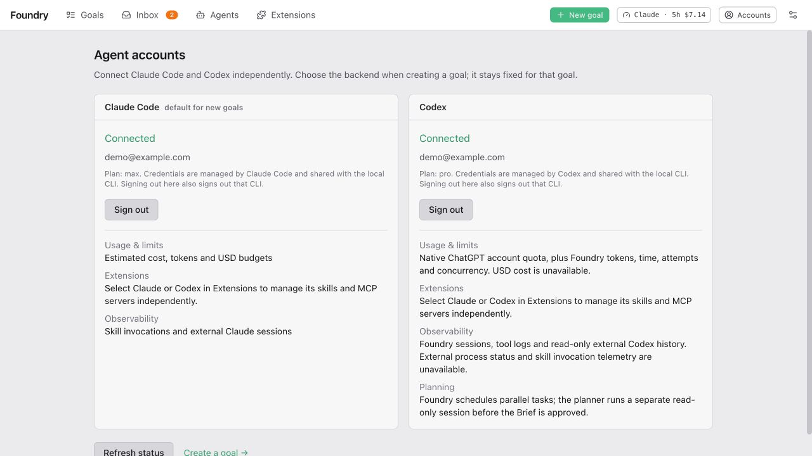
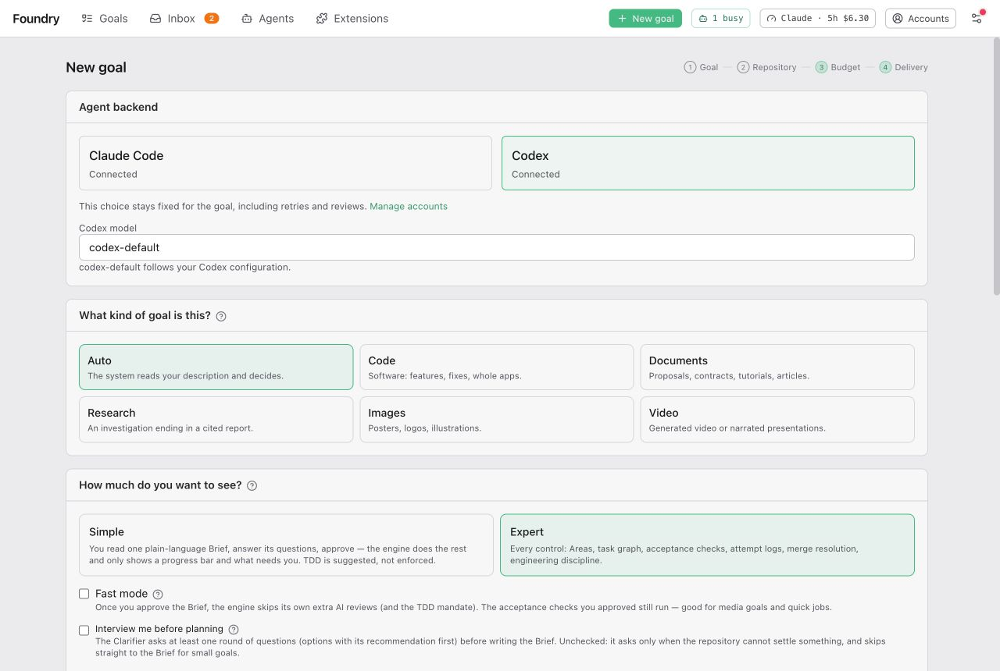
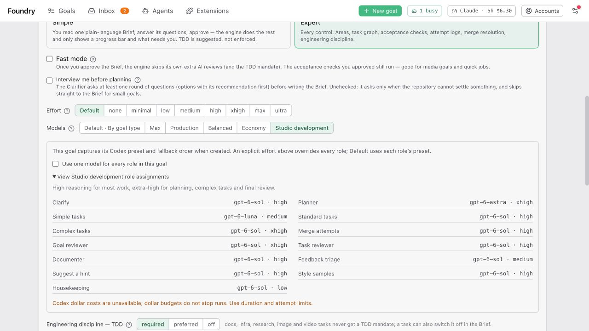
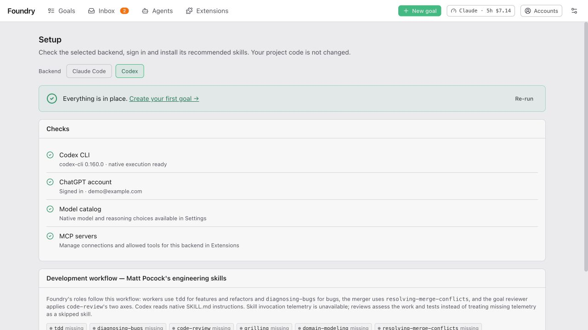
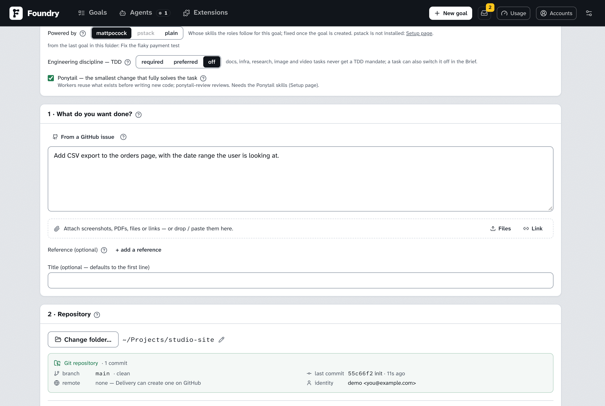

# 你的第一个 goal

> [English](./your-first-goal.md) · 中文

## 账户与编码智能体

点击顶栏 **Accounts**，分别查看 Claude Code、Codex 和 Antigravity。Antigravity 在终端里登录：运行一次 `agy`（它会打开浏览器），然后点 **Refresh status**。**Sign in to Codex** 使用 ChatGPT 设备授权：窗口会显示一次性验证码（带复制按钮）和 OpenAI 的设备授权页，在那里输入验证码并批准。验证码 15 分钟内有效，窗口也会等这么久；**Sign in to Claude Code** 使用 Claude 原生登录。凭据与本机 CLI 共用，在这里退出也会退出对应 CLI，但不会影响另一个提供商。执行期间不能登录或退出，CLI 请求也遵守同样的保护。Codex 只支持 ChatGPT 登录，不使用 API-key 模式；原生 CLI 提供邮箱和方案时会显示在账户卡片。Foundry 运行期间安装 CLI 后，下次账户检查即可识别；Setup 与 Accounts 都使用当前可执行文件。修改配置中的程序路径或原生配置目录仍需重启。Claude Code 和 Codex 可以同时登录你的多个账号，执行期间也可以添加：见 [多个账号](./costs-and-usage.zh.md#多个账号)。

使用 Accounts 顶部的 **Refresh status** 重新检查两个原生账户。检查期间保留现有卡片，预留状态行显示加载或错误，不会用加载文字替换整个页面。

**Setup** 可选择 **Claude Code** 或 **Codex**；检查、登录、修复及技能安装均针对所选编码智能体。**Create your first goal** 会保留该选择。

创建任务时，在 **Coding agent**（编码智能体）中选择 Claude Code、Codex 或 Antigravity。同一 Foundry 实例可以运行三种编码智能体；选定后，澄清、执行、重试、审核等会话始终使用该编码智能体，不会把会话交给另一种 CLI 恢复。两种编码智能体在 **Models** 下各有独立预设。Codex 创建任务时会保存预设中的各角色模型、推理强度和备用模型顺序。

Codex 的预算选项只有时间、尝试次数和并发限制，没有美元上限。**Accounts** 列出了目前的适配限制。

本页从上到下带你过一遍 **New goal** 表单。大多数字段保持原样就行。你必须填的只有两样：想做什么，以及项目文件夹。

## 开始之前

### 检查 Setup 页面

打开顶栏右侧的 ⚙ 菜单，选 **Setup**（⚙ 上有红点，表示还缺东西）。Foundry 会检查它在这台电脑上需要的东西，每一项显示一行绿色或红色：

| 检查项 | 是什么 | 如果是红色 |
|---|---|---|
| **Claude Code CLI** / **Codex CLI** | 当前所选编码智能体的程序。 | 按 **Install**：Claude Code 用它自己的安装器，Codex 用 Homebrew、npm 或官方下载，都不需要 npm。也可以复制显示的命令。 |
| **Claude login** / **Codex login** | 当前所选编码智能体的账户。 | 按 **Sign in**。 |
| **git** | 保存你文件的每一个版本。 | 复制显示的命令。 |
| **Bun runtime** | Foundry 自己运行所需的环境。 | 复制显示的命令。 |
| **Required: …** | Foundry 的会话需要的技能（skills）。 | 按 **Install**。 |
| **GitHub CLI (optional)** | 只有想让 Foundry 替你开 pull request 时才需要。 | 保持黄色也没关系。显示 *not logged in* 时，按 **Sign in** 会打开一个带一次性代码的窗口：复制代码，打开 GitHub 的页面，粘贴并批准。 |

需要的东西都齐了，页面会显示 **Everything is in place**，并提供 **Create your first goal →**。**Re-run** 会再检查一次。之后如果缺了什么，会出现红色横幅 **Setup incomplete**，上面有 **Fix in Setup →**。它会检查默认的编码智能体，以及还有未完成 goal 在用的另一个智能体；两个都检查时会写明是哪一个。对 Codex，Setup 还会确认 CLI 支持 hooks，Foundry 的会话需要它。

**Development workflow — Matt Pocock's engineering skills** 这张卡片列出 Foundry 的执行者遵循的技能（比如先写测试）。如果缺了一些，按 **Install N missing**。该包包含上游现有的八项技能，不再安装已被删除的 `resolving-merge-conflicts`；冲突处理仍由 Foundry 内置的 Merger 指令负责。

**Workflow suite — pstack** 这张卡片整套安装 goal 可以选用的第二个套件（见 [Workflow suite](#workflow-suite)）：Foundry 自己保存的 pstack 插件固定版本副本，不带它的 hooks。装好后它的技能在 Extensions 页显示为一个来源 **pstack suite**。

**3D models — text-to-cad (CAD)** 这张卡片安装 **CAD** goal 背后的插件：它的技能（零件与装配体、工程图、DXF、机器人文件、可打印性和可制造性检查、无头切片）和一个 `cad` 查看器 server，来自 earthtojake/text-to-cad（MIT）。安装会为所选编码智能体加上这个插件，允许会话使用它的 server，并下载一次 CAD 运行时（Python 3.13 和 OpenCASCADE，几百 MB，通过 uv），进度显示在卡片下方；安装在后台进行，期间可以离开这个页面。上面的 **CAD tools** 检查项会说明这台电脑上有没有 uv，以及找到了哪些切片或打印机应用；向这些应用的移交在 **Settings → Safety → Desktop apps & printers** 打开之前一直是关的。Foundry 的会话运行 cadgen 时关闭使用统计和更新检查；你自己使用 text-to-cad 时的设置不受影响。

### 选一个仓库文件夹

Foundry 在一个*仓库*（repository）里工作：也就是由 git 保存历史的项目文件夹。你不需要懂 git。要紧的是：

- 任何文件夹都行。如果它还不是仓库，Foundry 会提供 **Initialize git here**，替你搞定。
- Foundry 干活时从不改动你文件夹里的文件。它在旁边的一个副本里干活，也就是进度文件夹（见 [运行期间](./while-it-runs.zh.md#进度文件夹)）。
- 如果文件夹里有还没保存进 git 的改动（"uncommitted changes"），没关系。Brief 会问你怎么处理。

## The New goal form

按顶栏上的 **New goal**。右上角的四个编号步骤（**Goal**、**Repository**、**Budget**、**Delivery**）显示你填到哪了。描述了 goal，**Goal** 就变成实心；选好一个可用的文件夹，**Repository** 就变成实心。**Budget** 和 **Delivery** 一直是实心的：它们的默认值就能用。表单开头是三张选项卡片（编码代理、goal 的类型、想看到多少），后面是编号 **1** 到 **4** 的卡片。表单的各个部分列在左侧的菜单里，屏幕窄时是顶部的一排标签：每一项写着它现在的情况（选了哪个代理、哪种 goal、哪种视图、预算和交付方式），还要你填的东西（比如 goal 的描述或文件夹）用黄色标出。点一项就跳过去。

有几项选择从 [Settings → New goal defaults](./settings.zh.md#new-goal-defaults) 开始：视图、**Fast mode**、TDD、Ponytail、工作流套件，以及交付方式和粒度。你可以为这个 goal 修改它们。

选好可用的仓库文件夹后，未改过的 **Workflow suite**、**TDD** 和 **Ponytail** 会从完全相同路径下按创建时间最新的 goal 继承。仍属于导入历史记录的 goal 不参与选择。继承的是 goal 当前保存的值，包括创建后对 Ponytail 的修改。你在这个页面上改过的每个字段都会保留你的选择。Expert 视图在 **Powered by** 下方以淡色显示来源：`from the last goal in this folder: <title>`。只要这三项中还有一项继承自该 goal，这条提示就保留。

选择另一个文件夹时，未改过的字段会立即重置为 Settings 默认值，并隐藏旧的来源提示。验证进行中、文件夹无效或没有提交、文件夹没有更早的 goal 时，都使用 Settings 默认值。验证成功后才应用该文件夹的最新值；拉取或初始化后重新验证也会刷新它们。

从 goal 页面打开的 **Follow-up** 则优先从所选的较早 goal 预填这三项，即使文件夹里已有更新的 goal。稍后返回的 Settings 或文件夹验证结果不会覆盖它们，也不会显示文件夹来源提示。创建前仍可手动修改。页面上的 **Follows** 选择器只建立关联。Simple 视图保留继承的套件和 Ponytail，但提交 **preferred** TDD；**Fast mode** 不提交 TDD，由引擎默认设为 **off**。

如果 Follow-up 草稿返回前你已经改过 **TDD** 或 **Ponytail**，这些修改会保留。草稿返回时，它的 **Workflow suite** 会替换当前套件。

### What kind of goal is this

选这个 goal 要产出什么。拿不准就留在 **Auto**。

| 选项 | 适用于 |
|---|---|
| **Auto** | Foundry 读你的描述后自己决定。 |
| **Code** | 软件：功能、修复、整个应用。 |
| **Documents** | 提案、合同、教程、文章。 |
| **Research** | 一次调查，最后给出一份带来源的报告。 |
| **Images** | 海报、logo、插画。 |
| **Video** | 生成的视频或带旁白的演示。 |
| **Figures** | 物件与机器的可交互等轴测图，每张一个网页。Beta：Settings → Beta → Figure goals 打开后才显示；见 [Figure goal](./figures.zh.md)。 |
| **CAD** | 3D 零件和装配体（STEP，按需也出 STL、3MF 或 GLB）、工程图、DXF 切割轮廓、URDF/SRDF/SDF 机器人文件。需要 text-to-cad，在 Setup 页安装。 |

选 **Documents**、**Research**、**Images**、**Video** 或 **Figures** 会把视图切到 **Simple**。选 **Images**、**Video** 或 **Figures** 还会勾上 **Fast mode**，除非你已经自己改过它。**Figures** 会多出一行 **Style**：Settings 里的默认风格，或两个 figure 技能之一。**CAD** 保留你的默认值：它是带几何内核的代码工作，所以 Brief 的检查很要紧；它的 TDD 要求是 *preferred*（几何检查写在模型之前），Ponytail 也适用。

选 **Images**、**Video**、**Figures** 和 **CAD** 时会多出一个字段：**Output folder**。goal 完成后，做好的文件会复制到那里。按 **Choose…** 选一个文件夹。这是可选的；不选的话文件就留在进度文件夹里。图片类 goal 还需要图片 key，见 [费用与用量](./costs-and-usage.zh.md#图片类-goal-需要图片-key)。

**CAD** goal 需要你所选编码智能体的 text-to-cad 插件。插件缺失时，这一项上会写明；goal 照样保存，然后在它的页面上等着，带一个 **Install text-to-cad** 按钮，直到插件装好（Setup 页有同样的安装，还会检测 uv 和切片软件）。没有插件时，**Auto** 从不把 goal 判定为 CAD：它会被当作代码工作。

### How much do you want to see

| 视图 | 你会看到 |
|---|---|
| **Simple** | 一份大白话写的 Brief。你回答它的问题，然后批准。之后你会看到一个进度条，以及需要你处理的事。 |
| **Expert** | 所有控制项：Area、任务图、验收检查、每次尝试的日志、合并处理。 |

一开始选中哪个，来自 Settings（**Default goal view**）。底层做的工作是一样的。任何 goal 之后都能一键切到另一种视图。本指南两种都会讲。

### Fast mode

勾上：你批准 Brief 后，Foundry 会跳过它自己额外的 AI 审查。你批准的验收检查照常运行。适合图片、视频和快活儿，也更省钱。

不勾（代码类的默认，除非 Settings 把节奏设成了 fast）：除了你的检查，Foundry 还会审查每个任务和整体结果，并且可以追加修复任务。

### Interview depth

Foundry 写 Brief 之前问你问得多深：**Skip**，然后是 **1** 到 **5**。它决定 Foundry 追问的深入程度，不是轮数；每一轮仍然只问项目本身回答不了的事。

- **Skip**：不问，直接写 Brief。
- **1**：只问猜错了会白做的事。**2** 再加上范围上的取舍。
- **3**（默认）：会影响结果的决定；小细节作为假设，你可以在 Brief 上改。小 goal 常常一个问题都不问。
- **4**：至少问一轮，边界情况、错误和空状态、数据规则也会问。
- **5**：打破沙煲问到底：每个部分的行为、页面、边界情况、数据、权限、性能和安全，一轮接一轮，直到没有需要决定的事，或者你按 **Enough — write the Brief**。

问得越深，花你的时间越多，费用也略高。这个默认值可以在 Settings 里改（见 [设置说明](./settings.zh.md#new-goal-defaults)）。更多内容见 [回答访谈](./answering-the-interview.zh.md)。

### Delegated goals

两个开关，默认都关。勾上 **Delegated goals**，planner 就可以把一个本身就是一个项目的步骤——必须先做的调研、代码旁边的 3D 模型或视频、大到一份计划装不下的部分——交给一个独立的 goal：一个*委派 goal*，有自己的 Clarify、Brief 和计划。它从这个 goal 的分支出发，完成后把结果作为那一步的提交落回这个分支，再让需要它的任务开始；之后的任务会被告知它交付了什么。这样的步骤在 Brief 上显示为 kind 是 **goal** 的任务，你可以像改其它任务一样改它们。彼此没有先后关系的委派 goal 会并行跑，数量以这个 goal 的并行上限为准（Budget 里的 *parallel*），各自分得一份预算；它们自己不会再委派，花费记在这个 goal 上。

勾上 **Approve delegated goals' Briefs for me**，它们的 Brief 写好就自动批准，除非留下了只有你能回答的问题。不勾，这个 goal 会停下来，等你亲自批准每个委派 goal 的 Brief。无论哪种，委派 goal 需要你的时候——一个问题、一个 milestone、一条 Inbox 事项——这个 goal 以 **blocked** 状态等待，之后自己继续。运行时你会看到什么，见 [Delegated goals](./while-it-runs.zh.md#delegated-goals)。

### Effort

这个 goal 的会话思考得有多用力。明确选择一个值会覆盖所有角色。Codex 的 **Default** 使用预设中各角色的强度；当模型支持时，也可选择 **none**、**minimal** 或 **ultra**。表单初始填入 Settings 中配置的强度；主动选 **Default** 会恢复 Codex 角色设置。已知不兼容的模型与强度组合必须修正后才能创建任务。

| 选项 | 什么时候用 |
|---|---|
| **Default** | Codex：各角色预设强度。Claude：Settings 中设置的 effort。 |
| **low** | 小而明显、需要较少推理的改动。 |
| **medium**、**high** | 介于两者之间。 |
| **xhigh**、**max** | 给牵涉项目多部分的难活分配更多推理。需要模型支持。 |

### Models

这个 goal 用哪个模型预设，由 **Coding agent** 决定使用 [Claude 预设](./settings.zh.md#presets) 还是 [Codex 预设](./settings.zh.md#codex-预设与模型)（Antigravity goal 则只有[一个模型和 effort](./settings.zh.md#antigravity-model)）。**Default** 使用 Settings 为代码、文档或媒体类 goal 选定的预设；后面的名字就是那个预设，例如 **Default · Production**。换 goal 类型时它会跟着变。选 **Max**、**Production**、**Balanced**、**Economy** 或自定义预设，只为这个 goal 覆盖默认值。切换编码智能体会分别保留各自的选择。

Codex 的 **View … role assignments** 展开各角色将使用的模型与强度。勾选 **Use one model for every role in this goal**，才会把所有角色改为同一个模型；不勾选就保留预设中的各角色模型。可以从本机目录选择模型，也可用 **Custom model ID…** 输入具体 ID。覆盖选项中的 **CLI default model** 使用本机 Codex 配置。不覆盖时，预设中的 **Default model · from Settings** 使用 Settings 的 **Default Codex model**。覆盖模型后，仍保留各角色强度，除非你同时选择全任务 effort。

Codex 任务创建后保留这些设置；以后编辑或删除预设不会改变已有任务。如果后续任务引用的预设已被删除，表单会要求重新选择可用预设。Codex 预设名称表示推理强度分配，不表示美元价格，也不保证账户一定可用。

**Auto** 类型的 **Default · By goal type** 会保存 Code、Docs & research 和 Media 的配置默认表。角色预览初始显示 Code；分类后使用对应类型的已保存表。明确选择一个预设时，分类不会改变所选预设。

### Workflow suite

选择器只在 Expert 视图里显示。**pstack** 要先在 Setup 页装好才可选（**Workflow suite — pstack** 这张卡片会安装 Foundry 自己保存的一个固定版本副本，不带插件的 hooks；Claude 每个会话加载它，Codex 则把它的技能链接进 goal 的工作区）。装好之前这个选项是灰的；从文件夹或 Follow-up 继承的 pstack 选择会保留，并显示安装提示；引擎仍使用现有的回退规则。**Powered by** 选这个 goal 的各角色遵循谁的技能：**mattpocock**（Settings 的初始默认值：Matt Pocock 的套件——功能先写测试，bug 先诊断，最后做 code review）、**pstack**（pstack 的套件，它没有的由 Matt Pocock 的技能补上）或 **plain**（没有规则：会话只知道装了哪些技能）。goal 创建时就定下来了；从 goal 页面打开的 Follow-up 从所选较早 goal 的选择开始，delegated goal 沿用主 goal 的。Simple 和 Expert 视图使用相同的套件继承规则，以 Settings 为回退值。较早的 goal 没有保存套件时，继承的套件使用当前 Settings 值。goal 页面和 Brief 上会显示一个 **Powered by** 标签。

### Engineering discipline (TDD)

只在 Expert 视图里有。TDD 的意思是先写测试，再写让测试通过的代码。

| 选项 | 意思 |
|---|---|
| **required** | 执行者必须遵守；Claude 会提供技能调用证据，Codex 根据工作与测试结果审查。这是 Settings 的初始默认值；文件夹和 Follow-up 继承可以替换它。 |
| **preferred** | 只是建议。Simple 视图提交这个值，除非开启 Fast mode。 |
| **off** | 完全不提。 |

docs、infra、research、image 和 video 类任务从来不加 TDD 规则；单个任务也可以在 Brief 里关掉它。勾上 **Fast mode** 时，TDD 是关闭的。

### Ponytail: less code

开关只在 Expert 视图里显示。Settings 的初始默认值是开启；表单遵循上面的继承规则。Ponytail 是"懒惰的资深工程师"：写代码之前，worker 先问这段代码需不需要存在，仓库、标准库、平台或已装的依赖是不是已经有了，然后才写能完整解决任务的最小改动，连同调用方、测试和 fixture。planner 也这样规划；`ponytail-review` 审查每个任务和整个 goal：它读改动牵连到的代码，不只看 diff，只有它的 *must fix* 发现（bug、安全漏洞、丢数据、在预期负载下出问题）会阻断，其余写进审查笔记和 pull request。测试怎么写仍由 TDD 决定。不是代码的工作（文档、调研、媒体）从来不会用到它；开关之后可以在 goal 页面上改，从 goal 的下一个会话起生效。它需要 Ponytail 的 skill，在 Setup 页安装。

### Templates

在 *What kind of goal is this?* 下面，**Start from a template…** 会弹出模版对话框：你所选种类的 goal 的一个模式，留着空白的描述，加上适合它的设置。按一张卡片，在文本框上方填好它的输入，描述就自己写出来；**Fill in with AI** 能从几行零散笔记里替你填好输入，没选模版时文本框下方的 **Write it with AI** 则把你写在框里的内容写成一段描述。每个模版以及怎样做自己的模版，见[模版](./templates.zh.md)。

### What do you want done

大文本框 **1 · What do you want done?**。像跟一位资深同事说话那样描述 goal：你想要什么、给谁用、有什么必须发生或绝不能发生。Foundry 会把它变成验收检查和计划交给你批准，所以你不用写得面面俱到。

### From a GitHub issue

文本框上方的 **From a GitHub issue** 接受一个 issue 链接（`https://github.com/owner/name/issues/12`）、`owner/name#12`，或者在下面选好了带 GitHub 远端的仓库文件夹之后只写 `#12`。按 **Read issue**：issue 的标题和正文会填进标题和文本框（你已经写的文字会保留），整个讨论串（当时的正文和评论）会作为带文本的链接附件附上，这个 goal 的每个会话都能读到。一个小标签标出这个 issue；它的 **×** 取消关联并移除讨论串，你的文字保留。

读取 issue 需要已连接的 GitHub CLI（Setup 页，或 Settings → Git & delivery）。goal 以 **Open a PR** 或 **PR + auto-merge** 交付时，pull request 的描述会以 `Closes #12` 开头，pull request 合并后 GitHub 会关闭这个 issue；每个任务一个 PR 时，由最后一个关闭。Foundry 不会往 issue 本身写任何东西。goal 页面的标题下会显示 **From issue**，goal 列表会有一个 `#12` 标签。命令行里 `foundry goal new --issue <链接> --repo <路径>` 做同样的事。

### Attachments

文本框下面：**Attach screenshots, PDFs, files or links — or drop / paste them here.** 用 **Files** 选文件，或者用 **Link** 加一个网址，然后按 **Add**。你也可以直接把截图粘贴到页面上。

这个 goal 的每个会话都能读到这些附件。一个文件最大 25 MB，音频或视频文件（参考影片、音乐）最大 200 MB，一个 goal 最多 20 个附件。它们永远不会被加进你的项目。文档会在后台转成文本，转好后会显示一个小标签。之后你还可以在 goal 页面上继续添加附件。

### Reference

**+ add a reference** 填入这个 goal 要学习的已发布软件：一个网站、这台电脑上的一个应用（`/Applications/Notes.app`）、一个安装包或解包后的应用，以及要看哪个功能。Clarify 之前，REA（一个逆向工程 server，在 **Extensions → MCP servers** 装一次）会调查每个参考对象，写出带证据的报告：功能怎么实现、哪些没能核实、该做什么。goal 的每个会话都读得到这份报告，它还会以 `docs/reference/<name>.md` 提交到 goal 分支上，Brief 页面会显示它，并带 **Investigate again**。最多五个参考对象；调查的花费和时间上限在 Settings 里。

只能分析你有权分析的软件。goal 会根据证据做自己的版本，绝不拷贝；各个会话也被这样要求。网站、JavaScript 和 Electron 应用、.NET 和 Android 安装包不需要别的东西；原生应用和二进制需要这台电脑上有 Hopper、Ghidra 或 IDA，Setup 页会检查。没装 REA 时调查会跳过，Clarify 照常进行。跳过 Clarify 的 goal（**Skip Clarify (advanced)**）不能带参考对象：调查发生在 Clarify 之前。

### Title

可选。不填的话，描述的第一行就是标题。标题也会用来给进度文件夹命名。

### Repository

**2 · Repository.** 按 **Select folder…** 选项目文件夹，或者直接输入路径。选择器里的 **New folder** 会在当前浏览的位置建一个空文件夹，给还不存在的项目用。**Choose with Finder…** 打开 macOS 的文件夹对话框；从其它设备打开 Foundry 时不显示，因为那个对话框会出现在 Foundry 所在的电脑上。

然后 Foundry 会显示它发现的情况：分支、有没有 uncommitted changes、最后保存的版本、线上副本（remote，如果有的话），以及提交会以谁的名义做出。如果线上副本比你的文件夹有更新的工作，卡片会说明 goal 从哪里开始（通常是更新的那份），而 **pull into my checkout** 会把你自己的文件夹也更新到最新。

如果文件夹还不是仓库，按 **Initialize git here**。如果你选的是某个仓库里面的子文件夹，Foundry 会改为提供这个仓库的顶层文件夹。

这个文件夹里以前跑过 goal 时，卡片下面会有一行，说 Foundry 对它有几条 [Learnings](./learnings.zh.md)：那些 goal 教会的项目知识。计划会带着它们来写。

### Also change: companion folders

一个 goal 要改不止一个仓库 —— 后端和调用它的前端、一个库和用它的应用 —— 就在 Repository 卡片下面的 **Also change these folders** 里填上其它文件夹（主文件夹就绪后出现）。每个都像主文件夹一样检查（在某个分支上的 git 仓库）。planner 会把每个这样的文件夹里要做的部分规划成一个绑定到它的 **goal** 类任务，由那个仓库里一个独立的[委派 goal](#delegated-goals) 来做（Delegated goals 会自动为你打开），从那个文件夹当前的分支开始。这个委派 goal 会去主仓库读两边共用的接口，什么都不会落到这个 goal 的分支上 —— 后面的任务读的是它的摘要 —— 它的成果留在自己仓库的分支上，直到这个 goal 交付时一起交付：每个仓库一个 pull request，各自写明属于哪个 goal（见 [伴随仓库](./getting-the-result.zh.md#伴随仓库)）。主文件夹自己的预览、检查和截图不覆盖伴随仓库；每个委派 goal 有自己的。命令行：`--also <path>`，每个文件夹一次。

### Follows

仓库下面，当这个仓库已经有结束了的 goal 时：**Follows** 用来选这个 goal 接着做的是哪一个更早的 goal（或者选 **Nothing — a new line of work**）。这样 Clarifier 会拿到那个 goal 当时要求了什么、做了哪些决定、结果如何，你不用再解释一遍。更改这个选择器不会改变 **Workflow suite**、**TDD** 和 **Ponytail**。

选择器下面的卡片会说明新 goal 从哪里开始。如果之前那个 goal 的工作已经在你的基础分支上（它的 pull request 已经合并），就从那里开始。如果还没有（Local only 的 goal、没合并的 pull request、失败的 goal），就从之前那个 goal 的分支开始，那些改动会随着这个 goal 的 pull request 一起交付。**Start from** 可以在两者之间切换。勾选或取消 **Bring its attachments** 和 **Keep its style direction**，决定是否把附件和风格方向一起带过来。

在一个已结束的 goal 上按 **Continue with a follow-up…**，会打开已经填好的这个表单，包括该 goal 的 **Workflow suite**、**TDD** 和当前保存的 **Ponytail**。它们优先于文件夹默认值；见 [Continue with a follow-up](./getting-the-result.zh.md#continue-with-a-follow-up)。

### Budget

**3 · Budget.** goal 运行时不能超过的上限。碰到上限时，goal 会暂停并问你；它从不悄无声息地失败。下表美元数值和 **Max cost (USD est.)** 字段只适用于 Claude；Codex 的相同预设保留时间、并发和尝试次数，隐藏美元上限。

| 预设 | 上限 |
|---|---|
| **Auto**（默认） | Foundry 规划期间没有上限。Brief 会估算费用和时间，并提议一个预算；你批准时确认它。 |
| **Quick** | $3 · 30 分钟 · 2 个并行 · 每个任务 2 次尝试。适合小修复或关于代码的提问。 |
| **Thorough** | $25 · 8 小时 · 3 个并行 · 每个任务 4 次尝试。一个带测试和审查的功能。 |
| **Unlimited** | 没有费用和时间上限。每个任务的尝试次数和并行会话数仍然有效。 |
| **Custom** | 自己设 **Max cost (USD est.)**、**Max minutes**、**Parallel sessions**、**Attempts per task**，以及会话跑得久的 goal（比如渲染影片）用的 **Attempt timeout**；超时留空就沿用 Settings 的值。 |

拿不准就保持 **Auto**。更多内容见 [费用与用量](./costs-and-usage.zh.md)。

### Delivery

**4 · Delivery — what may the engine do with the result?** 它从 Settings → New goal defaults 开始：除非有人在那里改过，否则就是 **Local only**。**Local only** 把工作留在你的电脑上。其它选项允许 Foundry 在 goal 完成后推送代码或开 pull request。这方面的一切都在 [拿到结果](./getting-the-result.zh.md)。之后你也可以在 goal 页面上改。

### Advanced: skip Clarify

表单下方的一个链接。它把 goal 当作一个任务来跑，用你自己输入的命令检查（比如 `bun test`），没有访谈，也没有 Brief。适合清楚知道用哪些命令能证明工作已完成的人。你可以不管它。

### 表单上没有的：自检

自检（Foundry 在一个隐藏的浏览器里打开运行中的结果并截图）在 [Settings → Preview & self-check](./settings.zh.md#preview--self-check) 里设置，也可以在 Brief 页面（**How to run it**）或之后在 goal 页面上为单个 goal 打开。见 [运行期间](./while-it-runs.zh.md#self-check)。

### Schedule it

创建按钮旁边的 **Schedule…** 把表单保存为一个 [Schedule](./schedules.zh.md)，而不是生成 goal：每天、每周或每月，Foundry 用它生成一个 goal 并自己跑完。上传的文件、参考和 issue 不会被 schedule 保留；链接会。

## 按下创建按钮之后

按钮上写的是 **Create & clarify**（如果你跳过了 Clarify，就是 **Create & run**）。如果按钮是灰的，旁边的文字会写出第一个还缺的东西：**Describe the goal**、**Select a repository folder**、**Repository is not ready (see above)**、**Sign in to Claude Code first: see Accounts**（选 Codex 时则是 Codex）、**Choose a model preset (see above)**，或者某个 Codex 模型不支持所选的 reasoning。

这个浏览器会记住 goal 类型、预算，以及更细的交付选项（比如合并方式和 CI 相关的开关），下一个 goal 就从这些开始。视图、**Fast mode**，以及交付方式和粒度从 Settings → New goal defaults 开始。**Workflow suite**、**TDD** 和 **Ponytail** 遵循上面的文件夹和 Follow-up 规则；浏览器不会把它们记作默认值。

然后你会进入 goal 的 Brief 页面，Foundry 开始读你的项目：

- 如果它有问题，你会看到 **Round 1 — N questions**。回答它们：[回答访谈](./answering-the-interview.zh.md)。
- 如果没有，你会看到 **Reading the repository…**，下面是它正在读什么的实时日志（如果 Settings 关掉了访谈，显示的是 **Clarifying…**）。通常要几分钟。Brief 准备好后页面会自己更新。

然后阅读并批准 Brief：[批准 Brief](./approving-the-brief.zh.md)。你批准之前，什么都不会开始做。
